# MÃ NGUỒN SƠ ĐỒ HỆ THỐNG PERFO

> Tập hợp mã nguồn toàn bộ sơ đồ của hệ thống: PlantUML (.puml), Mermaid (.mmd), DBML (.dbml) và DrawIO (.drawio).
> Ảnh xem trước SVG tương ứng nằm tại thư mục `docs/so-do/anh-xem-truoc-svg/`.

---


## CHƯƠNG 2

### Hình 2.1. Vòng đời của một lần đặt vé

- **Tệp nguồn:** `docs/so-do/mermaid/hinh-2-1.mmd`
- **Ảnh xem trước:** `docs/so-do/anh-xem-truoc-svg/hinh-2-1.svg`

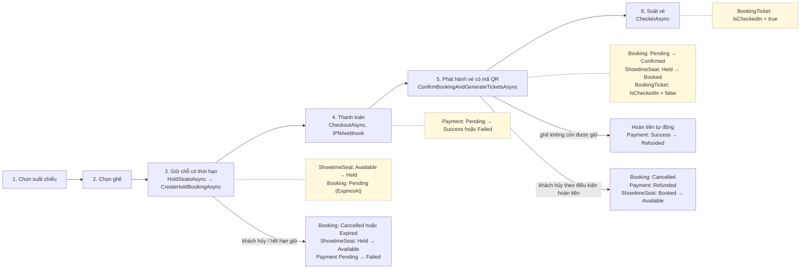

### Hình 2.2. Quy trình thực hiện đề tài

- **Tệp nguồn:** `docs/so-do/mermaid/hinh-2-2.mmd`
- **Ảnh xem trước:** `docs/so-do/anh-xem-truoc-svg/hinh-2-2.svg`

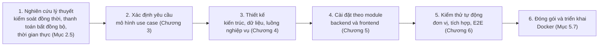

### Hình 2.3. Mô hình phân tầng các project

- **Tệp nguồn:** `docs/so-do/plantuml/hinh-2-3.puml`
- **Ảnh xem trước:** `docs/so-do/anh-xem-truoc-svg/hinh-2-3.svg`

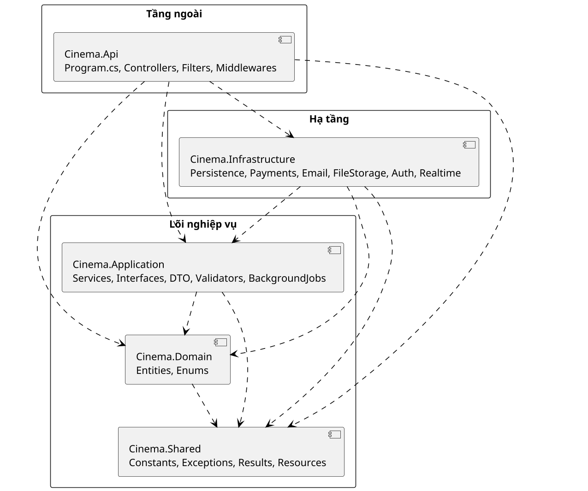


## CHƯƠNG 3

### Hình 3.1. Quan hệ giữa các tác nhân

- **Tệp nguồn:** `docs/so-do/plantuml/hinh-3-1.puml`
- **Ảnh xem trước:** `docs/so-do/anh-xem-truoc-svg/hinh-3-1.svg`

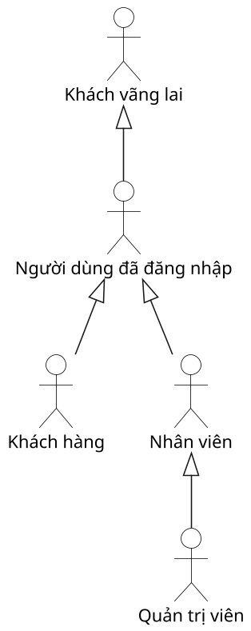

### Hình 3.2. Sơ đồ ngữ cảnh hệ thống

- **Tệp nguồn:** `docs/so-do/plantuml/hinh-3-2.puml`
- **Ảnh xem trước:** `docs/so-do/anh-xem-truoc-svg/hinh-3-2.svg`

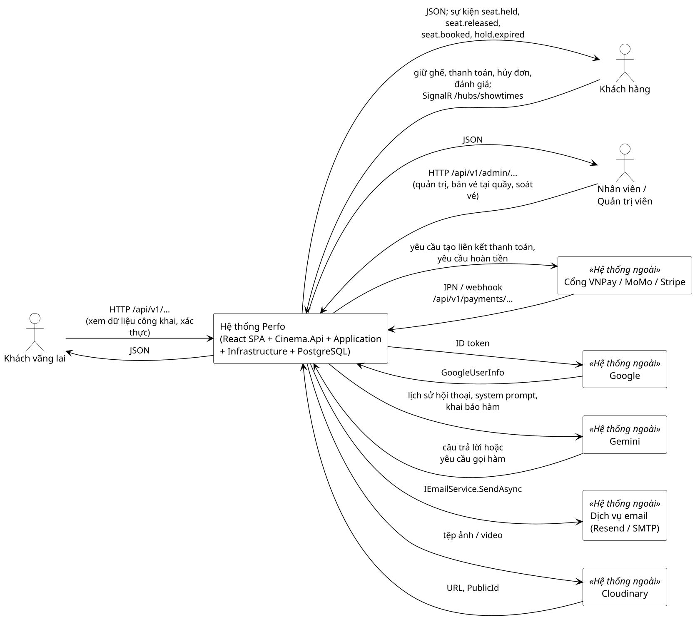

### Hình 3.3. Sơ đồ package use case tổng quát

- **Tệp nguồn:** `docs/so-do/plantuml/hinh-3-3.puml`
- **Ảnh xem trước:** `docs/so-do/anh-xem-truoc-svg/hinh-3-3.svg`

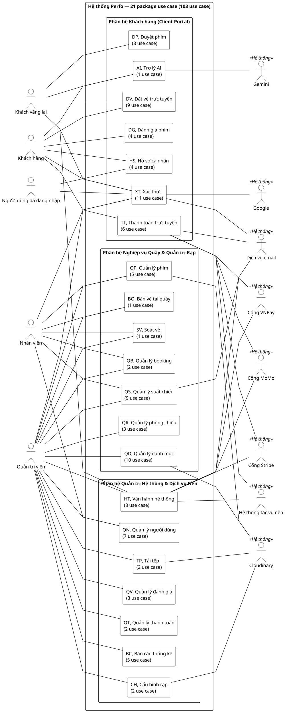

### Hình 3.4. Sơ đồ use case package Xác thực

- **Tệp nguồn:** `docs/so-do/plantuml/hinh-3-4.puml`
- **Ảnh xem trước:** `docs/so-do/anh-xem-truoc-svg/hinh-3-4.svg`

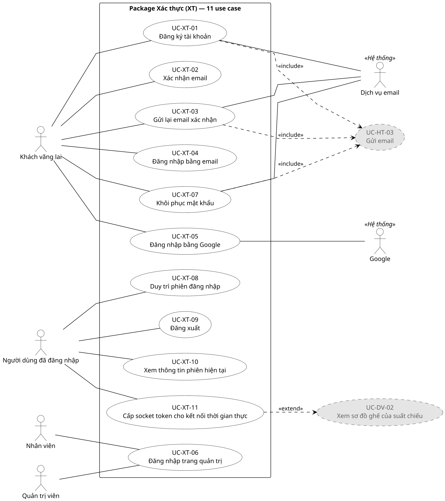

### Hình 3.5. Sơ đồ use case package Hồ sơ cá nhân

- **Tệp nguồn:** `docs/so-do/plantuml/hinh-3-5.puml`
- **Ảnh xem trước:** `docs/so-do/anh-xem-truoc-svg/hinh-3-5.svg`

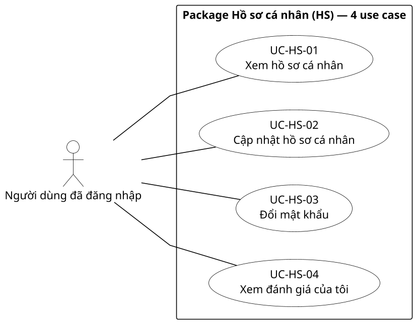

### Hình 3.6. Sơ đồ use case package Duyệt phim

- **Tệp nguồn:** `docs/so-do/plantuml/hinh-3-6.puml`
- **Ảnh xem trước:** `docs/so-do/anh-xem-truoc-svg/hinh-3-6.svg`

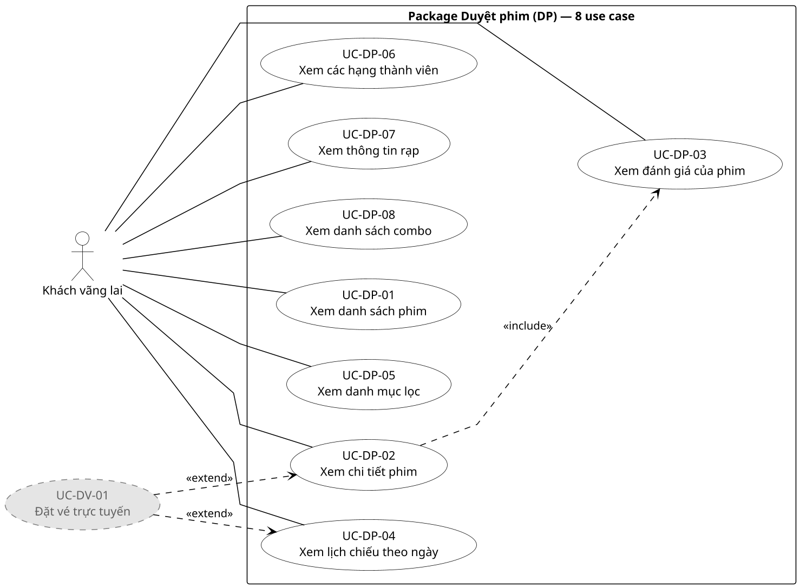

### Hình 3.7. Sơ đồ use case package Đánh giá phim

- **Tệp nguồn:** `docs/so-do/plantuml/hinh-3-7.puml`
- **Ảnh xem trước:** `docs/so-do/anh-xem-truoc-svg/hinh-3-7.svg`

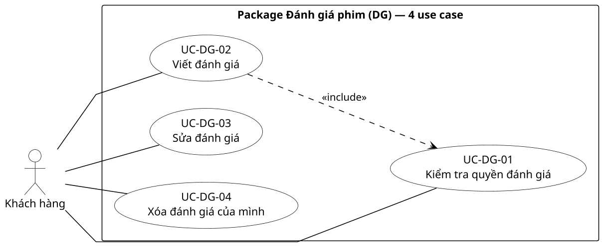

### Hình 3.8. Sơ đồ use case package Đặt vé trực tuyến

- **Tệp nguồn:** `docs/so-do/plantuml/hinh-3-8.puml`
- **Ảnh xem trước:** `docs/so-do/anh-xem-truoc-svg/hinh-3-8.svg`

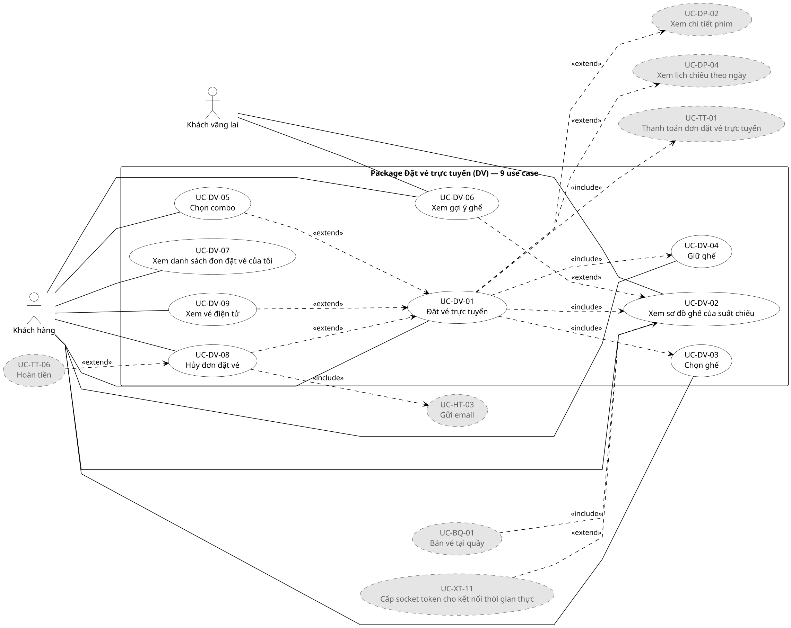

### Hình 3.9. Sơ đồ use case package Thanh toán trực tuyến

- **Tệp nguồn:** `docs/so-do/plantuml/hinh-3-9.puml`
- **Ảnh xem trước:** `docs/so-do/anh-xem-truoc-svg/hinh-3-9.svg`

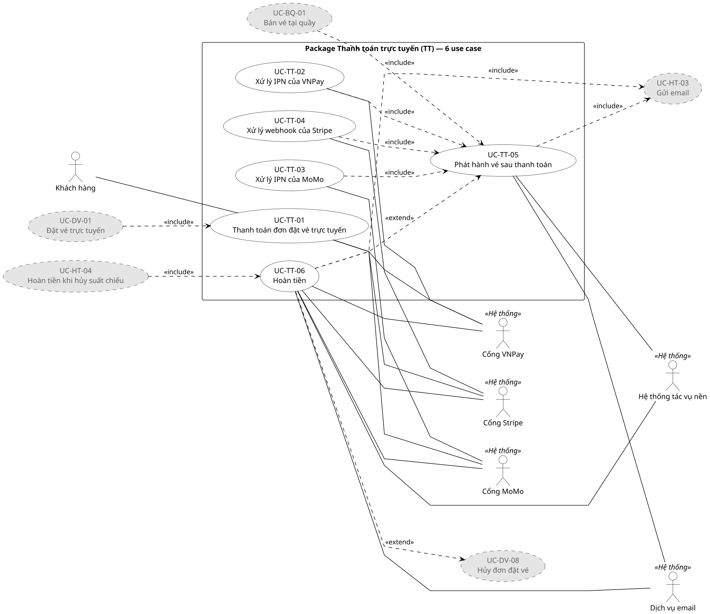

### Hình 3.10. Sơ đồ use case package Trợ lý AI

- **Tệp nguồn:** `docs/so-do/plantuml/hinh-3-10.puml`
- **Ảnh xem trước:** `docs/so-do/anh-xem-truoc-svg/hinh-3-10.svg`

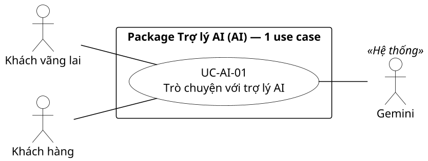

### Hình 3.11. Sơ đồ use case package Bán vé tại quầy

- **Tệp nguồn:** `docs/so-do/plantuml/hinh-3-11.puml`
- **Ảnh xem trước:** `docs/so-do/anh-xem-truoc-svg/hinh-3-11.svg`

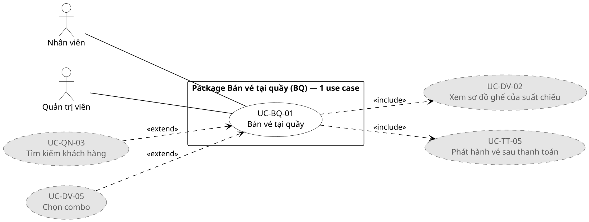

### Hình 3.12. Sơ đồ use case package Soát vé

- **Tệp nguồn:** `docs/so-do/plantuml/hinh-3-12.puml`
- **Ảnh xem trước:** `docs/so-do/anh-xem-truoc-svg/hinh-3-12.svg`

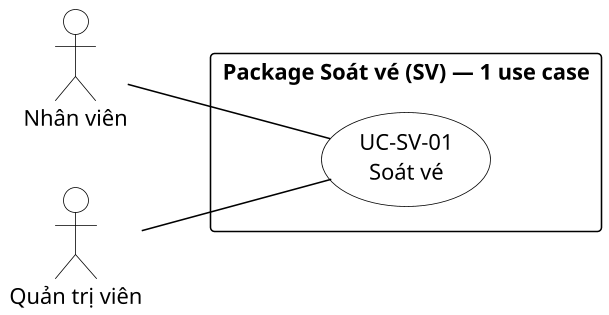

### Hình 3.13. Sơ đồ use case package Quản lý booking

- **Tệp nguồn:** `docs/so-do/plantuml/hinh-3-13.puml`
- **Ảnh xem trước:** `docs/so-do/anh-xem-truoc-svg/hinh-3-13.svg`

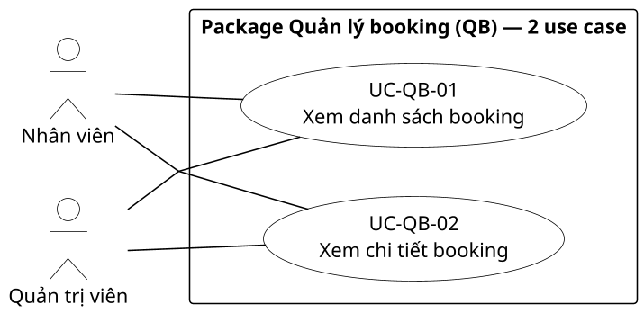

### Hình 3.14. Sơ đồ use case package Quản lý phim

- **Tệp nguồn:** `docs/so-do/plantuml/hinh-3-14.puml`
- **Ảnh xem trước:** `docs/so-do/anh-xem-truoc-svg/hinh-3-14.svg`

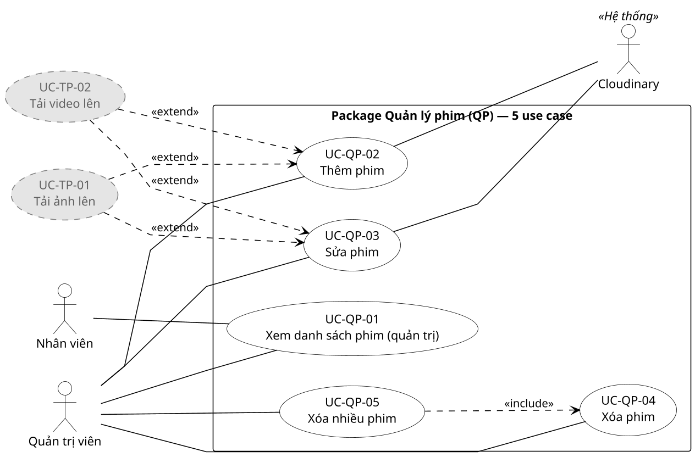

### Hình 3.15. Sơ đồ use case package Quản lý danh mục

- **Tệp nguồn:** `docs/so-do/plantuml/hinh-3-15.puml`
- **Ảnh xem trước:** `docs/so-do/anh-xem-truoc-svg/hinh-3-15.svg`

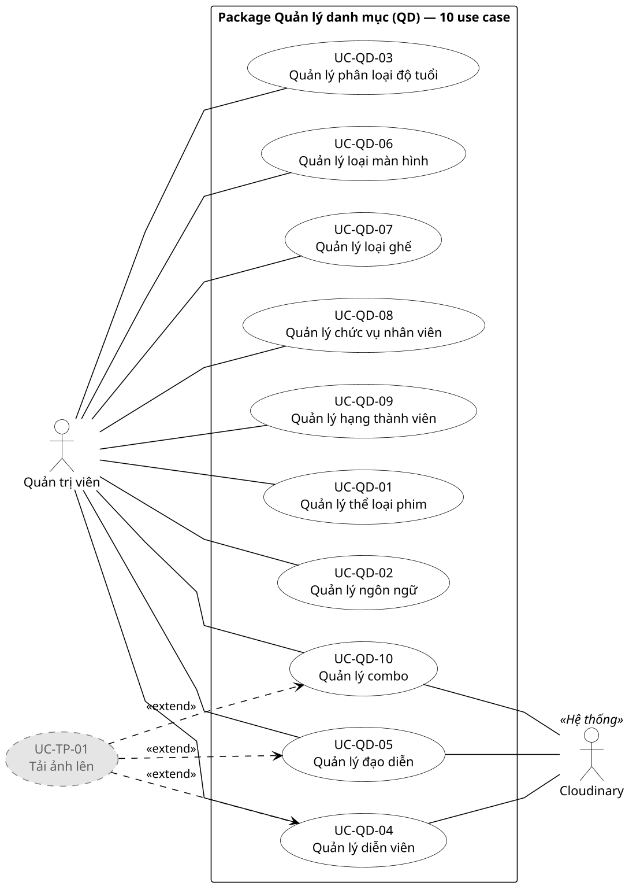

### Hình 3.16. Sơ đồ use case package Quản lý phòng chiếu

- **Tệp nguồn:** `docs/so-do/plantuml/hinh-3-16.puml`
- **Ảnh xem trước:** `docs/so-do/anh-xem-truoc-svg/hinh-3-16.svg`

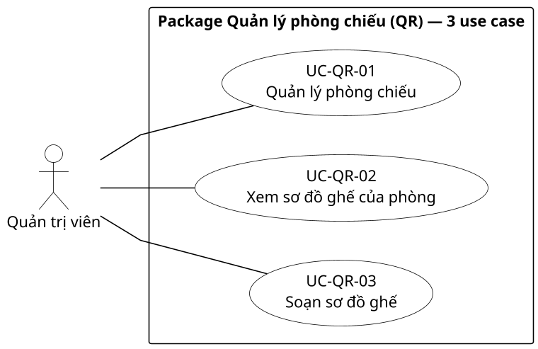

### Hình 3.17. Sơ đồ use case package Quản lý suất chiếu

- **Tệp nguồn:** `docs/so-do/plantuml/hinh-3-17.puml`
- **Ảnh xem trước:** `docs/so-do/anh-xem-truoc-svg/hinh-3-17.svg`

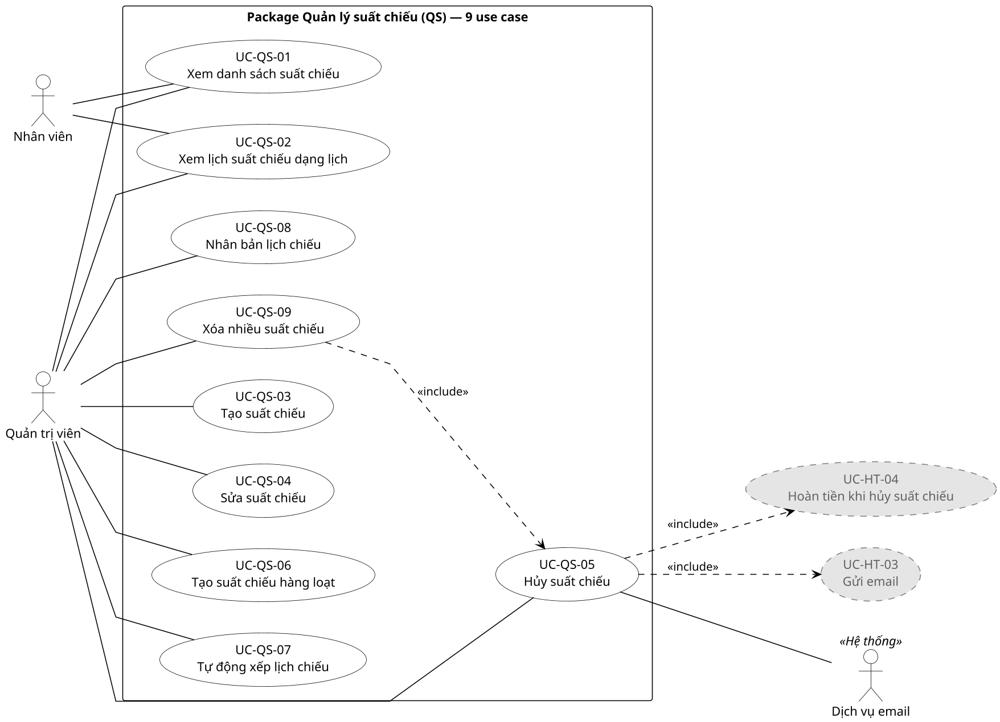

### Hình 3.18. Sơ đồ use case package Quản lý người dùng

- **Tệp nguồn:** `docs/so-do/plantuml/hinh-3-18.puml`
- **Ảnh xem trước:** `docs/so-do/anh-xem-truoc-svg/hinh-3-18.svg`

```plantuml
@startuml
left to right direction
skinparam linetype polyline
skinparam shadowing false
skinparam defaultFontName "Times New Roman"
skinparam packageStyle rectangle
skinparam dpi 150
skinparam ArrowColor Black
skinparam actorBackgroundColor White
skinparam actorBorderColor Black
skinparam usecaseBackgroundColor White
skinparam usecaseBorderColor Black
skinparam rectangleBackgroundColor White
skinparam rectangleBorderColor Black
actor "Nhân viên" as A_NV
actor "Quản trị viên" as A_QTV
rectangle "Package Quản lý người dùng (QN) — 7 use case" as PK {
  usecase "UC-QN-01\nXem danh sách người dùng" as UC_QN_01
  usecase "UC-QN-02\nXem danh sách tài khoản quản trị" as UC_QN_02
  usecase "UC-QN-03\nTìm kiếm khách hàng" as UC_QN_03
  usecase "UC-QN-04\nKhóa hoặc mở khóa tài khoản" as UC_QN_04
  usecase "UC-QN-05\nĐổi vai trò tài khoản" as UC_QN_05
  usecase "UC-QN-06\nCập nhật trạng thái nhiều tài khoản" as UC_QN_06
  usecase "UC-QN-07\nQuản lý nhân viên" as UC_QN_07
}
usecase "UC-BQ-01\nBán vé tại quầy" as UC_BQ_01 #E5E5E5;line:808080;text:606060;line.dashed
A_NV -- UC_QN_03
A_QTV -- UC_QN_01
A_QTV -- UC_QN_02
A_QTV -- UC_QN_03
A_QTV -- UC_QN_04
A_QTV -- UC_QN_05
A_QTV -- UC_QN_06
A_QTV -- UC_QN_07
UC_QN_03 ..> UC_BQ_01 : <<extend>>
UC_QN_06 ..> UC_QN_04 : <<include>>
UC_QN_07 ..> UC_QN_02 : <<include>>
@enduml
```

### Hình 3.19. Sơ đồ use case package Quản lý đánh giá

- **Tệp nguồn:** `docs/so-do/plantuml/hinh-3-19.puml`
- **Ảnh xem trước:** `docs/so-do/anh-xem-truoc-svg/hinh-3-19.svg`

```plantuml
@startuml
left to right direction
skinparam linetype polyline
skinparam shadowing false
skinparam defaultFontName "Times New Roman"
skinparam packageStyle rectangle
skinparam dpi 150
skinparam ArrowColor Black
skinparam actorBackgroundColor White
skinparam actorBorderColor Black
skinparam usecaseBackgroundColor White
skinparam usecaseBorderColor Black
skinparam rectangleBackgroundColor White
skinparam rectangleBorderColor Black
actor "Quản trị viên" as A_QTV
rectangle "Package Quản lý đánh giá (QV) — 3 use case" as PK {
  usecase "UC-QV-01\nXem danh sách đánh giá" as UC_QV_01
  usecase "UC-QV-02\nXóa đánh giá" as UC_QV_02
  usecase "UC-QV-03\nXóa nhiều đánh giá" as UC_QV_03
}
A_QTV -- UC_QV_01
A_QTV -- UC_QV_02
A_QTV -- UC_QV_03
UC_QV_03 ..> UC_QV_02 : <<include>>
@enduml
```

### Hình 3.20. Sơ đồ use case package Quản lý thanh toán

- **Tệp nguồn:** `docs/so-do/plantuml/hinh-3-20.puml`
- **Ảnh xem trước:** `docs/so-do/anh-xem-truoc-svg/hinh-3-20.svg`

```plantuml
@startuml
left to right direction
skinparam linetype polyline
skinparam shadowing false
skinparam defaultFontName "Times New Roman"
skinparam packageStyle rectangle
skinparam dpi 150
skinparam ArrowColor Black
skinparam actorBackgroundColor White
skinparam actorBorderColor Black
skinparam usecaseBackgroundColor White
skinparam usecaseBorderColor Black
skinparam rectangleBackgroundColor White
skinparam rectangleBorderColor Black
actor "Quản trị viên" as A_QTV
rectangle "Package Quản lý thanh toán (QT) — 2 use case" as PK {
  usecase "UC-QT-01\nXem danh sách thanh toán" as UC_QT_01
  usecase "UC-QT-02\nXem chi tiết thanh toán" as UC_QT_02
}
A_QTV -- UC_QT_01
A_QTV -- UC_QT_02
@enduml
```

### Hình 3.21. Sơ đồ use case package Báo cáo thống kê

- **Tệp nguồn:** `docs/so-do/plantuml/hinh-3-21.puml`
- **Ảnh xem trước:** `docs/so-do/anh-xem-truoc-svg/hinh-3-21.svg`

```plantuml
@startuml
left to right direction
skinparam linetype polyline
skinparam shadowing false
skinparam defaultFontName "Times New Roman"
skinparam packageStyle rectangle
skinparam dpi 150
skinparam ArrowColor Black
skinparam actorBackgroundColor White
skinparam actorBorderColor Black
skinparam usecaseBackgroundColor White
skinparam usecaseBorderColor Black
skinparam rectangleBackgroundColor White
skinparam rectangleBorderColor Black
actor "Quản trị viên" as A_QTV
rectangle "Package Báo cáo thống kê (BC) — 5 use case" as PK {
  usecase "UC-BC-01\nXem tổng quan dashboard" as UC_BC_01
  usecase "UC-BC-02\nXem nhận định (insights)" as UC_BC_02
  usecase "UC-BC-03\nXem báo cáo doanh thu" as UC_BC_03
  usecase "UC-BC-04\nXem báo cáo phim bán chạy" as UC_BC_04
  usecase "UC-BC-05\nXem báo cáo hiệu suất nhân viên" as UC_BC_05
}
A_QTV -- UC_BC_01
A_QTV -- UC_BC_02
A_QTV -- UC_BC_03
A_QTV -- UC_BC_04
A_QTV -- UC_BC_05
@enduml
```

### Hình 3.22. Sơ đồ use case package Cấu hình rạp

- **Tệp nguồn:** `docs/so-do/plantuml/hinh-3-22.puml`
- **Ảnh xem trước:** `docs/so-do/anh-xem-truoc-svg/hinh-3-22.svg`

```plantuml
@startuml
left to right direction
skinparam linetype polyline
skinparam shadowing false
skinparam defaultFontName "Times New Roman"
skinparam packageStyle rectangle
skinparam dpi 150
skinparam ArrowColor Black
skinparam actorBackgroundColor White
skinparam actorBorderColor Black
skinparam usecaseBackgroundColor White
skinparam usecaseBorderColor Black
skinparam rectangleBackgroundColor White
skinparam rectangleBorderColor Black
actor "Quản trị viên" as A_QTV
rectangle "Package Cấu hình rạp (CH) — 2 use case" as PK {
  usecase "UC-CH-01\nXem cấu hình rạp" as UC_CH_01
  usecase "UC-CH-02\nCập nhật cấu hình rạp" as UC_CH_02
}
usecase "UC-TP-01\nTải ảnh lên" as UC_TP_01 #E5E5E5;line:808080;text:606060;line.dashed
actor "Cloudinary" <<Hệ thống>> as A_CLD
A_QTV -- UC_CH_01
A_QTV -- UC_CH_02
UC_CH_02 -- A_CLD
UC_TP_01 ..> UC_CH_02 : <<extend>>
@enduml
```

### Hình 3.23. Sơ đồ use case package Tải tệp

- **Tệp nguồn:** `docs/so-do/plantuml/hinh-3-23.puml`
- **Ảnh xem trước:** `docs/so-do/anh-xem-truoc-svg/hinh-3-23.svg`

```plantuml
@startuml
left to right direction
skinparam linetype polyline
skinparam shadowing false
skinparam defaultFontName "Times New Roman"
skinparam packageStyle rectangle
skinparam dpi 150
skinparam ArrowColor Black
skinparam actorBackgroundColor White
skinparam actorBorderColor Black
skinparam usecaseBackgroundColor White
skinparam usecaseBorderColor Black
skinparam rectangleBackgroundColor White
skinparam rectangleBorderColor Black
actor "Quản trị viên" as A_QTV
rectangle "Package Tải tệp (TP) — 2 use case" as PK {
  usecase "UC-TP-01\nTải ảnh lên" as UC_TP_01
  usecase "UC-TP-02\nTải video lên" as UC_TP_02
}
usecase "UC-QP-02\nThêm phim" as UC_QP_02 #E5E5E5;line:808080;text:606060;line.dashed
usecase "UC-QP-03\nSửa phim" as UC_QP_03 #E5E5E5;line:808080;text:606060;line.dashed
usecase "UC-QD-04\nQuản lý diễn viên" as UC_QD_04 #E5E5E5;line:808080;text:606060;line.dashed
usecase "UC-QD-05\nQuản lý đạo diễn" as UC_QD_05 #E5E5E5;line:808080;text:606060;line.dashed
usecase "UC-QD-10\nQuản lý combo" as UC_QD_10 #E5E5E5;line:808080;text:606060;line.dashed
usecase "UC-CH-02\nCập nhật cấu hình rạp" as UC_CH_02 #E5E5E5;line:808080;text:606060;line.dashed
actor "Cloudinary" <<Hệ thống>> as A_CLD
A_QTV -- UC_TP_01
A_QTV -- UC_TP_02
UC_TP_01 -- A_CLD
UC_TP_02 -- A_CLD
UC_TP_01 ..> UC_QP_02 : <<extend>>
UC_TP_01 ..> UC_QP_03 : <<extend>>
UC_TP_01 ..> UC_QD_04 : <<extend>>
UC_TP_01 ..> UC_QD_05 : <<extend>>
UC_TP_01 ..> UC_QD_10 : <<extend>>
UC_TP_01 ..> UC_CH_02 : <<extend>>
UC_TP_02 ..> UC_QP_02 : <<extend>>
UC_TP_02 ..> UC_QP_03 : <<extend>>
@enduml
```

### Hình 3.24. Sơ đồ use case package Vận hành hệ thống

- **Tệp nguồn:** `docs/so-do/plantuml/hinh-3-24.puml`
- **Ảnh xem trước:** `docs/so-do/anh-xem-truoc-svg/hinh-3-24.svg`

```plantuml
@startuml
left to right direction
skinparam linetype polyline
skinparam shadowing false
skinparam defaultFontName "Times New Roman"
skinparam packageStyle rectangle
skinparam dpi 150
skinparam ArrowColor Black
skinparam actorBackgroundColor White
skinparam actorBorderColor Black
skinparam usecaseBackgroundColor White
skinparam usecaseBorderColor Black
skinparam rectangleBackgroundColor White
skinparam rectangleBorderColor Black
actor "Khách vãng lai" as A_KVL
actor "Quản trị viên" as A_QTV
rectangle "Package Vận hành hệ thống (HT) — 8 use case" as PK {
  usecase "UC-HT-01\nGiải phóng ghế hết hạn" as UC_HT_01
  usecase "UC-HT-02\nCập nhật vòng đời suất chiếu" as UC_HT_02
  usecase "UC-HT-03\nGửi email" as UC_HT_03
  usecase "UC-HT-04\nHoàn tiền khi hủy suất chiếu" as UC_HT_04
  usecase "UC-HT-05\nKhởi tạo dữ liệu khi khởi động" as UC_HT_05
  usecase "UC-HT-06\nXem bảng điều khiển Hangfire" as UC_HT_06
  usecase "UC-HT-07\nKiểm tra sức khỏe hệ thống" as UC_HT_07
  usecase "UC-HT-08\nĐồng bộ điểm thành viên hết hạn" as UC_HT_08
}
usecase "UC-XT-01\nĐăng ký tài khoản" as UC_XT_01 #E5E5E5;line:808080;text:606060;line.dashed
usecase "UC-XT-03\nGửi lại email xác nhận" as UC_XT_03 #E5E5E5;line:808080;text:606060;line.dashed
usecase "UC-XT-07\nKhôi phục mật khẩu" as UC_XT_07 #E5E5E5;line:808080;text:606060;line.dashed
usecase "UC-DV-08\nHủy đơn đặt vé" as UC_DV_08 #E5E5E5;line:808080;text:606060;line.dashed
usecase "UC-TT-05\nPhát hành vé sau thanh toán" as UC_TT_05 #E5E5E5;line:808080;text:606060;line.dashed
usecase "UC-TT-06\nHoàn tiền" as UC_TT_06 #E5E5E5;line:808080;text:606060;line.dashed
usecase "UC-QS-05\nHủy suất chiếu" as UC_QS_05 #E5E5E5;line:808080;text:606060;line.dashed
actor "Hệ thống tác vụ nền" <<Hệ thống>> as A_NEN
actor "Cổng VNPay" <<Hệ thống>> as A_VNP
actor "Cổng MoMo" <<Hệ thống>> as A_MOMO
actor "Cổng Stripe" <<Hệ thống>> as A_STR
actor "Dịch vụ email" <<Hệ thống>> as A_MAIL
A_KVL -- UC_HT_07
A_QTV -- UC_HT_06
A_QTV -- UC_HT_07
UC_HT_01 -- A_NEN
UC_HT_02 -- A_NEN
UC_HT_03 -- A_NEN
UC_HT_04 -- A_NEN
UC_HT_05 -- A_NEN
UC_HT_08 -- A_NEN
UC_HT_04 -- A_VNP
UC_HT_04 -- A_MOMO
UC_HT_04 -- A_STR
UC_HT_03 -- A_MAIL
UC_HT_04 -- A_MAIL
UC_XT_01 ..> UC_HT_03 : <<include>>
UC_XT_03 ..> UC_HT_03 : <<include>>
UC_XT_07 ..> UC_HT_03 : <<include>>
UC_DV_08 ..> UC_HT_03 : <<include>>
UC_TT_05 ..> UC_HT_03 : <<include>>
UC_TT_06 ..> UC_HT_03 : <<include>>
UC_QS_05 ..> UC_HT_03 : <<include>>
UC_QS_05 ..> UC_HT_04 : <<include>>
UC_HT_04 ..> UC_TT_06 : <<include>>
UC_HT_04 ..> UC_HT_03 : <<include>>
@enduml
```


## CHƯƠNG 4

### Hình 4.1. Kiến trúc tổng thể

- **Tệp nguồn:** `docs/so-do/plantuml/hinh-4-1.puml`
- **Ảnh xem trước:** `docs/so-do/anh-xem-truoc-svg/hinh-4-1.svg`

```plantuml
@startuml
skinparam defaultFontName "Times New Roman"
skinparam shadowing false
skinparam dpi 150
left to right direction
skinparam monochrome true
skinparam ArrowColor Black
skinparam maxMessageSize 160

node "Trình duyệt" {
  component "SPA React 19\n(Vite, TanStack Query, Zustand)" as SPA
}
node "Tiến trình ASP.NET Core (Cinema.Api)" {
  component "Controllers REST\n/api/v1 (Client, Admin, Payments, Health, Import/Export)" as CTRL
  component "SignalR Hubs\n/hubs/showtimes, /hubs/import-export" as HUB
  component "Hangfire Server + Dashboard\n/admin/hangfire" as HF
  component "Services\n(Cinema.Application, QuestPDF, Import/Export Engine)" as SVC
  component "Cinema.Infrastructure\nAppDbContext, Gateways, Email, Storage" as INF
}
database "PostgreSQL\n(dữ liệu ứng dụng + kho Hangfire)" as DB
cloud "Dịch vụ ngoài" {
  component "Cloudinary" as CLD
  component "Resend / SMTP" as MAIL
  component "Google Sign-In" as GG
  component "Gemini" as GEM
  component "VNPay / MoMo / Stripe" as PAY
}
SPA --> CTRL : REST + JWT
SPA <--> HUB : SignalR
CTRL --> SVC
HF --> SVC
SVC --> INF
INF --> DB
HF --> DB
INF --> CLD
INF --> MAIL
INF --> GG
INF --> GEM
INF --> PAY
PAY --> CTRL : IPN / webhook
SVC ..> HUB : IRealtimeNotifier
@enduml
```

### Hình 4.2. Phụ thuộc giữa các project backend

- **Tệp nguồn:** `docs/so-do/plantuml/hinh-4-2.puml`
- **Ảnh xem trước:** `docs/so-do/anh-xem-truoc-svg/hinh-4-2.svg`

```plantuml
@startuml
skinparam defaultFontName "Times New Roman"
skinparam shadowing false
skinparam dpi 150
skinparam monochrome true
skinparam ArrowColor Black

component "Cinema.Api" as API
component "Cinema.Infrastructure" as INF
component "Cinema.Application" as APP
component "Cinema.Domain" as DOM
component "Cinema.Shared" as SHR
API ..> INF
API ..> APP
API ..> DOM
API ..> SHR
INF ..> APP
INF ..> DOM
INF ..> SHR
APP ..> DOM
APP ..> SHR
DOM ..> SHR
@enduml
```

### Hình 4.3. Tổ chức mã nguồn frontend

- **Tệp nguồn:** `docs/so-do/plantuml/hinh-4-3.puml`
- **Ảnh xem trước:** `docs/so-do/anh-xem-truoc-svg/hinh-4-3.svg`

```plantuml
@startsalt
skinparam defaultFontName "Times New Roman"
skinparam shadowing false
skinparam dpi 150
{
{T
+ frontend/src
++ app : providers, routes, modals
++ features
+++ client (12)
++++ api · hooks · components · pages · types (· schemas · utils)
+++ admin (19)
++++ api · hooks · components · pages · types (· schemas · utils)
+++ auth
++++ api · hooks · components · pages · types (· schemas · utils)
++ components : ui, common
++ layouts : client, admin
++ stores : auth, dialog, alert-dialog, sheet
++ api : axios, query-client, query-keys, query-invalidation
++ hooks, lib, config, types, pages
}
}
@endsalt
```

### Hình 4.4. Sơ đồ lớp miền

- **Tệp nguồn:** `docs/so-do/plantuml/hinh-4-4.puml`
- **Ảnh xem trước:** `docs/so-do/anh-xem-truoc-svg/hinh-4-4.svg`

```plantuml
@startuml
skinparam monochrome true
skinparam shadowing false
skinparam defaultFontName "Times New Roman"
skinparam classAttributeIconSize 0
skinparam dpi 150
skinparam nodesep 35
skinparam ranksep 55
left to right direction
hide circle
hide empty members
class Actor <<Entity>> {
  -ActorId : int
  -AvatarUrl : string?
  -FullName : string
}
class AgeRating <<Entity>> {
  -AgeRatingId : int
  -Code : string
  -Description : string?
}
class BookingCombo <<Entity>> {
  -BookingComboId : int
  -BookingId : int
  -ComboId : int
  -Quantity : int
  -UnitPrice : decimal
}
class BookingTicket <<Entity>> {
  -TicketId : int
  -BookingId : int
  -CheckedInAt : DateTime?
  -IsCheckedIn : bool
  -Price : decimal
  -QrCode : string?
  -ShowtimeSeatId : int
}
class Booking <<Entity>> {
  -BookingId : int
  -BookingCode : string
  -Channel : BookingChannel
  -CreatedAt : DateTime
  -CreatedByEmployeeId : int?
  -CustomerName : string
  -CustomerPhone : string?
  -DiscountAmount : decimal
  -ExpiresAt : DateTime?
  -FinalAmount : decimal
  -ShowtimeId : int
  -Status : BookingStatus
  -TotalAmount : decimal
  -UserId : int?
}
class CinemaRoom <<Entity>> {
  -RoomId : int
  -Cols : int
  -IsActive : bool
  -RoomName : string
  -Rows : int
  -ScreenTypeId : int?
  -TotalSeats : int
}
class CinemaSettings <<Entity>> {
  -Id : int
  -Name : string
  -Address : string
  -Phone : string?
  -Email : string?
  -TaxCode : string?
  -LogoUrl : string?
  -OpeningTime : TimeOnly?
  -ClosingTime : TimeOnly?
  -UpdatedAt : DateTime?
  -PointsPerAmount : decimal
  -CancelRefundPercent : decimal
  -CancelDeadlineHours : int
  -StopSellingMinutesBefore : int
  -HoldDurationMinutes : int
  -CheckInOpenMinutes : int
  -SeatGapRuleMode : string
  -RoomBufferMinutes : int
  -MaxSeatsPerBooking : int
  -MaxComboQuantity : int
  -LoyaltyWindowMonths : int
  -MovieEndGraceDays : int
  -ShowtimeLookaheadDays : int
  -SchedulerStepMinutes : int
  -SchedulerMinSameMovieGapMinutes : int
  -SchedulerHeatLookbackDays : int
  -SchedulerHeatSalesWeight : double
  -SchedulerHeatRatingWeight : double
  -SchedulerMaxRating : double
  -DefaultEmployeePassword : string?
}
class Combo <<Entity>> {
  -ComboId : int
  -Description : string?
  -ImageUrl : string?
  -IsActive : bool
  -Name : string
  -Price : decimal
}
class CustomerProfile <<Entity>> {
  -UserId : int
  -Points : int
  -TierId : int?
  -TotalSpent : decimal
}
class Director <<Entity>> {
  -DirectorId : int
  -AvatarUrl : string?
  -FullName : string
}
class Employee <<Entity>> {
  -EmployeeId : int
  -HireDate : DateOnly?
  -IsActive : bool
  -PositionId : int?
  -UserId : int
}
class Genre <<Entity>> {
  -GenreId : int
  -Name : string
}
class Language <<Entity>> {
  -LanguageId : int
  -Name : string
}
class LoyaltyPointEntry <<Entity>> {
  -EntryId : int
  -UserId : int
  -BookingId : int?
  -Points : int
  -RevokedPoints : int
  -EarnedAt : DateTime
}
class MembershipTier <<Entity>> {
  -TierId : int
  -DiscountPercent : decimal
  -MinPoints : int
  -TierName : string
}
class MovieCast <<Entity>> {
  -MovieId : int
  -ActorId : int
  -CharacterName : string?
}
class MovieGenre <<Entity>> {
  -MovieId : int
  -GenreId : int
}
class Movie <<Entity>> {
  -MovieId : int
  -AgeRatingId : int?
  -AverageRating : decimal
  -CreatedAt : DateTime
  -Description : string?
  -DirectorId : int?
  -DurationMinutes : int
  -LanguageId : int?
  -OriginalTitle : string?
  -PosterUrl : string?
  -ReleaseDate : DateOnly?
  -Status : MovieStatus
  -Subtitle : string?
  -Title : string
  -TrailerUrl : string?
}
class Payment <<Entity>> {
  -PaymentId : int
  -Amount : decimal
  -AmountReceived : decimal?
  -BookingId : int
  -ChangeGiven : decimal?
  -CreatedAt : DateTime
  -GatewayResponseCode : string?
  -GatewayTransactionId : string?
  -PaidAt : DateTime?
  -PaymentMethod : PaymentMethod
  -RefundTransactionId : string?
  -RefundedAmount : decimal?
  -RefundedAt : DateTime?
  -Status : PaymentStatus
  -TransactionId : string?
}
class Position <<Entity>> {
  -PositionId : int
  -Name : string
}
class RefreshToken <<Entity>> {
  -RefreshTokenId : int
  -CreatedAt : DateTime
  -ExpiresAt : DateTime
  -IsRevoked : bool
  -ReplacedByTokenId : int?
  -RevokedAt : DateTime?
  -TokenHash : string
  -UserId : int
}
class Review <<Entity>> {
  -ReviewId : int
  -Comment : string?
  -CreatedAt : DateTime
  -MovieId : int
  -Rating : int
  -UserId : int
}
class Role <<Entity>> {
  -RoleId : int
  -RoleName : string
}
class ScreenType <<Entity>> {
  -ScreenTypeId : int
  -Name : string
}
class SeatType <<Entity>> {
  -SeatTypeId : int
  -Name : string
  -PriceMultiplier : decimal
}
class Seat <<Entity>> {
  -SeatId : int
  -CoupleId : Guid?
  -IsActive : bool
  -IsAisle : bool
  -RoomId : int
  -SeatNumber : int
  -SeatRow : string
  -SeatTypeId : int?
}
class ShowtimeSeat <<Entity>> {
  -ShowtimeSeatId : int
  -HeldByBookingId : int?
  -HeldByUserId : int?
  -HeldUntil : DateTime?
  -Price : decimal
  -SeatId : int
  -ShowtimeId : int
  -Status : ShowtimeSeatStatus
}
class Showtime <<Entity>> {
  -ShowtimeId : int
  -BasePrice : decimal
  -CreatedAt : DateTime
  -EndTime : DateTime
  -MovieId : int
  -RoomId : int
  -StartTime : DateTime
  -Status : ShowtimeStatus
}
class UserVerificationToken <<Entity>> {
  -TokenId : int
  -CreatedAt : DateTime
  -ExpiresAt : DateTime
  -Purpose : VerificationTokenPurpose
  -TokenHash : string
  -Used : bool
  -UserId : int
}
class User <<Entity>> {
  -UserId : int
  -Avatar : string?
  -CreatedAt : DateTime
  -DateOfBirth : DateOnly?
  -Email : string
  -EmailConfirmed : bool
  -FullName : string
  -Gender : Gender?
  -GoogleId : string?
  -IsActive : bool
  -PasswordHash : string
  -Phone : string?
  -RoleId : int
  -MustChangePassword : bool
  -UpdatedAt : DateTime?
}
class ImportExportJob <<Entity>> {
  -JobId : Guid
  -Type : ImportExportJobType
  -Module : string
  -Format : string
  -Status : ImportExportJobStatus
  -Progress : int
  -TotalRows : int
  -SuccessRows : int
  -FailedRows : int
  -FileName : string?
  -StoragePath : string?
  -FileUrl : string?
  -ErrorMessage : string?
  -CreatedByUserId : int
  -ActorRole : string?
  -IpAddress : string?
  -UserAgent : string?
  -Parameters : string?
  -FileSizeBytes : long?
  -IsSensitive : bool
  -IsPiiMasked : bool
  -CreatedAt : DateTime
  -StartedAt : DateTime?
  -CompletedAt : DateTime?
  -ExpiresAt : DateTime?
}
enum BookingChannel {
  Online
  Counter
}
enum BookingStatus {
  Pending
  Confirmed
  Cancelled
  Expired
}
enum Gender {
  Male
  Female
  Other
}
enum MovieStatus {
  ComingSoon
  NowShowing
  Ended
}
enum PaymentMethod {
  VNPay
  Momo
  Cash
  Stripe
}
enum PaymentStatus {
  Pending
  Success
  Failed
  Refunded
}
enum SeatGapRuleMode {
  Strict
  AllowEdge
  Off
}
enum ShowtimeSeatStatus {
  Available
  Held
  Booked
}
enum ShowtimeStatus {
  Scheduled
  Cancelled
  Completed
}
enum VerificationTokenPurpose {
  EmailConfirmation
  PasswordReset
}
enum ImportExportJobType {
  Import
  Export
}
enum ImportExportJobStatus {
  Queued
  Processing
  Completed
  Failed
  Cancelled
}
Booking "*" --> "0..1" User : User
Booking "*" --> "1" Showtime : Showtime
Booking "*" --> "0..1" Employee : CreatedByEmployee
BookingCombo "*" --> "1" Booking : Booking
BookingCombo "*" --> "1" Combo : Combo
BookingTicket "*" --> "1" Booking : Booking
BookingTicket "1" -- "1" ShowtimeSeat : ShowtimeSeat
CinemaRoom "*" --> "0..1" ScreenType : ScreenType
CustomerProfile "1" -- "1" User : User
CustomerProfile "*" --> "0..1" MembershipTier : Tier
Employee "1" -- "1" User : User
Employee "*" --> "0..1" Position : Position
LoyaltyPointEntry "*" --> "1" User : User
LoyaltyPointEntry "0..1" -- "0..1" Booking : Booking
Movie "*" --> "0..1" Director : Director
Movie "*" --> "0..1" Language : Language
Movie "*" --> "0..1" AgeRating : AgeRating
MovieCast "*" --> "1" Movie : Movie
MovieCast "*" --> "1" Actor : Actor
MovieGenre "*" --> "1" Movie : Movie
MovieGenre "*" --> "1" Genre : Genre
Payment "*" --> "1" Booking : Booking
RefreshToken "*" --> "1" User : User
RefreshToken "*" --> "0..1" RefreshToken : ReplacedByToken
Review "*" --> "1" Movie : Movie
Review "*" --> "1" User : User
Seat "*" --> "1" CinemaRoom : Room
Seat "*" --> "0..1" SeatType : SeatType
Showtime "*" --> "1" Movie : Movie
Showtime "*" --> "1" CinemaRoom : Room
ShowtimeSeat "*" --> "1" Showtime : Showtime
ShowtimeSeat "*" --> "1" Seat : Seat
ShowtimeSeat "*" --> "0..1" User : HeldByUser
User "*" --> "1" Role : Role
UserVerificationToken "*" --> "1" User : User
ImportExportJob "*" --> "1" User : CreatedByUser
Booking ..> BookingChannel
Booking ..> BookingStatus
User ..> Gender
Movie ..> MovieStatus
Payment ..> PaymentMethod
Payment ..> PaymentStatus
CinemaSettings ..> SeatGapRuleMode
ShowtimeSeat ..> ShowtimeSeatStatus
Showtime ..> ShowtimeStatus
UserVerificationToken ..> VerificationTokenPurpose
ImportExportJob ..> ImportExportJobType
ImportExportJob ..> ImportExportJobStatus
@enduml
```

### Hình 4.5. Sơ đồ lớp package Xác thực

- **Tệp nguồn:** `docs/so-do/plantuml/hinh-4-5.puml`
- **Ảnh xem trước:** `docs/so-do/anh-xem-truoc-svg/hinh-4-5.svg`

```plantuml
@startuml
skinparam monochrome true
skinparam shadowing false
skinparam defaultFontName "Times New Roman"
skinparam classAttributeIconSize 0
skinparam dpi 150
skinparam nodesep 35
skinparam ranksep 55
left to right direction
hide circle
hide empty members
class AuthController <<Controller>> {
  +Register(request : RegisterRequest) : IActionResult
  +ConfirmEmail(request : ConfirmEmailRequest) : IActionResult
  +Login(request : LoginRequest) : IActionResult
  +AdminLogin(request : LoginRequest) : IActionResult
  +GoogleLogin(request : GoogleLoginRequest) : IActionResult
  +Refresh(request : RefreshRequest) : IActionResult
  +Logout(request : LogoutRequest) : IActionResult
  +ForgotPassword(request : ForgotPasswordRequest) : IActionResult
  +ResetPassword(request : ResetPasswordRequest) : IActionResult
  .. rút gọn 9/12 phương thức ..
}
interface IAuthService {
  +LoginAsync(request : LoginRequest, adminOnly : bool) : LoginResponse
  +GoogleLoginAsync(request : GoogleLoginRequest) : LoginResponse
  +RefreshAsync(request : RefreshRequest) : RefreshResponse
  +GetMeAsync(userId : int) : MeResponse
  +LogoutAsync(request : LogoutRequest) : MessageResponse
}
interface IRegistrationService {
  +RegisterAsync(request : RegisterRequest) : RegisterResponse
  +ConfirmEmailAsync(request : ConfirmEmailRequest) : MessageResponse
}
interface IPasswordService {
  +ChangePasswordAsync(userId : int, request : ChangePasswordRequest) : MessageResponse
  +ForgotPasswordAsync(request : ForgotPasswordRequest) : MessageResponse
  +ResetPasswordAsync(request : ResetPasswordRequest) : MessageResponse
}
interface IVerificationTokenSender {
  +IssueAndSendAsync(user : User, purpose : VerificationPurpose) : void
}
interface INotificationService {
  +EnqueueEmailAsync(toEmail : string, subject : string, htmlBody : string) : void
}
interface ITokenService {
  +GenerateAccessToken(user : User) : AccessTokenResult
  +GenerateSocketToken(user : User) : AccessTokenResult
  +GenerateOpaqueToken() : string
  +HashOpaqueToken(token : string) : string
}
interface IGoogleAuthService {
  +VerifyIdTokenAsync(idToken : string) : GoogleUserInfo
}
class AuthService <<Service>>
class RegistrationService <<Service>>
class PasswordService <<Service>>
class VerificationTokenSender <<Service>>
class NotificationService <<Service>>
class JwtTokenService <<Service>>
class GoogleAuthService <<Service>>
class SendEmailJob <<Job>> {
  +RunAsync(toEmail : string, subject : string, htmlbody : string) : void
}
class LoyaltyWindow <<Utility>> {
  +GetStandingAsync(db : IAppDbContext, userId : int, utcNow : DateTime) : Tuple
}
class EmailTemplates <<Utility>> {
  +ActionLink(brand : BrandOptions, fullName : string, title : string, introText : string, buttonLabel : string, link : string, expiresIn : string) : string
}
interface IEmailService {
  +SendAsync(toEmail : string, subject : string, htmlBody : string) : void
}
class JwtOptions <<Options>>
class EmailOptions <<Options>>
class AppUrlOptions <<Options>>
class GoogleOptions <<Options>>
interface IAppDbContext {
  +DbSet
  +SaveChangesAsync
}
class User <<Entity>>
class Role <<Entity>>
class CustomerProfile <<Entity>>
class RefreshToken <<Entity>>
class UserVerificationToken <<Entity>>
class RegisterRequest <<DTO>>
class ChangePasswordRequest <<DTO>>
class ResetPasswordRequest <<DTO>>
class LoginRequest <<DTO>>
class LoginResponse <<DTO>>
class RefreshResponse <<DTO>>
class MeResponse <<DTO>>
class SocketTokenResponse <<DTO>>
class AccessTokenResult <<record>>
class GoogleUserInfo <<record>>
AuthController ..> IAuthService
AuthController ..> IRegistrationService
AuthController ..> IPasswordService
AuthService ..|> IAuthService
RegistrationService ..|> IRegistrationService
PasswordService ..|> IPasswordService
VerificationTokenSender ..|> IVerificationTokenSender
NotificationService ..|> INotificationService
JwtTokenService ..|> ITokenService
GoogleAuthService ..|> IGoogleAuthService
AuthService ..> ITokenService
AuthService ..> IGoogleAuthService
RegistrationService ..> IVerificationTokenSender
PasswordService ..> IVerificationTokenSender
VerificationTokenSender ..> ITokenService
VerificationTokenSender ..> INotificationService
NotificationService ..> SendEmailJob
VerificationTokenSender ..> EmailTemplates
AuthService ..> LoyaltyWindow
AuthService ..> User
AuthService ..> Role
AuthService ..> CustomerProfile
AuthService ..> RefreshToken
AuthService ..> LoginRequest
AuthService ..> LoginResponse
AuthService ..> RefreshResponse
AuthService ..> MeResponse
AuthService ..> SocketTokenResponse
AuthService ..> JwtOptions
RegistrationService ..> User
RegistrationService ..> Role
RegistrationService ..> CustomerProfile
RegistrationService ..> UserVerificationToken
RegistrationService ..> RegisterRequest
PasswordService ..> User
PasswordService ..> RefreshToken
PasswordService ..> UserVerificationToken
PasswordService ..> ChangePasswordRequest
PasswordService ..> ResetPasswordRequest
VerificationTokenSender ..> UserVerificationToken
VerificationTokenSender ..> EmailOptions
VerificationTokenSender ..> AppUrlOptions
SendEmailJob ..> IEmailService
JwtTokenService ..> JwtOptions
ITokenService ..> AccessTokenResult
IGoogleAuthService ..> GoogleUserInfo
GoogleAuthService ..> GoogleOptions
AuthService ..> IAppDbContext
RegistrationService ..> IAppDbContext
PasswordService ..> IAppDbContext
VerificationTokenSender ..> IAppDbContext
@enduml
```

### Hình 4.6. Sơ đồ lớp package Hồ sơ cá nhân

- **Tệp nguồn:** `docs/so-do/plantuml/hinh-4-6.puml`
- **Ảnh xem trước:** `docs/so-do/anh-xem-truoc-svg/hinh-4-6.svg`

```plantuml
@startuml
skinparam monochrome true
skinparam shadowing false
skinparam defaultFontName "Times New Roman"
skinparam classAttributeIconSize 0
skinparam dpi 150
skinparam nodesep 35
skinparam ranksep 55
left to right direction
hide circle
hide empty members
class UsersController <<Controller>> {
  +GetMyProfile() : IActionResult
  +UpdateMyProfile(request : UpdateProfileRequest) : IActionResult
  +GetMyReviews(cursor : string?, limit : int?) : ActionResult<CursorPageResultOfUserMyReviewDto>
  +ChangePassword(request : ChangePasswordRequest) : IActionResult
}
interface IUserProfileService {
  +GetMyProfileAsync(userId : int) : UserProfileDto
  +UpdateMyProfileAsync(userId : int, request : UpdateProfileRequest) : UserProfileDto
}
interface IPasswordService {
  +ChangePasswordAsync(userId : int, request : ChangePasswordRequest) : MessageResponse
}
interface IReviewService {
  +GetMyReviewsAsync(userId : int, cursor : string?, limit : int) : CursorPageResult<UserMyReviewDto>
}
class UserProfileService <<Service>>
class PasswordService <<Service>>
class ReviewService <<Service>>
class LoyaltyWindow <<Utility>> {
  +GetStandingAsync(db : IAppDbContext, userId : int, utcNow : DateTime) : Tuple
}
class UpdateProfileRequestValidator <<Validator>>
class ChangePasswordRequestValidator <<Validator>>
interface IAppDbContext {
  +DbSet
  +SaveChangesAsync
}
class User <<Entity>>
class CustomerProfile <<Entity>>
class MembershipTier <<Entity>>
class Review <<Entity>>
class RefreshToken <<Entity>>
class UserProfileDto <<DTO>>
class UpdateProfileRequest <<DTO>>
class ChangePasswordRequest <<DTO>>
class UserMyReviewDto <<DTO>>
class NextTierDto <<DTO>>
UsersController ..> IUserProfileService
UsersController ..> IPasswordService
UsersController ..> IReviewService
UserProfileService ..|> IUserProfileService
PasswordService ..|> IPasswordService
ReviewService ..|> IReviewService
UserProfileService ..> User
UserProfileService ..> CustomerProfile
UserProfileService ..> MembershipTier
UserProfileService ..> UserProfileDto
UserProfileService ..> UpdateProfileRequest
UserProfileService ..> LoyaltyWindow
PasswordService ..> RefreshToken
PasswordService ..> ChangePasswordRequest
ReviewService ..> Review
ReviewService ..> UserMyReviewDto
UserProfileDto --> NextTierDto
UpdateProfileRequestValidator ..> UpdateProfileRequest
ChangePasswordRequestValidator ..> ChangePasswordRequest
UserProfileService ..> IAppDbContext
PasswordService ..> IAppDbContext
ReviewService ..> IAppDbContext
@enduml
```

### Hình 4.7. Sơ đồ lớp package Duyệt phim

- **Tệp nguồn:** `docs/so-do/plantuml/hinh-4-7.puml`
- **Ảnh xem trước:** `docs/so-do/anh-xem-truoc-svg/hinh-4-7.svg`

```plantuml
@startuml
skinparam monochrome true
skinparam shadowing false
skinparam defaultFontName "Times New Roman"
skinparam classAttributeIconSize 0
skinparam dpi 150
skinparam nodesep 35
skinparam ranksep 55
left to right direction
hide circle
hide empty members
class MoviesController <<Controller>> {
  +GetMovies(filter : MovieListFilter, cursor : string?, limit : int?) : IActionResult
  +GetMovieDetail(movieId : int) : IActionResult
  +GetReviews(movieId : int, cursor : string?, limit : int?) : IActionResult
}
class ShowtimesController <<Controller>> {
  +GetSchedule(date : DateOnly?, screenType : string?) : IActionResult
}
class CatalogController <<Controller>> {
  +GetGenres() : IActionResult
  +GetLanguages() : IActionResult
  +GetAgeRatings() : IActionResult
  +GetMembershipTiers() : IActionResult
}
class SettingsController <<Controller>> {
  +GetSettings() : ActionResult<CinemaSettingsDto>
}
class CombosController <<Controller>> {
  +GetCombos() : IActionResult
}
interface IMovieService {
  +GetMoviesAsync(filter : MovieListFilter, cursor : string?, limit : int) : CursorPageResult<MovieListItemDto>
  +GetMovieDetailAsync(movieId : int) : MovieDetailDto
}
interface IReviewService {
  +GetMovieReviewsAsync(movieId : int, cursor : string?, limit : int) : CursorPageResult<ReviewDto>
}
interface IShowtimeQueryService {
  +GetWholeCinemaScheduleAsync(date : DateOnly, screenType : string?) : WholeCinemaScheduleDto
}
interface ICatalogService {
  +GetGenresAsync() : List<GenreDto>
  +GetLanguagesAsync() : List<LanguageDto>
  +GetAgeRatingsAsync() : List<AgeRatingDto>
  +GetMembershipTiersAsync() : List<MembershipTierDto>
}
interface ISettingsService {
  +GetSettingsAsync() : CinemaSettingsDto
}
interface IComboService {
  +GetActiveCombosAsync() : List<ComboDto>
}
class MovieService <<Service>>
class ReviewService <<Service>>
class ShowtimeQueryService <<Service>>
class CatalogService <<Service>>
class SettingsService <<Service>>
class ComboService <<Service>>
class MovieListFilter <<record>>
interface IAppDbContext {
  +DbSet
  +SaveChangesAsync
}
class Movie <<Entity>>
class Showtime <<Entity>>
class Review <<Entity>>
class Genre <<Entity>>
class Language <<Entity>>
class AgeRating <<Entity>>
class MembershipTier <<Entity>>
class CinemaSettings <<Entity>>
class Combo <<Entity>>
class MovieListItemDto <<DTO>>
class MovieDetailDto <<DTO>>
class UpcomingShowtimeDto <<DTO>>
class WholeCinemaScheduleDto <<DTO>>
class ReviewDto <<DTO>>
class CinemaSettingsDto <<DTO>>
class ComboDto <<DTO>>
MoviesController ..> IMovieService
MoviesController ..> IReviewService
ShowtimesController ..> IShowtimeQueryService
CatalogController ..> ICatalogService
SettingsController ..> ISettingsService
CombosController ..> IComboService
MovieService ..|> IMovieService
ReviewService ..|> IReviewService
ShowtimeQueryService ..|> IShowtimeQueryService
CatalogService ..|> ICatalogService
SettingsService ..|> ISettingsService
ComboService ..|> IComboService
MovieService ..> Movie
MovieService ..> MovieListFilter
MovieService ..> MovieListItemDto
MovieService ..> MovieDetailDto
MovieService ..> UpcomingShowtimeDto
ReviewService ..> Review
ReviewService ..> ReviewDto
ShowtimeQueryService ..> Showtime
ShowtimeQueryService ..> WholeCinemaScheduleDto
CatalogService ..> Genre
CatalogService ..> Language
CatalogService ..> AgeRating
CatalogService ..> MembershipTier
SettingsService ..> CinemaSettings
SettingsService ..> CinemaSettingsDto
ComboService ..> Combo
ComboService ..> ComboDto
MovieService ..> IAppDbContext
ReviewService ..> IAppDbContext
ShowtimeQueryService ..> IAppDbContext
CatalogService ..> IAppDbContext
SettingsService ..> IAppDbContext
ComboService ..> IAppDbContext
@enduml
```

### Hình 4.8. Sơ đồ lớp package Đánh giá phim

- **Tệp nguồn:** `docs/so-do/plantuml/hinh-4-8.puml`
- **Ảnh xem trước:** `docs/so-do/anh-xem-truoc-svg/hinh-4-8.svg`

```plantuml
@startuml
skinparam monochrome true
skinparam shadowing false
skinparam defaultFontName "Times New Roman"
skinparam classAttributeIconSize 0
skinparam dpi 150
skinparam nodesep 35
skinparam ranksep 55
left to right direction
hide circle
hide empty members
class MoviesController <<Controller>> {
  +GetCanReviewStatus(movieId : int) : ActionResult<CanReviewResponse>
  +CreateReview(movieId : int, request : CreateReviewRequest) : IActionResult
  +UpdateReview(movieId : int, id : int, request : CreateReviewRequest) : IActionResult
  +DeleteReview(movieId : int, id : int) : IActionResult
}
interface IReviewService {
  +GetUserMovieReviewStatusAsync(userId : int, movieId : int) : CanReviewResponse
  +CreateReviewAsync(userId : int, movieId : int, request : CreateReviewRequest) : ReviewDto
  +UpdateReviewAsync(userId : int, movieId : int, reviewId : int, request : CreateReviewRequest) : ReviewDto
  +DeleteMyReviewAsync(userId : int, movieId : int, reviewId : int) : DeleteReviewResponse
}
class ReviewService <<Service>>
class CreateReviewRequestValidator <<Validator>>
interface IAppDbContext {
  +DbSet
  +SaveChangesAsync
}
class Review <<Entity>>
class Movie <<Entity>>
class BookingTicket <<Entity>>
class CanReviewResponse <<DTO>>
class CreateReviewRequest <<DTO>>
class ReviewDto <<DTO>>
class DeleteReviewResponse <<DTO>>
MoviesController ..> IReviewService
ReviewService ..|> IReviewService
ReviewService ..> Review
ReviewService ..> Movie
ReviewService ..> BookingTicket
ReviewService ..> CanReviewResponse
ReviewService ..> CreateReviewRequest
ReviewService ..> ReviewDto
ReviewService ..> DeleteReviewResponse
CreateReviewRequestValidator ..> CreateReviewRequest
ReviewService ..> IAppDbContext
@enduml
```

### Hình 4.9. Sơ đồ lớp package Đặt vé trực tuyến

- **Tệp nguồn:** `docs/so-do/plantuml/hinh-4-9.puml`
- **Ảnh xem trước:** `docs/so-do/anh-xem-truoc-svg/hinh-4-9.svg`

```plantuml
@startuml
skinparam monochrome true
skinparam shadowing false
skinparam defaultFontName "Times New Roman"
skinparam classAttributeIconSize 0
skinparam dpi 150
skinparam nodesep 35
skinparam ranksep 55
left to right direction
hide circle
hide empty members

class BookingsController <<Controller>> {
  +HoldSeats(request : HoldSeatsRequest) : ActionResult<HoldBookingResponse>
  +GetMyBookings(status : string?, cursor : string?, limit : int?) : ActionResult<CursorPageResult<BookingListItemDto>>
  +GetBookingDetail(bookingId : int) : ActionResult<BookingDetailDto>
  +Checkout(bookingId : int, request : CheckoutRequest) : ActionResult<CheckoutResponse>
  +CancelBooking(bookingId : int) : ActionResult<CancelBookingResponse>
}

class ShowtimesController <<Controller>> {
  +GetSeats(showtimeId : int) : IActionResult
  +GetSeatSuggestions(showtimeId : int, count : int) : IActionResult
}

class CombosController <<Controller>> {
  +GetCombos() : IActionResult
  +GetSuggestions(showtimeId : int, seatCount : int) : IActionResult
}

interface IBookingHoldService {
  +HoldSeatsAsync(userId : int, request : HoldSeatsRequest) : HoldBookingResponse
}

interface IBookingCheckoutService {
  +CheckoutAsync(userId : int, bookingId : int, request : CheckoutRequest) : CheckoutResponse
}

interface IBookingQueryService {
  +GetMyBookingsAsync(userId : int, status : string?, cursor : string?, limit : int) : CursorPageResult<BookingListItemDto>
  +GetBookingDetailAsync(userId : int, bookingId : int) : BookingDetailDto
}

interface IBookingCancellationService {
  +CancelBookingAsync(userId : int, bookingId : int) : CancelBookingResponse
}

interface IBookingHoldPolicy {
  +HoldDurationMinutes : int
  +Channel : BookingChannel
}

interface IShowtimeQueryService {
  +GetShowtimeSeatsAsync(showtimeId : int) : ShowtimeSeatsResponseDto
  +GetSeatSuggestionsAsync(showtimeId : int, count : int) : List<SeatSuggestionDto>
}

interface IComboService {
  +GetActiveCombosAsync() : List<ComboDto>
  +GetComboSuggestionsAsync(showtimeId : int, seatCount : int) : List<ComboSuggestionDto>
}

interface IRealtimeNotifier {
  +NotifySeatHeldAsync(showtimeId : int, seatIds : List<int>, heldByUserId : int, heldUntil : DateTime) : void
  +NotifySeatReleasedAsync(showtimeId : int, seatIds : List<int>) : void
  +NotifySeatBookedAsync(showtimeId : int, seatIds : List<int>) : void
  +NotifyHoldExpiredAsync(showtimeId : int, bookingId : int, seatIds : List<int>) : void
}

class BookingHoldService <<Service>>
class BookingCheckoutService <<Service>>
class BookingQueryService <<Service>>
class BookingCancellationService <<Service>>
class OnlineHoldPolicy <<Policy>>
class BookingSeatReleaser <<Service>>
class ShowtimeQueryService <<Service>>
class ComboService <<Service>>
class SignalRRealtimeNotifier <<Service>>

class ShowtimeHub <<Hub>> {
  +JoinShowtime(showtimeId : int) : void
  +LeaveShowtime(showtimeId : int) : void
}

class SeatLayoutRules <<Utility>> {
  +LoadSeatSlotsAsync(db : IAppDbContext, showtimeId : int) : List<SeatSlot>
  +LoadSeatGapRuleModeAsync(db : IAppDbContext) : SeatGapRuleMode
  +Suggest(seats : IReadOnlyList<SeatSlot>, cols : int, count : int, top : int) : List<SeatSuggestionDto>
  +ValidateSelection(seats : IReadOnlyList<SeatSlot>, selectedSeatIds : ICollection<int>, gapRuleMode : SeatGapRuleMode) : string?
}

class SeatSlot <<record>>

class LoyaltyWindow <<Utility>> {
  +SumActiveAsync(db : IAppDbContext, userId : int, utcNow : DateTime) : int
  +ResolveTierAsync(db : IAppDbContext, points : int) : MembershipTier?
  +PointsFor(finalAmount : decimal, pointsPerAmount : decimal) : int
  +ResyncProfileAsync(db : IAppDbContext, profile : CustomerProfile, pendingNewPoints : int, utcNow : DateTime) : void
}

class SeatConflictException <<Exception>>
class BookingOptions <<Options>>
class HoldSeatsRequestValidator <<Validator>>
class CheckoutRequestValidator <<Validator>>

interface IAppDbContext {
  +DbSet
  +SaveChangesAsync
}

class Booking <<Entity>>
class BookingTicket <<Entity>>
class BookingCombo <<Entity>>
class ShowtimeSeat <<Entity>>
class Combo <<Entity>>

class HoldSeatsRequest <<DTO>>
class HoldBookingResponse <<DTO>>
class CheckoutRequest <<DTO>>
class CheckoutResponse <<DTO>>
class CancelBookingResponse <<DTO>>
class ShowtimeSeatsResponseDto <<DTO>>
class SeatSuggestionDto <<DTO>>
class ComboSuggestionDto <<DTO>>

BookingsController ..> IBookingHoldService
BookingsController ..> IBookingCheckoutService
BookingsController ..> IBookingQueryService
BookingsController ..> IBookingCancellationService

ShowtimesController ..> IShowtimeQueryService
CombosController ..> IComboService

BookingHoldService ..|> IBookingHoldService
BookingCheckoutService ..|> IBookingCheckoutService
BookingQueryService ..|> IBookingQueryService
BookingCancellationService ..|> IBookingCancellationService
OnlineHoldPolicy ..|> IBookingHoldPolicy

ShowtimeQueryService ..|> IShowtimeQueryService
ComboService ..|> IComboService
SignalRRealtimeNotifier ..|> IRealtimeNotifier

BookingHoldService ..> IBookingHoldPolicy
BookingHoldService ..> IRealtimeNotifier
BookingHoldService ..> SeatLayoutRules
BookingHoldService ..> SeatConflictException
BookingHoldService ..> BookingSeatReleaser
BookingHoldService ..> BookingOptions
BookingHoldService ..> Booking
BookingHoldService ..> BookingTicket
BookingHoldService ..> BookingCombo
BookingHoldService ..> ShowtimeSeat
BookingHoldService ..> LoyaltyWindow

BookingCheckoutService ..> Booking
BookingCheckoutService ..> LoyaltyWindow
BookingCancellationService ..> Booking
BookingCancellationService ..> BookingSeatReleaser

ShowtimeQueryService ..> SeatLayoutRules
ShowtimeQueryService ..> ShowtimeSeatsResponseDto
ShowtimeQueryService ..> SeatSuggestionDto
ComboService ..> Combo
ComboService ..> ComboSuggestionDto

SignalRRealtimeNotifier ..> ShowtimeHub
HoldSeatsRequestValidator ..> HoldSeatsRequest
CheckoutRequestValidator ..> CheckoutRequest
SeatLayoutRules ..> SeatSlot

BookingHoldService ..> IAppDbContext
BookingCheckoutService ..> IAppDbContext
BookingQueryService ..> IAppDbContext
BookingCancellationService ..> IAppDbContext
ShowtimeQueryService ..> IAppDbContext
ComboService ..> IAppDbContext
@enduml
```

### Hình 4.10. Sơ đồ lớp package Thanh toán trực tuyến

- **Tệp nguồn:** `docs/so-do/plantuml/hinh-4-10.puml`
- **Ảnh xem trước:** `docs/so-do/anh-xem-truoc-svg/hinh-4-10.svg`

```plantuml
@startuml
skinparam monochrome true
skinparam shadowing false
skinparam defaultFontName "Times New Roman"
skinparam classAttributeIconSize 0
skinparam dpi 150
skinparam nodesep 35
skinparam ranksep 55
left to right direction
hide circle
hide empty members

class BookingsController <<Controller>> {
  +Checkout(bookingId : int, request : CheckoutRequest) : ActionResult<CheckoutResponse>
}

class PaymentsController <<Controller>> {
  +VnPayIpn() : IActionResult
  +MomoIpn() : IActionResult
  +StripeWebhook() : IActionResult
}

interface IBookingCheckoutService {
  +CheckoutAsync(userId : int, bookingId : int, request : CheckoutRequest) : CheckoutResponse
}

interface IBookingFulfillmentService {
  +ConfirmBookingAndGenerateTicketsAsync(bookingId : int) : Task
  +ProcessPaymentFailureAsync(bookingId : int) : Task
}

interface IPaymentService {
  +ProcessVnPayIpnAsync(parameters : IReadOnlyDictionary<string, string>) : VnPayIpnResult
  +ProcessMomoIpnAsync(parameters : IReadOnlyDictionary<string, string>) : MomoIpnResult
  +ProcessStripeWebhookAsync(jsonPayload : string, stripeSignature : string?) : StripeWebhookResult
}

interface IPaymentGateway {
  +MethodName : string
  +CreatePaymentAsync(request : CreatePaymentRequest) : CreatePaymentResult
  +VerifyCallback(queryOrFormParams : IReadOnlyDictionary<string, string>) : GatewayCallbackResult
  +VerifyWebhook(rawBody : string, signatureHeader : string?) : GatewayCallbackResult
  +RefundAsync(request : RefundRequest) : RefundResult
}

class BookingCheckoutService <<Service>>
class BookingFulfillmentService <<Service>>
class PaymentService <<Service>>
class VnPayGateway <<Gateway>>
class MomoGateway <<Gateway>>
class StripeGateway <<Gateway>> {
  +VerifyWebhook(rawBody : string, signatureHeader : string?) : GatewayCallbackResult
}

class ShowtimeRefundJob <<Job>> {
  +RunAsync(paymentId : int, context : PerformContext?) : void
}

class SendEmailJob <<Job>> {
  +RunAsync(toEmail : string, subject : string, htmlbody : string) : void
}

class HmacSigner <<Utility>> {
  +Sha256Hex(key : string, data : string) : string
  +Sha512Hex(key : string, data : string) : string
}

class EmailTemplates <<Utility>> {
  +BookingConfirmed(brand : BrandOptions, customerName : string, bookingCode : string, movieTitle : string, seatCount : int) : string
  +BookingCancelledRefunded(brand : BrandOptions, customerName : string, bookingCode : string, refundAmount : decimal) : string
  +SeatsExpiredAfterPayment(brand : BrandOptions, autoRefunded : bool, bookingId : int, paymentId : int, amount : decimal) : string
}

class CodeGenerator <<Utility>> {
  +GeneratePaymentTransactionId(bookingCode : string) : string
  +GenerateTicketQrPayload(bookingCode : string, seatRow : string, seatNumber : int) : string
}

class SeatsNoLongerHeldException <<Exception>>
class VnPayOptions <<Options>>
class MomoOptions <<Options>>
class StripeOptions <<Options>>

class GatewayCallbackResult <<record>>
class CreatePaymentRequest <<record>>
class CreatePaymentResult <<record>>
class VnPayIpnResult <<record>>
class MomoIpnResult <<record>>
class StripeWebhookResult <<record>>
class RefundRequest <<record>>
class RefundResult <<record>>
class CheckoutRequestValidator <<Validator>>

interface IAppDbContext {
  +DbSet
  +SaveChangesAsync
}

class CheckoutRequest <<DTO>>

BookingsController ..> IBookingCheckoutService
PaymentsController ..> IPaymentService

BookingCheckoutService ..|> IBookingCheckoutService
BookingFulfillmentService ..|> IBookingFulfillmentService
PaymentService ..|> IPaymentService

VnPayGateway ..|> IPaymentGateway
MomoGateway ..|> IPaymentGateway
StripeGateway ..|> IPaymentGateway

PaymentService ..> IBookingFulfillmentService
PaymentService ..> IPaymentGateway
PaymentService ..> SendEmailJob
PaymentService ..> EmailTemplates
PaymentService ..> SeatsNoLongerHeldException

BookingCheckoutService ..> IPaymentGateway
BookingCheckoutService ..> CodeGenerator

BookingFulfillmentService ..> CodeGenerator
BookingFulfillmentService ..> SeatsNoLongerHeldException

VnPayGateway ..> HmacSigner
VnPayGateway ..> VnPayOptions
MomoGateway ..> HmacSigner
MomoGateway ..> MomoOptions
StripeGateway ..> StripeOptions

IPaymentGateway ..> GatewayCallbackResult
IPaymentGateway ..> CreatePaymentRequest
IPaymentGateway ..> CreatePaymentResult
IPaymentGateway ..> RefundRequest
IPaymentGateway ..> RefundResult

IPaymentService ..> VnPayIpnResult
IPaymentService ..> MomoIpnResult
IPaymentService ..> StripeWebhookResult

ShowtimeRefundJob ..> IPaymentGateway
CheckoutRequestValidator ..> CheckoutRequest

BookingCheckoutService ..> IAppDbContext
BookingFulfillmentService ..> IAppDbContext
PaymentService ..> IAppDbContext
@enduml
```

### Hình 4.11. Sơ đồ lớp package Trợ lý AI

- **Tệp nguồn:** `docs/so-do/plantuml/hinh-4-11.puml`
- **Ảnh xem trước:** `docs/so-do/anh-xem-truoc-svg/hinh-4-11.svg`

```plantuml
@startuml
skinparam monochrome true
skinparam shadowing false
skinparam defaultFontName "Times New Roman"
skinparam classAttributeIconSize 0
skinparam dpi 150
skinparam nodesep 35
skinparam ranksep 55
left to right direction
hide circle
hide empty members

class AiController <<Controller>> {
  +Chat(request : AiChatRequest) : ActionResult<AiChatResponse>
}

interface IAiAssistantService {
  +ChatAsync(userId : int?, request : AiChatRequest) : Task<AiChatResponse>
}

interface IAiModelClient {
  +GenerateReplyAsync(systemPrompt : string, history : IReadOnlyList<AiChatMessageDto>, declarations : JsonArray, toolExecutor : Func<string, JsonObject?, Task<ToolResult>>, cancellationToken : CancellationToken) : Task<AiModelReply>
}

class AiAssistantService <<Service>>
class AiSystemPromptBuilder <<Service>>
class GeminiAiModelClient <<Adapter>>

class AiToolExecutor <<Service>> {
  +BuildFunctionDeclarations(isAuthenticated : bool) : JsonArray
  +ExecuteAsync(name : string, args : JsonObject?, userId : int?) : Task<ToolResult>
  +SearchShowtimes
  +GetSeatAvailability
  +GetMyBookings
}

class ToolResult <<record>>
class AiModelReply <<record>>
class GeminiOptions <<Options>>
class BrandOptions <<Options>>
class AiChatRequestValidator <<Validator>>
class ChatMessageDtoValidator <<Validator>>

class LoyaltyWindow <<Utility>> {
  +GetStandingAsync(db : IAppDbContext, userId : int, utcNow : DateTime) : Tuple
}

interface IAppDbContext {
  +DbSet
  +SaveChangesAsync
}

class Movie <<Entity>>
class Combo <<Entity>>
class CinemaSettings <<Entity>>
class Showtime <<Entity>>
class ShowtimeSeat <<Entity>>
class Booking <<Entity>>

class AiChatRequest <<DTO>>
class AiChatResponse <<DTO>>
class ChatMessageDto <<DTO>>
class AiCardDto <<DTO>>

AiController ..> IAiAssistantService
AiAssistantService ..|> IAiAssistantService
GeminiAiModelClient ..|> IAiModelClient

AiAssistantService ..> IAiModelClient
AiAssistantService ..> AiSystemPromptBuilder
AiAssistantService ..> AiToolExecutor
AiAssistantService ..> GeminiOptions
AiAssistantService ..> BrandOptions

AiSystemPromptBuilder ..> CinemaSettings
AiSystemPromptBuilder ..> LoyaltyWindow

AiToolExecutor ..> Showtime
AiToolExecutor ..> ShowtimeSeat
AiToolExecutor ..> Booking
AiToolExecutor ..> Movie
AiToolExecutor ..> Combo
AiToolExecutor --> ToolResult
ToolResult ..> AiCardDto

AiChatRequestValidator ..> AiChatRequest
ChatMessageDtoValidator ..> ChatMessageDto
IAiAssistantService ..> AiChatResponse

GeminiAiModelClient ..> GeminiOptions
AiAssistantService ..> IAppDbContext
AiToolExecutor ..> IAppDbContext
@enduml
```

### Hình 4.12. Sơ đồ lớp package Bán vé tại quầy

- **Tệp nguồn:** `docs/so-do/plantuml/hinh-4-12.puml`
- **Ảnh xem trước:** `docs/so-do/anh-xem-truoc-svg/hinh-4-12.svg`

```plantuml
@startuml
skinparam monochrome true
skinparam shadowing false
skinparam defaultFontName "Times New Roman"
skinparam classAttributeIconSize 0
skinparam dpi 150
skinparam nodesep 35
skinparam ranksep 55
left to right direction
hide circle
hide empty members

class AdminCounterController <<Controller>> {
  +CounterHoldSeats(request : CounterHoldRequest) : ActionResult<CounterHoldResponse>
  +CounterCheckout(bookingId : int, request : CounterCheckoutRequest) : ActionResult<CounterCheckoutResponse>
  +CounterCancel(bookingId : int) : ActionResult<CancelBookingResponse>
}

class AdminUsersController <<Controller>> {
  +SearchCustomers(q : string?) : IActionResult
}

interface ICounterBookingService {
  +CounterHoldSeatsAsync(employeeId : int, employeeUserId : int, request : CounterHoldRequest) : Task<CounterHoldResponse>
  +CounterCheckoutAsync(bookingId : int, request : CounterCheckoutRequest) : Task<CounterCheckoutResponse>
  +CounterCancelAsync(bookingId : int, employeeId : int) : Task<CancelBookingResponse>
}

interface IBookingHoldPolicy {
  +HoldDurationMinutes : int
  +Channel : BookingChannel
}

interface IUserAdminService {
  +SearchCustomersForCounterAsync(query : string?) : List<CustomerLookupItemDto>
}

class CounterBookingService <<Service>>
class CounterHoldPolicy <<Policy>>
class BookingHoldService <<Service>>
class BookingCheckoutService <<Service>>
class BookingSeatReleaser <<Service>>
class UserAdminService <<Service>>

class SeatLayoutRules <<Utility>> {
  +LoadSeatSlotsAsync(db : IAppDbContext, showtimeId : int) : List<SeatSlot>
  +ValidateSelection(seats : IReadOnlyList<SeatSlot>, selectedSeatIds : ICollection<int>, gapRuleMode : SeatGapRuleMode) : string?
}

class QrCodeHelper <<Utility>> {
  +GenerateDataUri(content : string) : string
}

class CodeGenerator <<Utility>> {
  +GenerateTicketQrPayload(bookingCode : string, seatRow : string, seatNumber : int) : string
}

class LoyaltyWindow <<Utility>> {
  +GetStandingsAsync(db : IAppDbContext, userIds : IReadOnlyCollection<int>, utcNow : DateTime) : Dictionary<int, Tuple>
}

class BookingOptions <<Options>>
class CounterHoldRequestValidator <<Validator>>
class CounterCheckoutRequestValidator <<Validator>>

interface IAppDbContext {
  +DbSet
  +SaveChangesAsync
}

class Booking <<Entity>>
class BookingTicket <<Entity>>
class Payment <<Entity>>
class Employee <<Entity>>
class User <<Entity>>

class CounterHoldRequest <<DTO>>
class CounterHoldResponse <<DTO>>
class CounterCheckoutRequest <<DTO>>
class CounterCheckoutResponse <<DTO>>
class CustomerLookupItemDto <<DTO>>

AdminCounterController ..> ICounterBookingService
AdminUsersController ..> IUserAdminService

CounterBookingService ..|> ICounterBookingService
CounterHoldPolicy ..|> IBookingHoldPolicy
UserAdminService ..|> IUserAdminService

CounterBookingService ..> IBookingHoldPolicy
CounterBookingService ..> BookingHoldService
CounterBookingService ..> BookingCheckoutService
CounterBookingService ..> BookingSeatReleaser
CounterBookingService ..> SeatLayoutRules
CounterBookingService ..> CodeGenerator
CounterBookingService ..> BookingOptions
CounterBookingService ..> Booking
CounterBookingService ..> BookingTicket
CounterBookingService ..> Payment
CounterBookingService ..> Employee
CounterBookingService ..> User

UserAdminService ..> User
UserAdminService ..> BookingOptions
UserAdminService ..> LoyaltyWindow
UserAdminService ..> CustomerLookupItemDto

CounterHoldRequestValidator ..> CounterHoldRequest
CounterCheckoutRequestValidator ..> CounterCheckoutRequest
ICounterBookingService ..> CounterHoldResponse
ICounterBookingService ..> CounterCheckoutResponse

CounterBookingService ..> IAppDbContext
UserAdminService ..> IAppDbContext
@enduml
```

### Hình 4.13. Sơ đồ lớp package Soát vé

- **Tệp nguồn:** `docs/so-do/plantuml/hinh-4-13.puml`
- **Ảnh xem trước:** `docs/so-do/anh-xem-truoc-svg/hinh-4-13.svg`

```plantuml
@startuml
skinparam monochrome true
skinparam shadowing false
skinparam defaultFontName "Times New Roman"
skinparam classAttributeIconSize 0
skinparam dpi 150
skinparam nodesep 35
skinparam ranksep 55
left to right direction
hide circle
hide empty members

class AdminCounterController <<Controller>> {
  +Checkin(request : CheckinRequest) : ActionResult<CheckinResponse>
}

interface ICounterBookingService {
  +CheckinAsync(request : CheckinRequest) : Task<CheckinResponse>
}

class CounterBookingService <<Service>>
class CheckinRequestValidator <<Validator>>

interface IAppDbContext {
  +DbSet
  +SaveChangesAsync
}

class BookingTicket <<Entity>>
class Booking <<Entity>>
class Showtime <<Entity>>
class CinemaSettings <<Entity>>

class CheckinRequest <<DTO>>
class CheckinResponse <<DTO>>

AdminCounterController ..> ICounterBookingService
CounterBookingService ..|> ICounterBookingService

CounterBookingService ..> BookingTicket
CounterBookingService ..> Booking
CounterBookingService ..> Showtime
CounterBookingService ..> CinemaSettings
CounterBookingService ..> CheckinRequest
CounterBookingService ..> CheckinResponse

CheckinRequestValidator ..> CheckinRequest
CounterBookingService ..> IAppDbContext
@enduml
```

### Hình 4.14. Sơ đồ lớp package Quản lý booking

- **Tệp nguồn:** `docs/so-do/plantuml/hinh-4-14.puml`
- **Ảnh xem trước:** `docs/so-do/anh-xem-truoc-svg/hinh-4-14.svg`

```plantuml
@startuml
skinparam monochrome true
skinparam shadowing false
skinparam defaultFontName "Times New Roman"
skinparam classAttributeIconSize 0
skinparam dpi 150
skinparam nodesep 35
skinparam ranksep 55
left to right direction
hide circle
hide empty members

class AdminBookingsController <<Controller>> {
  +GetBookings(filter : AdminBookingListFilter, page : int, pageSize : int) : ActionResult<OffsetPageResult<AdminBookingListItemDto>>
  +GetBookingDetail(bookingId : int) : ActionResult<AdminBookingDetailDto>
}

interface IBookingQueryService {
  +GetBookingsAdminAsync(filter : AdminBookingListFilter, page : int, pageSize : int) : Task<OffsetPageResult<AdminBookingListItemDto>>
  +GetBookingDetailAdminAsync(bookingId : int) : Task<AdminBookingDetailDto>
}

class BookingQueryService <<Service>>
class AdminBookingListFilter <<record>>

interface IAppDbContext {
  +DbSet
  +SaveChangesAsync
}

class Booking <<Entity>>
class BookingTicket <<Entity>>
class BookingCombo <<Entity>>
class Payment <<Entity>>

class AdminBookingListItemDto <<DTO>>
class AdminBookingDetailDto <<DTO>>

AdminBookingsController ..> IBookingQueryService
BookingQueryService ..|> IBookingQueryService

BookingQueryService ..> AdminBookingListFilter
BookingQueryService ..> Booking
BookingQueryService ..> BookingTicket
BookingQueryService ..> BookingCombo
BookingQueryService ..> Payment
BookingQueryService ..> AdminBookingListItemDto
BookingQueryService ..> AdminBookingDetailDto

BookingQueryService ..> IAppDbContext
@enduml
```

### Hình 4.15. Sơ đồ lớp package Quản lý phim

- **Tệp nguồn:** `docs/so-do/plantuml/hinh-4-15.puml`
- **Ảnh xem trước:** `docs/so-do/anh-xem-truoc-svg/hinh-4-15.svg`

```plantuml
@startuml
skinparam monochrome true
skinparam shadowing false
skinparam defaultFontName "Times New Roman"
skinparam classAttributeIconSize 0
skinparam dpi 150
skinparam nodesep 35
skinparam ranksep 55
left to right direction
hide circle
hide empty members
class AdminMoviesController <<Controller>> {
  +GetMovies(filter : AdminMovieListFilter, page : int, pageSize : int) : IActionResult
  +Create(request : UpsertMovieRequest) : IActionResult
  +Update(id : int, request : UpsertMovieRequest) : IActionResult
  +Delete(id : int) : IActionResult
  +BulkDelete(request : BulkDeleteMoviesRequest) : IActionResult
}
interface IMovieService {
  +GetMoviesAdminAsync(filter : AdminMovieListFilter, page : int, pageSize : int) : OffsetPageResult<AdminMovieListItemDto>
  +CreateMovieAsync(request : UpsertMovieRequest) : MovieDetailDto
  +UpdateMovieAsync(movieId : int, request : UpsertMovieRequest) : MovieDetailDto
  +DeleteMovieAsync(movieId : int) : DeleteMovieResponse
  +BulkDeleteMoviesAsync(request : BulkDeleteMoviesRequest) : BulkDeleteMoviesResponse
  .. rút gọn 5/7 phương thức ..
}
class MovieService <<Service>>
class BookingOptions <<Options>>
class UpsertMovieRequestValidator <<Validator>>
class BulkDeleteMoviesRequestValidator <<Validator>>
class AdminMovieListFilter <<record>>
interface IAppDbContext {
  +DbSet
  +SaveChangesAsync
}
class Movie <<Entity>>
class MovieGenre <<Entity>>
class MovieCast <<Entity>>
class Director <<Entity>>
class Language <<Entity>>
class AgeRating <<Entity>>
class Genre <<Entity>>
class Actor <<Entity>>
class AdminMovieListItemDto <<DTO>>
class UpsertMovieRequest <<DTO>>
class MovieDetailDto <<DTO>>
class DeleteMovieResponse <<DTO>>
class BulkDeleteMoviesResponse <<DTO>>
AdminMoviesController ..> IMovieService
MovieService ..|> IMovieService
MovieService ..> AdminMovieListFilter
MovieService ..> Movie
MovieService ..> MovieGenre
MovieService ..> MovieCast
MovieService ..> Director
MovieService ..> Language
MovieService ..> AgeRating
MovieService ..> Genre
MovieService ..> Actor
MovieService ..> AdminMovieListItemDto
MovieService ..> UpsertMovieRequest
MovieService ..> MovieDetailDto
MovieService ..> DeleteMovieResponse
MovieService ..> BulkDeleteMoviesResponse
UpsertMovieRequestValidator ..> UpsertMovieRequest
BulkDeleteMoviesRequestValidator ..> BookingOptions
MovieService ..> IAppDbContext
@enduml
```

### Hình 4.16. Sơ đồ lớp package Quản lý danh mục

- **Tệp nguồn:** `docs/so-do/plantuml/hinh-4-16.puml`
- **Ảnh xem trước:** `docs/so-do/anh-xem-truoc-svg/hinh-4-16.svg`

```plantuml
@startuml
skinparam monochrome true
skinparam shadowing false
skinparam defaultFontName "Times New Roman"
skinparam classAttributeIconSize 0
skinparam dpi 150
skinparam nodesep 35
skinparam ranksep 55
left to right direction
hide circle
hide empty members

class AdminGenresController <<Controller>> {
  +GetAll(page : int, pageSize : int) : IActionResult
  +Create(request : UpsertGenreRequest) : IActionResult
  +Update(id : int, request : UpsertGenreRequest) : IActionResult
  .. rút gọn 3/4 phương thức ..
}
class AdminLanguagesController <<Controller>> {
  +GetAll(page : int, pageSize : int) : IActionResult
  +Create(request : UpsertLanguageRequest) : IActionResult
  +Update(id : int, request : UpsertLanguageRequest) : IActionResult
  .. rút gọn 3/4 phương thức ..
}
class AdminAgeRatingsController <<Controller>> {
  +GetAll(page : int, pageSize : int) : IActionResult
  +Create(request : UpsertAgeRatingRequest) : IActionResult
  +Update(id : int, request : UpsertAgeRatingRequest) : IActionResult
  .. rút gọn 3/4 phương thức ..
}
class AdminActorsController <<Controller>> {
  +GetAll(search : string?, page : int, pageSize : int) : IActionResult
  +Create(request : UpsertPersonRequest) : IActionResult
  +QuickCreate(request : QuickCreatePersonRequest) : IActionResult
  +Update(id : int, request : UpsertPersonRequest) : IActionResult
  .. rút gọn 4/6 phương thức ..
}
class AdminDirectorsController <<Controller>> {
  +GetAll(search : string?, page : int, pageSize : int) : IActionResult
  +Create(request : UpsertPersonRequest) : IActionResult
  +QuickCreate(request : QuickCreatePersonRequest) : IActionResult
  +Update(id : int, request : UpsertPersonRequest) : IActionResult
  .. rút gọn 4/6 phương thức ..
}
class AdminScreenTypesController <<Controller>> {
  +GetAll(page : int, pageSize : int) : IActionResult
  +Create(request : UpsertScreenTypeRequest) : IActionResult
  +Update(id : int, request : UpsertScreenTypeRequest) : IActionResult
  .. rút gọn 3/4 phương thức ..
}
class AdminSeatTypesController <<Controller>> {
  +GetAll(page : int, pageSize : int) : IActionResult
  +Create(request : UpsertSeatTypeRequest) : IActionResult
  +Update(id : int, request : UpsertSeatTypeRequest) : IActionResult
  .. rút gọn 3/4 phương thức ..
}
class AdminPositionsController <<Controller>> {
  +GetAll(page : int, pageSize : int) : IActionResult
  +Create(request : UpsertPositionRequest) : IActionResult
  +Update(id : int, request : UpsertPositionRequest) : IActionResult
  .. rút gọn 3/4 phương thức ..
}
class AdminMembershipTiersController <<Controller>> {
  +GetAll(page : int, pageSize : int) : IActionResult
  +Create(request : UpsertMembershipTierRequest) : IActionResult
  +Update(id : int, request : UpsertMembershipTierRequest) : IActionResult
  .. rút gọn 3/4 phương thức ..
}
class AdminCombosController <<Controller>> {
  +GetCombos(page : int, pageSize : int) : IActionResult
  +Create(request : UpsertComboRequest) : IActionResult
  +Update(id : int, request : UpsertComboRequest) : IActionResult
  .. rút gọn 3/5 phương thức ..
}

interface ICatalogService {
  +GetGenresAsync() : List<GenreDto>
  +GetLanguagesAsync() : List<LanguageDto>
  +GetAgeRatingsAsync() : List<AgeRatingDto>
  +GetMembershipTiersAsync() : List<MembershipTierDto>
  +GetGenresAdminAsync(page : int, pageSize : int) : OffsetPageResult<GenreDto>
  +CreateGenreAsync(request : UpsertGenreRequest) : GenreDto
  +QuickCreateActorAsync(request : QuickCreatePersonRequest) : Task<ActorDto>
  +QuickCreateDirectorAsync(request : QuickCreatePersonRequest) : Task<DirectorDto>
  +DeleteGenreAsync(id : int) : DeleteCategoryResponse
  .. rút gọn 8/44 phương thức ..
}

interface IComboService {
  +GetCombosAdminAsync(page : int, pageSize : int) : OffsetPageResult<AdminComboDto>
  +CreateComboAsync(request : UpsertComboRequest) : AdminComboDto
  +UpdateComboAsync(comboId : int, request : UpsertComboRequest) : AdminComboDto
  +ToggleComboAsync(comboId : int) : ToggleComboResponse
  +SetCombosActiveAsync(request : BulkStatusRequest) : BulkActionResponse
  .. rút gọn 5/7 phương thức ..
}

class CatalogService <<Service>>
class ComboService <<Service>>

class NameNormalizer <<Utility>> {
  +Normalize(input : string) : string
}

class BulkOperation <<Utility>> {
  +RunAsync(ids : IEnumerable<int>, action : Func<int, Task>, onUnexpected : Action<int, Exception>?) : BulkActionResponse
  +Build(results : List<BulkActionResultItem>) : BulkActionResponse
}

interface IAppDbContext {
  +DbSet
  +SaveChangesAsync
}

class Genre <<Entity>>
class Language <<Entity>>
class AgeRating <<Entity>>
class Actor <<Entity>>
class Director <<Entity>>
class ScreenType <<Entity>>
class SeatType <<Entity>>
class Position <<Entity>>
class MembershipTier <<Entity>>
class Combo <<Entity>>

AdminGenresController ..> ICatalogService
AdminLanguagesController ..> ICatalogService
AdminAgeRatingsController ..> ICatalogService
AdminActorsController ..> ICatalogService
AdminDirectorsController ..> ICatalogService
AdminScreenTypesController ..> ICatalogService
AdminSeatTypesController ..> ICatalogService
AdminPositionsController ..> ICatalogService
AdminMembershipTiersController ..> ICatalogService
AdminCombosController ..> IComboService

CatalogService ..|> ICatalogService
ComboService ..|> IComboService

CatalogService ..> NameNormalizer
CatalogService ..> BulkOperation
CatalogService ..> Genre
CatalogService ..> Language
CatalogService ..> AgeRating
CatalogService ..> Actor
CatalogService ..> Director
CatalogService ..> ScreenType
CatalogService ..> SeatType
CatalogService ..> Position
CatalogService ..> MembershipTier

ComboService ..> BulkOperation
ComboService ..> Combo

CatalogService ..> IAppDbContext
ComboService ..> IAppDbContext
@enduml
```

### Hình 4.17. Sơ đồ lớp package Quản lý phòng chiếu

- **Tệp nguồn:** `docs/so-do/plantuml/hinh-4-17.puml`
- **Ảnh xem trước:** `docs/so-do/anh-xem-truoc-svg/hinh-4-17.svg`

```plantuml
@startuml
skinparam monochrome true
skinparam shadowing false
skinparam defaultFontName "Times New Roman"
skinparam classAttributeIconSize 0
skinparam dpi 150
skinparam nodesep 35
skinparam ranksep 55
left to right direction
hide circle
hide empty members
class AdminRoomsController <<Controller>> {
  +GetRooms(page : int, pageSize : int) : IActionResult
  +Create(request : CreateRoomRequest) : IActionResult
  +GetById(id : int) : IActionResult
  +Update(id : int, request : UpdateRoomRequest) : IActionResult
  +Delete(id : int) : IActionResult
  +GetSeats(id : int) : IActionResult
  +UpdateSeatLayout(id : int, request : UpdateSeatLayoutRequest) : IActionResult
}
interface IRoomService {
  +GetRoomsAsync(page : int, pageSize : int) : OffsetPageResult<AdminRoomDto>
  +GetRoomByIdAsync(roomId : int) : AdminRoomDto
  +CreateRoomAsync(request : CreateRoomRequest) : AdminRoomDto
  +UpdateRoomAsync(roomId : int, request : UpdateRoomRequest) : AdminRoomDto
  +DeleteRoomAsync(roomId : int) : DeleteRoomResponse
  +GetRoomSeatsAsync(roomId : int) : List<SeatDto>
  +UpdateSeatLayoutAsync(roomId : int, request : UpdateSeatLayoutRequest) : UpdateSeatLayoutResponse
}
class RoomService <<Service>>
class UpdateSeatLayoutRequestValidator <<Validator>>
class CreateRoomRequestValidator <<Validator>>
interface IAppDbContext {
  +DbSet
  +SaveChangesAsync
}
class CinemaRoom <<Entity>>
class Seat <<Entity>>
class SeatType <<Entity>>
class ScreenType <<Entity>>
class Showtime <<Entity>>
class ShowtimeSeat <<Entity>>
class AdminRoomDto <<DTO>>
class CreateRoomRequest <<DTO>>
class UpdateRoomRequest <<DTO>>
class SeatDto <<DTO>>
class SeatLayoutItem <<DTO>>
class UpdateSeatLayoutRequest <<DTO>>
class UpdateSeatLayoutResponse <<DTO>>
class DeleteRoomResponse <<DTO>>
AdminRoomsController ..> IRoomService
RoomService ..|> IRoomService
RoomService ..> CinemaRoom
RoomService ..> Seat
RoomService ..> SeatType
RoomService ..> ScreenType
RoomService ..> Showtime
RoomService ..> ShowtimeSeat
RoomService ..> AdminRoomDto
RoomService ..> CreateRoomRequest
RoomService ..> UpdateRoomRequest
RoomService ..> SeatDto
RoomService ..> UpdateSeatLayoutResponse
RoomService ..> DeleteRoomResponse
UpdateSeatLayoutRequest --> SeatLayoutItem
UpdateSeatLayoutRequestValidator ..> UpdateSeatLayoutRequest
CreateRoomRequestValidator ..> CreateRoomRequest
RoomService ..> IAppDbContext
@enduml
```

### Hình 4.18. Sơ đồ lớp package Quản lý suất chiếu

- **Tệp nguồn:** `docs/so-do/plantuml/hinh-4-18.puml`
- **Ảnh xem trước:** `docs/so-do/anh-xem-truoc-svg/hinh-4-18.svg`

```plantuml
@startuml
skinparam monochrome true
skinparam shadowing false
skinparam defaultFontName "Times New Roman"
skinparam classAttributeIconSize 0
skinparam dpi 150
skinparam nodesep 35
skinparam ranksep 55
left to right direction
hide circle
hide empty members
class AdminShowtimesController <<Controller>> {
  +GetShowtimes(filter : AdminShowtimeListFilter, page : int, pageSize : int) : IActionResult
  +GetCalendar(filter : AdminShowtimeCalendarFilter) : IActionResult
  +Create(request : UpsertShowtimeRequest) : IActionResult
  +Update(id : int, request : UpsertShowtimeRequest) : IActionResult
  +Delete(id : int) : IActionResult
  +BulkCreate(request : BulkCreateShowtimesRequest) : IActionResult
  +PreviewAutoSchedule(request : AutoScheduleRequest) : IActionResult
  +ApplyAutoSchedule(request : ApplyAutoScheduleRequest) : IActionResult
  .. rút gọn 8/10 phương thức ..
}
interface IShowtimeQueryService {
  +GetShowtimesAdminAsync(filter : AdminShowtimeListFilter, page : int, pageSize : int) : OffsetPageResult<AdminShowtimeDto>
  +GetShowtimesCalendarAsync(filter : AdminShowtimeCalendarFilter) : ShowtimeCalendarResponseDto
}
interface IShowtimeBatchService {
  +CreateShowtimeAsync(request : UpsertShowtimeRequest) : CreateShowtimeResponse
  +UpdateShowtimeAsync(showtimeId : int, request : UpsertShowtimeRequest) : AdminShowtimeDto
  +BulkCreateShowtimesAsync(request : BulkCreateShowtimesRequest) : BulkCreateShowtimesResponse
  +CloneShowtimesAsync(request : CloneShowtimesRequest) : CloneShowtimesResponse
}
interface IShowtimeAutoScheduleService {
  +PreviewAutoScheduleAsync(request : AutoScheduleRequest) : AutoScheduleResponseDto
  +ApplyAutoScheduleAsync(request : ApplyAutoScheduleRequest) : ApplyAutoScheduleResponseDto
}
interface IShowtimeCancellationService {
  +DeleteShowtimeAsync(showtimeId : int) : DeleteShowtimeResponse
  +BulkDeleteShowtimesAsync(request : BulkDeleteShowtimesRequest) : BulkDeleteShowtimesResponse
}
interface IBookingService {
  +HoldSeatsAsync(userId : int, request : HoldSeatsRequest) : HoldBookingResponse
  +GetMyBookingsAsync(userId : int, status : string?, cursor : string?, limit : int) : CursorPageResult<BookingListItemDto>
  +GetBookingDetailAsync(userId : int, bookingId : int) : BookingDetailDto
  +CheckoutAsync(userId : int, bookingId : int, request : CheckoutRequest) : CheckoutResponse
  +CancelBookingAsync(userId : int, bookingId : int) : CancelBookingResponse
  +CounterHoldSeatsAsync(employeeId : int, employeeUserId : int, request : CounterHoldRequest) : CounterHoldResponse
  +GetBookingsAdminAsync(filter : AdminBookingListFilter, page : int, pageSize : int) : OffsetPageResult<AdminBookingListItemDto>
  +GetBookingDetailAdminAsync(bookingId : int) : AdminBookingDetailDto
  .. rút gọn 8/14 phương thức ..
}
interface IPaymentGateway {
  +CreatePaymentAsync(request : CreatePaymentRequest) : CreatePaymentResult
  +VerifyCallback(queryOrFormParams : IReadOnlyDictionary<string, string>) : GatewayCallbackResult
  +VerifyWebhook(rawBody : string, signatureHeader : string?) : GatewayCallbackResult
  +RefundAsync(request : RefundRequest) : RefundResult
}
class ShowtimeQueryService <<Service>>
class ShowtimeBatchService <<Service>>
class ShowtimeAutoScheduleService <<Service>>
class ShowtimeCancellationService <<Service>>
class ShowtimeRules <<Utility>>
class SendEmailJob <<Job>> {
  +RunAsync(toEmail : string, subject : string, htmlbody : string) : void
}
class ShowtimeRefundJob <<Job>> {
  +RunAsync(paymentId : int, context : PerformContext?) : void
}
class ShowtimeScheduler <<Utility>> {
  +Heat(tickets : int, maxTickets : int, rating : decimal) : double
  +Build(day : DateOnly, opening : TimeOnly?, closing : TimeOnly?, allowAfterHours : bool, bufferMinutes : int, rooms : IReadOnlyList<SchedulerRoom>, movies : IReadOnlyList<SchedulerMovie>, busy : IReadOnlyList<SchedulerBusy>, schedulerOptions : SchedulerOptions?) : List<SchedulerSlot>
}
class OperatingHours <<Utility>> {
  +Window(day : DateOnly, opening : TimeOnly?, closing : TimeOnly?) : Tuple
  +Violation(start : DateTime, end : DateTime, opening : TimeOnly?, closing : TimeOnly?, allowAfterHours : bool) : string?
}
class VietnamTime <<Utility>> {
  +TimeZoneInfo : Zone
  +Configure(timeZoneId : string) : void
  +ToUtc(value : DateTime) : DateTime
  +ToUtc(day : DateOnly, time : TimeOnly) : DateTime
  +ToLocal(utc : DateTime) : DateTime
  +LocalDate(utc : DateTime) : DateOnly
  +Today(utcNow : DateTime?) : DateOnly
  +StartOfDayUtc(localDay : DateOnly) : DateTime
  .. rút gọn 8/9 phương thức ..
}
class EmailTemplates <<Utility>> {
  +ShowtimeCancelledAutoRefunded(brand : BrandOptions, customerName : string, bookingCode : string, refundAmount : decimal) : string
  +ShowtimeCancelledManualRefund(brand : BrandOptions, customerName : string, bookingCode : string, amountDue : decimal) : string
}
class BookingOptions <<Options>>
class SchedulerOptions <<Options>>
class UpsertShowtimeRequestValidator <<Validator>>
class AdminShowtimeListFilter <<record>>
class AdminShowtimeCalendarFilter <<record>>
interface IAppDbContext {
  +DbSet
  +SaveChangesAsync
}
class Showtime <<Entity>>
class ShowtimeSeat <<Entity>>
class CinemaRoom <<Entity>>
class Movie <<Entity>>
class Booking <<Entity>>
class Payment <<Entity>>
class AdminShowtimeDto <<DTO>>
class UpsertShowtimeRequest <<DTO>>
class CreateShowtimeResponse <<DTO>>
class SchedulerRoom <<record>>
class SchedulerMovie <<record>>
class SchedulerBusy <<record>>
class SchedulerSlot <<record>>
AdminShowtimesController ..> IShowtimeQueryService
AdminShowtimesController ..> IShowtimeBatchService
AdminShowtimesController ..> IShowtimeAutoScheduleService
AdminShowtimesController ..> IShowtimeCancellationService
ShowtimeQueryService ..|> IShowtimeQueryService
ShowtimeBatchService ..|> IShowtimeBatchService
ShowtimeAutoScheduleService ..|> IShowtimeAutoScheduleService
ShowtimeCancellationService ..|> IShowtimeCancellationService
ShowtimeCancellationService ..> IBookingService
ShowtimeCancellationService ..> IPaymentGateway
ShowtimeCancellationService ..> BookingOptions
ShowtimeBatchService ..> BookingOptions
ShowtimeAutoScheduleService ..> SchedulerOptions
ShowtimeCancellationService ..> SendEmailJob
ShowtimeCancellationService ..> ShowtimeRefundJob
ShowtimeCancellationService ..> EmailTemplates
ShowtimeAutoScheduleService ..> ShowtimeScheduler
ShowtimeBatchService ..> ShowtimeRules
ShowtimeAutoScheduleService ..> ShowtimeRules
ShowtimeBatchService ..> OperatingHours
ShowtimeAutoScheduleService ..> OperatingHours
ShowtimeBatchService ..> VietnamTime
ShowtimeAutoScheduleService ..> VietnamTime
ShowtimeCancellationService ..> VietnamTime
ShowtimeQueryService ..> VietnamTime
ShowtimeQueryService ..> Showtime
ShowtimeBatchService ..> Showtime
ShowtimeAutoScheduleService ..> Showtime
ShowtimeCancellationService ..> Showtime
ShowtimeBatchService ..> ShowtimeSeat
ShowtimeCancellationService ..> ShowtimeSeat
ShowtimeBatchService ..> CinemaRoom
ShowtimeAutoScheduleService ..> CinemaRoom
ShowtimeBatchService ..> Movie
ShowtimeAutoScheduleService ..> Movie
ShowtimeCancellationService ..> Booking
ShowtimeCancellationService ..> Payment
ShowtimeQueryService ..> AdminShowtimeDto
ShowtimeBatchService ..> AdminShowtimeDto
ShowtimeBatchService ..> UpsertShowtimeRequest
ShowtimeBatchService ..> CreateShowtimeResponse
ShowtimeQueryService ..> AdminShowtimeListFilter
ShowtimeQueryService ..> AdminShowtimeCalendarFilter
ShowtimeScheduler ..> SchedulerRoom
ShowtimeScheduler ..> SchedulerMovie
ShowtimeScheduler ..> SchedulerBusy
ShowtimeScheduler ..> SchedulerSlot
UpsertShowtimeRequestValidator ..> UpsertShowtimeRequest
ShowtimeQueryService ..> IAppDbContext
ShowtimeBatchService ..> IAppDbContext
ShowtimeAutoScheduleService ..> IAppDbContext
ShowtimeCancellationService ..> IAppDbContext
@enduml
```

### Hình 4.19. Sơ đồ lớp package Quản lý người dùng

- **Tệp nguồn:** `docs/so-do/plantuml/hinh-4-19.puml`
- **Ảnh xem trước:** `docs/so-do/anh-xem-truoc-svg/hinh-4-19.svg`

```plantuml
@startuml
skinparam monochrome true
skinparam shadowing false
skinparam defaultFontName "Times New Roman"
skinparam classAttributeIconSize 0
skinparam dpi 150
skinparam nodesep 35
skinparam ranksep 55
left to right direction
hide circle
hide empty members

class AdminUsersController <<Controller>> {
  +GetUsers(roleId : int?, search : string?, page : int, pageSize : int) : IActionResult
  +GetAdminUsers(search : string?, availableOnly : bool) : IActionResult
  +SearchCustomers(q : string?) : IActionResult
  +UpdateStatus(id : int, request : UpdateUserStatusRequest) : IActionResult
  +UpdateRole(id : int, request : UpdateUserRoleRequest) : IActionResult
  +BulkUpdateStatus(request : BulkStatusRequest) : IActionResult
}

class AdminEmployeesController <<Controller>> {
  +GetEmployees(positionId : int?, page : int, pageSize : int) : IActionResult
  +Create(request : CreateEmployeeRequest) : IActionResult
  +Invite(request : InviteEmployeeRequest) : IActionResult
  +CreateDirect(request : CreateEmployeeDirectRequest) : IActionResult
  +ResetPassword(id : int) : IActionResult
  +ResendInvite(id : int) : IActionResult
  +Update(id : int, request : UpdateEmployeeRequest) : IActionResult
}

interface IUserAdminService {
  +GetUsersAdminAsync(roleId : int?, search : string?, page : int, pageSize : int) : OffsetPageResult<AdminUserListItemDto>
  +GetAdminUsersForSelectAsync(search : string?, availableOnly : bool) : List<AdminUserSelectDto>
  +SearchCustomersForCounterAsync(query : string?) : List<CustomerLookupItemDto>
  +UpdateUserStatusAsync(userId : int, request : UpdateUserStatusRequest, currentUserId : int) : UpdateUserStatusResponse
  +BulkUpdateUserStatusAsync(request : BulkStatusRequest, currentUserId : int) : BulkActionResponse
  +UpdateUserRoleAsync(userId : int, request : UpdateUserRoleRequest, currentUserId : int) : UpdateUserRoleResponse
}

interface IEmployeeService {
  +GetEmployeesAdminAsync(positionId : int?, page : int, pageSize : int) : OffsetPageResult<AdminEmployeeDto>
  +CreateEmployeeAsync(request : CreateEmployeeRequest, currentUserId : int) : AdminEmployeeDto
  +InviteEmployeeAsync(request : InviteEmployeeRequest) : AdminEmployeeDto
  +CreateEmployeeDirectAsync(request : CreateEmployeeDirectRequest) : AdminEmployeeDto
  +ResetEmployeePasswordAsync(employeeId : int, currentUserId : int) : AdminEmployeeDto
  +ResendEmployeeInviteAsync(employeeId : int) : AdminEmployeeDto
  +UpdateEmployeeAsync(employeeId : int, request : UpdateEmployeeRequest, currentUserId : int) : AdminEmployeeDto
}

interface IVerificationTokenSender {
  +IssueAndSendAsync(user : User, purpose : VerificationPurpose) : void
}

class UserAdminService <<Service>>
class EmployeeService <<Service>>
class VerificationTokenSender <<Service>>

class BulkOperation <<Utility>> {
  +RunAsync(ids : IEnumerable<int>, action : Func<int, Task>, onUnexpected : Action<int, Exception>?) : BulkActionResponse
  +Build(results : List<BulkActionResultItem>) : BulkActionResponse
}

class BookingOptions <<Options>>
class UpdateUserRoleRequestValidator <<Validator>>
class CreateEmployeeRequestValidator <<Validator>>
class InviteEmployeeRequestValidator <<Validator>>

interface IAppDbContext {
  +DbSet
  +SaveChangesAsync
}

class User <<Entity>>
class Role <<Entity>>
class Employee <<Entity>>
class Position <<Entity>>

class AdminUserListItemDto <<DTO>>
class AdminUserSelectDto <<DTO>>
class CustomerLookupItemDto <<DTO>>
class UpdateUserRoleRequest <<DTO>>
class CreateEmployeeRequest <<DTO>>
class InviteEmployeeRequest <<DTO>>
class AdminEmployeeDto <<DTO>>

AdminUsersController ..> IUserAdminService
AdminEmployeesController ..> IEmployeeService

UserAdminService ..|> IUserAdminService
EmployeeService ..|> IEmployeeService
VerificationTokenSender ..|> IVerificationTokenSender

EmployeeService ..> IVerificationTokenSender
UserAdminService ..> BookingOptions
UserAdminService ..> BulkOperation
UserAdminService ..> User
UserAdminService ..> Role
UserAdminService ..> Employee
UserAdminService ..> AdminUserListItemDto
UserAdminService ..> AdminUserSelectDto
UserAdminService ..> CustomerLookupItemDto

EmployeeService ..> User
EmployeeService ..> Role
EmployeeService ..> Employee
EmployeeService ..> Position
EmployeeService ..> AdminEmployeeDto
EmployeeService ..> InviteEmployeeRequest

UpdateUserRoleRequestValidator ..> UpdateUserRoleRequest
CreateEmployeeRequestValidator ..> CreateEmployeeRequest
InviteEmployeeRequestValidator ..> InviteEmployeeRequest

UserAdminService ..> IAppDbContext
EmployeeService ..> IAppDbContext
@enduml
```

### Hình 4.20. Sơ đồ lớp package Quản lý đánh giá

- **Tệp nguồn:** `docs/so-do/plantuml/hinh-4-20.puml`
- **Ảnh xem trước:** `docs/so-do/anh-xem-truoc-svg/hinh-4-20.svg`

```plantuml
@startuml
skinparam monochrome true
skinparam shadowing false
skinparam defaultFontName "Times New Roman"
skinparam classAttributeIconSize 0
skinparam dpi 150
skinparam nodesep 35
skinparam ranksep 55
left to right direction
hide circle
hide empty members
class AdminReviewsController <<Controller>> {
  +GetReviews(movieId : int?, rating : int?, page : int, pageSize : int) : IActionResult
  +Delete(id : int) : IActionResult
  +BulkDelete(request : BulkDeleteReviewsRequest) : IActionResult
}
interface IReviewService {
  +GetReviewsAdminAsync(movieId : int?, rating : int?, page : int, pageSize : int) : OffsetPageResult<AdminReviewDto>
  +DeleteReviewAsync(reviewId : int) : DeleteReviewResponse
  +BulkDeleteReviewsAsync(request : BulkDeleteReviewsRequest) : BulkDeleteReviewsResponse
  .. rút gọn 3/9 phương thức ..
}
class ReviewService <<Service>>
class BookingOptions <<Options>>
class BulkDeleteReviewsRequestValidator <<Validator>>
interface IAppDbContext {
  +DbSet
  +SaveChangesAsync
}
class Review <<Entity>>
class Movie <<Entity>>
class AdminReviewDto <<DTO>>
class DeleteReviewResponse <<DTO>>
class BulkDeleteReviewsRequest <<DTO>>
AdminReviewsController ..> IReviewService
ReviewService ..|> IReviewService
ReviewService ..> Review
ReviewService ..> Movie
ReviewService ..> AdminReviewDto
ReviewService ..> DeleteReviewResponse
ReviewService ..> BulkDeleteReviewsRequest
BulkDeleteReviewsRequestValidator ..> BulkDeleteReviewsRequest
BulkDeleteReviewsRequestValidator ..> BookingOptions
ReviewService ..> IAppDbContext
@enduml
```

### Hình 4.21. Sơ đồ lớp package Quản lý thanh toán

- **Tệp nguồn:** `docs/so-do/plantuml/hinh-4-21.puml`
- **Ảnh xem trước:** `docs/so-do/anh-xem-truoc-svg/hinh-4-21.svg`

```plantuml
@startuml
skinparam monochrome true
skinparam shadowing false
skinparam defaultFontName "Times New Roman"
skinparam classAttributeIconSize 0
skinparam dpi 150
skinparam nodesep 35
skinparam ranksep 55
left to right direction
hide circle
hide empty members
class AdminPaymentsController <<Controller>> {
  +GetPayments(filter : AdminPaymentListFilter, page : int, pageSize : int) : IActionResult
  +GetDetail(id : int) : IActionResult
}
interface IPaymentAdminService {
  +GetPaymentsAsync(filter : AdminPaymentListFilter, page : int, pageSize : int) : OffsetPageResult<AdminPaymentListItemDto>
  +GetPaymentDetailAsync(paymentId : int) : AdminPaymentDetailDto
}
class PaymentAdminService <<Service>>
class AdminPaymentListFilter <<record>>
interface IAppDbContext {
  +DbSet
  +SaveChangesAsync
}
class Payment <<Entity>>
class Booking <<Entity>>
class AdminPaymentListItemDto <<DTO>>
class AdminPaymentDetailDto <<DTO>>
class AdminPaymentBookingBriefDto <<DTO>>
AdminPaymentsController ..> IPaymentAdminService
PaymentAdminService ..|> IPaymentAdminService
PaymentAdminService ..> AdminPaymentListFilter
PaymentAdminService ..> Payment
PaymentAdminService ..> Booking
PaymentAdminService ..> AdminPaymentListItemDto
PaymentAdminService ..> AdminPaymentDetailDto
AdminPaymentDetailDto --> AdminPaymentBookingBriefDto
PaymentAdminService ..> IAppDbContext
@enduml
```

### Hình 4.22. Sơ đồ lớp package Báo cáo thống kê

- **Tệp nguồn:** `docs/so-do/plantuml/hinh-4-22.puml`
- **Ảnh xem trước:** `docs/so-do/anh-xem-truoc-svg/hinh-4-22.svg`

```plantuml
@startuml
skinparam monochrome true
skinparam shadowing false
skinparam defaultFontName "Times New Roman"
skinparam classAttributeIconSize 0
skinparam dpi 150
skinparam nodesep 35
skinparam ranksep 55
left to right direction
hide circle
hide empty members
class AdminDashboardController <<Controller>> {
  +GetSummary() : IActionResult
  +GetInsights(days : int) : IActionResult
}
class AdminReportsController <<Controller>> {
  +GetRevenue(fromDate : DateOnly, toDate : DateOnly, groupBy : string) : IActionResult
  +GetTopMovies(fromDate : DateOnly, toDate : DateOnly, limit : int?) : IActionResult
  +GetEmployeePerformance(fromDate : DateOnly, toDate : DateOnly) : IActionResult
}
interface IDashboardService {
  +GetSummaryAsync() : DashboardSummaryDto
  +GetInsightsAsync(days : int) : DashboardInsightsDto
}
interface IReportService {
  +GetRevenueReportAsync(fromDate : DateOnly, toDate : DateOnly, groupBy : string) : RevenueReportDto
  +GetTopMoviesReportAsync(fromDate : DateOnly, toDate : DateOnly, limit : int) : List<TopMovieDto>
  +GetEmployeePerformanceReportAsync(fromDate : DateOnly, toDate : DateOnly) : List<EmployeePerformanceDto>
}
class DashboardService <<Service>>
class ReportService <<Service>>
class DateTimeUtils <<Utility>> {
  +ParseTimeOnly(value : string?, format : string) : TimeOnly?
  +FormatDuration(span : TimeSpan) : string
  +GetPeriodKey(createdAt : DateTime, groupBy : string) : string
  +GetStartOfDay(date : DateOnly) : DateTime
  +GetStartOfNextDay(date : DateOnly) : DateTime
}
interface IAppDbContext {
  +DbSet
  +SaveChangesAsync
}
class Booking <<Entity>>
class Payment <<Entity>>
class Showtime <<Entity>>
class Movie <<Entity>>
class Employee <<Entity>>
class BookingTicket <<Entity>>
class DashboardSummaryDto <<DTO>>
class DashboardInsightsDto <<DTO>>
AdminDashboardController ..> IDashboardService
AdminReportsController ..> IReportService
DashboardService ..|> IDashboardService
ReportService ..|> IReportService
DashboardService ..> IReportService
DashboardService ..> DashboardSummaryDto
DashboardService ..> DashboardInsightsDto
ReportService ..> DateTimeUtils
ReportService ..> Booking
ReportService ..> Payment
ReportService ..> Showtime
ReportService ..> Movie
ReportService ..> Employee
ReportService ..> BookingTicket
DashboardService ..> IAppDbContext
ReportService ..> IAppDbContext
@enduml
```

### Hình 4.23. Sơ đồ lớp package Cấu hình rạp

- **Tệp nguồn:** `docs/so-do/plantuml/hinh-4-23.puml`
- **Ảnh xem trước:** `docs/so-do/anh-xem-truoc-svg/hinh-4-23.svg`

```plantuml
@startuml
skinparam monochrome true
skinparam shadowing false
skinparam defaultFontName "Times New Roman"
skinparam classAttributeIconSize 0
skinparam dpi 150
skinparam nodesep 35
skinparam ranksep 55
left to right direction
hide circle
hide empty members
class AdminSettingsController <<Controller>> {
  +Get() : IActionResult
  +Update(request : UpdateSettingsRequest) : IActionResult
}
class SettingsController <<Controller>> {
  +GetSettings() : ActionResult<CinemaSettingsDto>
}
interface ISettingsService {
  +GetSettingsAsync() : CinemaSettingsDto
  +UpdateSettingsAsync(request : UpdateSettingsRequest) : CinemaSettingsDto
}
class SettingsService <<Service>>
class UpdateSettingsRequestValidator <<Validator>>
interface IAppDbContext {
  +DbSet
  +SaveChangesAsync
}
class CinemaSettings <<Entity>>
class CinemaSettingsDto <<DTO>>
class UpdateSettingsRequest <<DTO>>
enum SeatGapRuleMode
AdminSettingsController ..> ISettingsService
SettingsController ..> ISettingsService
SettingsService ..|> ISettingsService
SettingsService ..> CinemaSettings
SettingsService ..> CinemaSettingsDto
SettingsService ..> UpdateSettingsRequest
CinemaSettings ..> SeatGapRuleMode
UpdateSettingsRequestValidator ..> UpdateSettingsRequest
SettingsService ..> IAppDbContext
@enduml
```

### Hình 4.24. Sơ đồ lớp package Tải tệp

- **Tệp nguồn:** `docs/so-do/plantuml/hinh-4-24.puml`
- **Ảnh xem trước:** `docs/so-do/anh-xem-truoc-svg/hinh-4-24.svg`

```plantuml
@startuml
skinparam monochrome true
skinparam shadowing false
skinparam defaultFontName "Times New Roman"
skinparam classAttributeIconSize 0
skinparam dpi 150
skinparam nodesep 35
skinparam ranksep 55
left to right direction
hide circle
hide empty members
class AdminUploadsController <<Controller>> {
  +UploadImage(folder : string, file : IFormFile?) : IActionResult
  +UploadVideo(folder : string, file : IFormFile?) : IActionResult
}
interface IFileStorage {
  +UploadImageAsync(fileStream : Stream, fileName : string, contentType : string, folder : string) : FileUploadResult
  +UploadVideoAsync(fileStream : Stream, fileName : string, contentType : string, folder : string) : FileUploadResult
  +DeleteAsync(publicId : string, resourceType : string) : void
}
class CloudinaryFileStorage <<Service>>
class CloudinaryOptions <<Options>>
class FileUploadResult <<record>>
class UploadImageResponse <<DTO>>
AdminUploadsController ..> IFileStorage
AdminUploadsController ..> UploadImageResponse
CloudinaryFileStorage ..|> IFileStorage
CloudinaryFileStorage ..> CloudinaryOptions
IFileStorage ..> FileUploadResult
@enduml
```

### Hình 4.25. Sơ đồ lớp package Vận hành hệ thống

- **Tệp nguồn:** `docs/so-do/plantuml/hinh-4-25.puml`
- **Ảnh xem trước:** `docs/so-do/anh-xem-truoc-svg/hinh-4-25.svg`

```plantuml
@startuml
skinparam monochrome true
skinparam shadowing false
skinparam defaultFontName "Times New Roman"
skinparam classAttributeIconSize 0
skinparam dpi 150
skinparam nodesep 35
skinparam ranksep 55
left to right direction
hide circle
hide empty members

class HealthController <<Controller>> {
  +Get() : IActionResult
}

interface ISeatExpirationService {
  +ReleaseStaleHeldSeatsAsync(showtimeIds : List<int>?) : int
  +ExpireDueBookingsAsync() : void
}

interface IShowtimeLifecycleService {
  +CompleteEndedShowtimesAsync() : int
  +EndMoviesWithoutUpcomingShowtimesAsync() : int
}

interface IRealtimeNotifier {
  +NotifyHoldExpiredAsync(showtimeId : int, bookingId : int, seatIds : List<int>) : void
  .. rút gọn 1/4 phương thức ..
}

interface INotificationService {
  +EnqueueEmailAsync(toEmail : string, subject : string, htmlBody : string) : void
}

interface IEmailService {
  +SendAsync(toEmail : string, subject : string, htmlBody : string) : void
}

interface IPaymentGateway {
  +RefundAsync(request : RefundRequest) : RefundResult
  .. rút gọn 1/4 phương thức ..
}

class SeatExpirationService <<Service>>
class ShowtimeLifecycleService <<Service>>
class NotificationService <<Service>>
class SignalRRealtimeNotifier <<Service>>
class FallbackEmailService <<Service>>
class ResendEmailService <<Service>>
class MailKitEmailService <<Service>>

class LoyaltyExpiryService <<Service>> {
  +RecalculateAllAsync() : int
}

class ReleaseExpiredSeatsJob <<Job>> {
  +RunAsync() : void
}

class ShowtimeLifecycleJob <<Job>> {
  +RunAsync() : void
}

class ExpireLoyaltyPointsJob <<Job>> {
  +RunAsync() : void
}

class SendEmailJob <<Job>> {
  +RunAsync(toEmail : string, subject : string, htmlbody : string) : void
}

class ShowtimeRefundJob <<Job>> {
  +RunAsync(paymentId : int, context : PerformContext?) : void
}

class RecurringJobIds <<Utility>> {
  +ReleaseExpiredSeats
  +UpdateShowtimeLifecycle
  +ExpireLoyaltyPoints
}

class LoyaltyWindow <<Utility>> {
  +Months
  +Cutoff(utcNow : DateTime) : DateTime
  +PointsFor(finalAmount : decimal, pointsPerAmount : decimal) : int
  +SumActiveAsync(db : IAppDbContext, userId : int, utcNow : DateTime) : int
  +ResolveTierAsync(db : IAppDbContext, points : int) : MembershipTier?
  +GetStandingAsync(db : IAppDbContext, userId : int, utcNow : DateTime) : Tuple
  +GetStandingsAsync(db : IAppDbContext, userIds : IReadOnlyCollection<int>, utcNow : DateTime) : Dictionary<int, Tuple>
  +ResyncProfileAsync(db : IAppDbContext, profile : CustomerProfile, pendingNewPoints : int, utcNow : DateTime) : void
}

class HangfireAdminAuthorizationFilter <<Utility>> {
  +Authorize(context : DashboardContext) : bool
}

class DbInitializer <<Utility>> {
  +SeedAsync(db : AppDbContext, logger : ILogger, seedDemoScenarios : bool) : void
}

interface IAppDbContext {
  +DbSet
  +SaveChangesAsync
}

class Booking <<Entity>>
class ShowtimeSeat <<Entity>>
class Payment <<Entity>>
class Showtime <<Entity>>
class Movie <<Entity>>
class CustomerProfile <<Entity>>

ReleaseExpiredSeatsJob ..> ISeatExpirationService
ShowtimeLifecycleJob ..> IShowtimeLifecycleService
ExpireLoyaltyPointsJob ..> LoyaltyExpiryService

SeatExpirationService ..|> ISeatExpirationService
ShowtimeLifecycleService ..|> IShowtimeLifecycleService
NotificationService ..|> INotificationService
SignalRRealtimeNotifier ..|> IRealtimeNotifier
FallbackEmailService ..|> IEmailService
ResendEmailService ..|> IEmailService
MailKitEmailService ..|> IEmailService

NotificationService ..> SendEmailJob
SeatExpirationService ..> IRealtimeNotifier
LoyaltyExpiryService ..> LoyaltyWindow
SendEmailJob ..> IEmailService

FallbackEmailService ..> ResendEmailService
FallbackEmailService ..> MailKitEmailService

ShowtimeRefundJob ..> IPaymentGateway
ShowtimeLifecycleService ..> Showtime
ShowtimeLifecycleService ..> Movie
SeatExpirationService ..> Booking
SeatExpirationService ..> ShowtimeSeat
SeatExpirationService ..> Payment
LoyaltyExpiryService ..> CustomerProfile

SeatExpirationService ..> IAppDbContext
LoyaltyExpiryService ..> IAppDbContext
ShowtimeLifecycleService ..> IAppDbContext
ShowtimeRefundJob ..> IAppDbContext
@enduml
```

### Hình 4.26. Sơ đồ ERD đầy đủ của hệ thống

- **Tệp nguồn:** `docs/so-do/dbml/hinh-4-26.dbml`
- **Ảnh xem trước:** `docs/so-do/anh-xem-truoc-svg/hinh-4-26.svg`

```dbml
// Hình 4.26. Sơ đồ ERD đầy đủ của hệ thống
// Dán vào https://dbdiagram.io/d để vẽ; xuất PNG/SVG/PDF.

Table Actors {
  ActorId int [pk]
  AvatarUrl varchar
  FullName varchar [not null]
}

Table AgeRatings {
  AgeRatingId int [pk]
  Code varchar [not null, unique]
  Description varchar
}

Table BookingCombos {
  BookingComboId int [pk]
  BookingId int [not null]
  ComboId int [not null]
  Quantity int [not null]
  UnitPrice decimal [not null]
}

Table BookingTickets {
  TicketId int [pk]
  BookingId int [not null]
  CheckedInAt timestamp
  IsCheckedIn boolean [not null]
  Price decimal [not null]
  QrCode varchar
  ShowtimeSeatId int [not null, unique]
}

Table Bookings {
  BookingId int [pk]
  BookingCode varchar [not null, unique]
  Channel varchar [not null, note: 'enum BookingChannel']
  CreatedAt timestamp [not null]
  CreatedByEmployeeId int
  CustomerName varchar [not null]
  CustomerPhone varchar
  DiscountAmount decimal [not null]
  ExpiresAt timestamp
  FinalAmount decimal [not null]
  ShowtimeId int [not null]
  Status varchar [not null, note: 'enum BookingStatus']
  TotalAmount decimal [not null]
  UserId int
}

Table CinemaRooms {
  RoomId int [pk]
  Cols int [not null]
  IsActive boolean [not null]
  RoomName varchar [not null, unique]
  Rows int [not null]
  ScreenTypeId int
  TotalSeats int [not null]
}

Table CinemaSettings {
  Id int [pk]
  Name varchar [not null]
  Address varchar [not null]
  Phone varchar
  Email varchar
  TaxCode varchar
  LogoUrl varchar
  OpeningTime time
  ClosingTime time
  UpdatedAt timestamp
  PointsPerAmount decimal [not null]
  CancelRefundPercent decimal [not null]
  CancelDeadlineHours int [not null]
  StopSellingMinutesBefore int [not null]
  HoldDurationMinutes int [not null]
  CheckInOpenMinutes int [not null]
  SeatGapRuleMode varchar [not null]
  RoomBufferMinutes int [not null]
  MaxSeatsPerBooking int [not null]
  MaxComboQuantity int [not null]
  LoyaltyWindowMonths int [not null]
  MovieEndGraceDays int [not null]
  ShowtimeLookaheadDays int [not null]
  SchedulerStepMinutes int [not null]
  SchedulerMinSameMovieGapMinutes int [not null]
  SchedulerHeatLookbackDays int [not null]
  SchedulerHeatSalesWeight double [not null]
  SchedulerHeatRatingWeight double [not null]
  SchedulerMaxRating double [not null]
  DefaultEmployeePassword varchar
}

Table Combos {
  ComboId int [pk]
  Description varchar
  ImageUrl varchar
  IsActive boolean [not null]
  Name varchar [not null]
  Price decimal [not null]
}

Table CustomerProfiles {
  UserId int [pk]
  Points int [not null]
  TierId int
  TotalSpent decimal [not null]
}

Table Directors {
  DirectorId int [pk]
  AvatarUrl varchar
  FullName varchar [not null]
}

Table Employees {
  EmployeeId int [pk]
  HireDate date
  IsActive boolean [not null]
  PositionId int
  UserId int [not null, unique]
}

Table Genres {
  GenreId int [pk]
  Name varchar [not null, unique]
}

Table Languages {
  LanguageId int [pk]
  Name varchar [not null, unique]
}

Table LoyaltyPointEntries {
  EntryId int [pk]
  UserId int [not null]
  BookingId int [unique, note: 'duy nhất khi khác NULL']
  Points int [not null]
  RevokedPoints int [not null]
  EarnedAt timestamp [not null]
}

Table MembershipTiers {
  TierId int [pk]
  DiscountPercent decimal [not null]
  MinPoints int [not null]
  TierName varchar [not null, unique]
}

Table MovieCast {
  MovieId int [not null]
  ActorId int [not null]
  CharacterName varchar
  indexes {
    (MovieId, ActorId) [pk]
  }
}

Table MovieGenres {
  MovieId int [not null]
  GenreId int [not null]
  indexes {
    (MovieId, GenreId) [pk]
  }
}

Table Movies {
  MovieId int [pk]
  AgeRatingId int
  AverageRating decimal [not null]
  CreatedAt timestamp [not null]
  Description text
  DirectorId int
  DurationMinutes int [not null]
  LanguageId int
  OriginalTitle varchar
  PosterUrl varchar
  ReleaseDate date
  Status varchar [not null, note: 'enum MovieStatus']
  Subtitle varchar
  Title varchar [not null]
  TrailerUrl varchar
}

Table Payments {
  PaymentId int [pk]
  Amount decimal [not null]
  AmountReceived decimal
  BookingId int [not null]
  ChangeGiven decimal
  CreatedAt timestamp [not null]
  GatewayResponseCode varchar
  GatewayTransactionId varchar
  PaidAt timestamp
  PaymentMethod varchar [not null, note: 'enum PaymentMethod']
  RefundTransactionId varchar
  RefundedAmount decimal
  RefundedAt timestamp
  Status varchar [not null, note: 'enum PaymentStatus']
  TransactionId varchar
}

Table Positions {
  PositionId int [pk]
  Name varchar [not null, unique]
}

Table RefreshTokens {
  RefreshTokenId int [pk]
  CreatedAt timestamp [not null]
  ExpiresAt timestamp [not null]
  IsRevoked boolean [not null]
  ReplacedByTokenId int
  RevokedAt timestamp
  TokenHash varchar [not null, unique]
  UserId int [not null]
}

Table Reviews {
  ReviewId int [pk]
  Comment text
  CreatedAt timestamp [not null]
  MovieId int [not null]
  Rating int [not null]
  UserId int [not null]
  indexes {
    (MovieId, UserId) [unique]
  }
}

Table Roles {
  RoleId int [pk]
  RoleName varchar [not null, unique]
}

Table ScreenTypes {
  ScreenTypeId int [pk]
  Name varchar [not null, unique]
}

Table SeatTypes {
  SeatTypeId int [pk]
  Name varchar [not null, unique]
  PriceMultiplier decimal [not null]
}

Table Seats {
  SeatId int [pk]
  CoupleId uuid
  IsActive boolean [not null]
  IsAisle boolean [not null]
  RoomId int [not null]
  SeatNumber int [not null]
  SeatRow varchar [not null]
  SeatTypeId int
  indexes {
    (RoomId, SeatNumber, SeatRow) [unique]
  }
}

Table ShowtimeSeats {
  ShowtimeSeatId int [pk]
  HeldByBookingId int
  HeldByUserId int
  HeldUntil timestamp
  Price decimal [not null]
  SeatId int [not null]
  ShowtimeId int [not null]
  Status varchar [not null, note: 'enum ShowtimeSeatStatus']
  indexes {
    (SeatId, ShowtimeId) [unique]
  }
}

Table Showtimes {
  ShowtimeId int [pk]
  BasePrice decimal [not null]
  CreatedAt timestamp [not null]
  EndTime timestamp [not null]
  MovieId int [not null]
  RoomId int [not null]
  StartTime timestamp [not null]
  Status varchar [not null, note: 'enum ShowtimeStatus']
}

Table UserVerificationTokens {
  TokenId int [pk]
  CreatedAt timestamp [not null]
  ExpiresAt timestamp [not null]
  Purpose varchar [not null, note: 'enum VerificationTokenPurpose']
  TokenHash varchar [not null, unique]
  Used boolean [not null]
  UserId int [not null]
}

Table Users {
  UserId int [pk]
  Avatar varchar
  CreatedAt timestamp [not null]
  DateOfBirth date
  Email varchar [not null, unique]
  EmailConfirmed boolean [not null]
  FullName varchar [not null]
  Gender varchar [note: 'enum Gender']
  GoogleId varchar [unique, note: 'duy nhất khi khác NULL']
  IsActive boolean [not null]
  PasswordHash varchar [not null]
  Phone varchar
  RoleId int [not null]
  MustChangePassword boolean [not null, default: false]
  UpdatedAt timestamp
}

Table ImportExportJobs {
  JobId uuid [pk]
  Type varchar(20) [not null, note: 'enum ImportExportJobType']
  Module varchar(50) [not null]
  Format varchar(20) [not null]
  Status varchar(20) [not null, note: 'enum ImportExportJobStatus']
  Progress int [not null, default: 0]
  TotalRows int [not null, default: 0]
  SuccessRows int [not null, default: 0]
  FailedRows int [not null, default: 0]
  FileName varchar(255)
  StoragePath varchar(500)
  FileUrl varchar(500)
  ErrorMessage text
  CreatedByUserId int [not null]
  ActorRole varchar(50)
  IpAddress varchar(45)
  UserAgent varchar(500)
  Parameters text
  FileSizeBytes bigint
  IsSensitive boolean [not null, default: false]
  IsPiiMasked boolean [not null, default: false]
  CreatedAt timestamp [not null]
  StartedAt timestamp
  CompletedAt timestamp
  ExpiresAt timestamp
}

Ref: Users.RoleId > Roles.RoleId
Ref: CustomerProfiles.UserId - Users.UserId
Ref: CustomerProfiles.TierId > MembershipTiers.TierId
Ref: Employees.UserId - Users.UserId
Ref: Employees.PositionId > Positions.PositionId
Ref: RefreshTokens.UserId > Users.UserId
Ref: RefreshTokens.ReplacedByTokenId > RefreshTokens.RefreshTokenId
Ref: UserVerificationTokens.UserId > Users.UserId
Ref: LoyaltyPointEntries.UserId > Users.UserId
Ref: LoyaltyPointEntries.BookingId - Bookings.BookingId
Ref: Bookings.UserId > Users.UserId
Ref: Bookings.CreatedByEmployeeId > Employees.EmployeeId
Ref: Bookings.ShowtimeId > Showtimes.ShowtimeId
Ref: BookingTickets.BookingId > Bookings.BookingId
Ref: BookingTickets.ShowtimeSeatId - ShowtimeSeats.ShowtimeSeatId
Ref: BookingCombos.BookingId > Bookings.BookingId
Ref: BookingCombos.ComboId > Combos.ComboId
Ref: Payments.BookingId > Bookings.BookingId
Ref: CinemaRooms.ScreenTypeId > ScreenTypes.ScreenTypeId
Ref: Seats.RoomId > CinemaRooms.RoomId
Ref: Seats.SeatTypeId > SeatTypes.SeatTypeId
Ref: Movies.AgeRatingId > AgeRatings.AgeRatingId
Ref: Movies.DirectorId > Directors.DirectorId
Ref: Movies.LanguageId > Languages.LanguageId
Ref: MovieGenres.MovieId > Movies.MovieId
Ref: MovieGenres.GenreId > Genres.GenreId
Ref: MovieCast.MovieId > Movies.MovieId
Ref: MovieCast.ActorId > Actors.ActorId
Ref: Reviews.MovieId > Movies.MovieId
Ref: Reviews.UserId > Users.UserId
Ref: Showtimes.MovieId > Movies.MovieId
Ref: Showtimes.RoomId > CinemaRooms.RoomId
Ref: ShowtimeSeats.ShowtimeId > Showtimes.ShowtimeId
Ref: ShowtimeSeats.SeatId > Seats.SeatId
Ref: ShowtimeSeats.HeldByUserId > Users.UserId
Ref: ShowtimeSeats.HeldByBookingId > Bookings.BookingId
Ref: ImportExportJobs.CreatedByUserId > Users.UserId
```

### Hình 4.27. ERD module Tài khoản người dùng

- **Tệp nguồn:** `docs/so-do/dbml/hinh-4-27.dbml`
- **Ảnh xem trước:** `docs/so-do/anh-xem-truoc-svg/hinh-4-27.svg`

```dbml
// Hình 4.27. ERD module Tài khoản người dùng
// Dán vào https://dbdiagram.io/d để vẽ; xuất PNG/SVG/PDF.

Table Roles {
  RoleId int [pk]
  RoleName varchar [not null, unique]
}

Table Users {
  UserId int [pk]
  Avatar varchar
  CreatedAt timestamp [not null]
  DateOfBirth date
  Email varchar [not null, unique]
  EmailConfirmed boolean [not null]
  FullName varchar [not null]
  Gender varchar [note: 'enum Gender']
  GoogleId varchar [unique, note: 'duy nhất khi khác NULL']
  IsActive boolean [not null]
  PasswordHash varchar [not null]
  Phone varchar
  RoleId int [not null]
  MustChangePassword boolean [not null, default: false]
  UpdatedAt timestamp
}

Table CustomerProfiles {
  UserId int [pk]
  Points int [not null]
  TierId int
  TotalSpent decimal [not null]
}

Table Employees {
  EmployeeId int [pk]
  HireDate date
  IsActive boolean [not null]
  PositionId int
  UserId int [not null, unique]
}

Table Positions {
  PositionId int [pk]
  Name varchar [not null, unique]
}

Table RefreshTokens {
  RefreshTokenId int [pk]
  CreatedAt timestamp [not null]
  ExpiresAt timestamp [not null]
  IsRevoked boolean [not null]
  ReplacedByTokenId int
  RevokedAt timestamp
  TokenHash varchar [not null, unique]
  UserId int [not null]
}

Table UserVerificationTokens {
  TokenId int [pk]
  CreatedAt timestamp [not null]
  ExpiresAt timestamp [not null]
  Purpose varchar [not null, note: 'enum VerificationTokenPurpose']
  TokenHash varchar [not null, unique]
  Used boolean [not null]
  UserId int [not null]
}

Table MembershipTiers {
  TierId int [pk]
}

Table Bookings {
  BookingId int [pk]
  UserId int
  CreatedByEmployeeId int
}

Table LoyaltyPointEntries {
  EntryId int [pk]
  UserId int
}

Table Reviews {
  ReviewId int [pk]
  UserId int
}

Table ShowtimeSeats {
  ShowtimeSeatId int [pk]
  HeldByUserId int
}

Table ImportExportJobs {
  JobId uuid [pk]
  CreatedByUserId int
}

Ref: Users.RoleId > Roles.RoleId
Ref: CustomerProfiles.UserId - Users.UserId
Ref: CustomerProfiles.TierId > MembershipTiers.TierId
Ref: Employees.UserId - Users.UserId
Ref: Employees.PositionId > Positions.PositionId
Ref: RefreshTokens.UserId > Users.UserId
Ref: RefreshTokens.ReplacedByTokenId > RefreshTokens.RefreshTokenId
Ref: UserVerificationTokens.UserId > Users.UserId
Ref: LoyaltyPointEntries.UserId > Users.UserId
Ref: Bookings.UserId > Users.UserId
Ref: Bookings.CreatedByEmployeeId > Employees.EmployeeId
Ref: Reviews.UserId > Users.UserId
Ref: ShowtimeSeats.HeldByUserId > Users.UserId
Ref: ImportExportJobs.CreatedByUserId > Users.UserId
```

### Hình 4.28. ERD module Danh mục phim

- **Tệp nguồn:** `docs/so-do/dbml/hinh-4-28.dbml`
- **Ảnh xem trước:** `docs/so-do/anh-xem-truoc-svg/hinh-4-28.svg`

```dbml
// Hình 4.28. ERD module Danh mục phim
// Dán vào https://dbdiagram.io/d để vẽ; xuất PNG/SVG/PDF.

Table Genres {
  GenreId int [pk]
  Name varchar [not null, unique]
}

Table Languages {
  LanguageId int [pk]
  Name varchar [not null, unique]
}

Table AgeRatings {
  AgeRatingId int [pk]
  Code varchar [not null, unique]
  Description varchar
}

Table Directors {
  DirectorId int [pk]
  AvatarUrl varchar
  FullName varchar [not null]
}

Table Actors {
  ActorId int [pk]
  AvatarUrl varchar
  FullName varchar [not null]
}

Table Movies {
  MovieId int [pk]
  DirectorId int
  LanguageId int
  AgeRatingId int
}

Table MovieGenres {
  MovieId int [not null]
  GenreId int [not null]
  indexes {
    (MovieId, GenreId) [pk]
  }
}

Table MovieCast {
  MovieId int [not null]
  ActorId int [not null]
  indexes {
    (MovieId, ActorId) [pk]
  }
}

Ref: Movies.DirectorId > Directors.DirectorId
Ref: Movies.LanguageId > Languages.LanguageId
Ref: Movies.AgeRatingId > AgeRatings.AgeRatingId
Ref: MovieGenres.GenreId > Genres.GenreId
Ref: MovieCast.ActorId > Actors.ActorId
```

### Hình 4.29. ERD module Phim

- **Tệp nguồn:** `docs/so-do/dbml/hinh-4-29.dbml`
- **Ảnh xem trước:** `docs/so-do/anh-xem-truoc-svg/hinh-4-29.svg`

```dbml
// Hình 4.29. ERD module Phim
// Dán vào https://dbdiagram.io/d để vẽ; xuất PNG/SVG/PDF.

Table Movies {
  MovieId int [pk]
  AgeRatingId int
  AverageRating decimal [not null]
  CreatedAt timestamp [not null]
  Description text
  DirectorId int
  DurationMinutes int [not null]
  LanguageId int
  OriginalTitle varchar
  PosterUrl varchar
  ReleaseDate date
  Status varchar [not null, note: 'enum MovieStatus']
  Subtitle varchar
  Title varchar [not null]
  TrailerUrl varchar
}

Table MovieGenres {
  MovieId int [not null]
  GenreId int [not null]
  indexes {
    (MovieId, GenreId) [pk]
  }
}

Table MovieCast {
  MovieId int [not null]
  ActorId int [not null]
  CharacterName varchar
  indexes {
    (MovieId, ActorId) [pk]
  }
}

Table Reviews {
  ReviewId int [pk]
  Comment text
  CreatedAt timestamp [not null]
  MovieId int [not null]
  Rating int [not null]
  UserId int [not null]
  indexes {
    (MovieId, UserId) [unique]
  }
}

Table Directors {
  DirectorId int [pk]
}

Table Languages {
  LanguageId int [pk]
}

Table AgeRatings {
  AgeRatingId int [pk]
}

Table Genres {
  GenreId int [pk]
}

Table Actors {
  ActorId int [pk]
}

Table Users {
  UserId int [pk]
}

Table Showtimes {
  ShowtimeId int [pk]
  MovieId int
}

Ref: Movies.DirectorId > Directors.DirectorId
Ref: Movies.LanguageId > Languages.LanguageId
Ref: Movies.AgeRatingId > AgeRatings.AgeRatingId
Ref: MovieGenres.MovieId > Movies.MovieId
Ref: MovieGenres.GenreId > Genres.GenreId
Ref: MovieCast.MovieId > Movies.MovieId
Ref: MovieCast.ActorId > Actors.ActorId
Ref: Reviews.MovieId > Movies.MovieId
Ref: Reviews.UserId > Users.UserId
Ref: Showtimes.MovieId > Movies.MovieId
```

### Hình 4.30. ERD module Phòng chiếu

- **Tệp nguồn:** `docs/so-do/dbml/hinh-4-30.dbml`
- **Ảnh xem trước:** `docs/so-do/anh-xem-truoc-svg/hinh-4-30.svg`

```dbml
// Hình 4.30. ERD module Phòng chiếu
// Dán vào https://dbdiagram.io/d để vẽ; xuất PNG/SVG/PDF.

Table CinemaRooms {
  RoomId int [pk]
  Cols int [not null]
  IsActive boolean [not null]
  RoomName varchar [not null, unique]
  Rows int [not null]
  ScreenTypeId int
  TotalSeats int [not null]
}

Table Seats {
  SeatId int [pk]
  CoupleId uuid
  IsActive boolean [not null]
  IsAisle boolean [not null]
  RoomId int [not null]
  SeatNumber int [not null]
  SeatRow varchar [not null]
  SeatTypeId int
  indexes {
    (RoomId, SeatNumber, SeatRow) [unique]
  }
}

Table ScreenTypes {
  ScreenTypeId int [pk]
  Name varchar [not null, unique]
}

Table SeatTypes {
  SeatTypeId int [pk]
  Name varchar [not null, unique]
  PriceMultiplier decimal [not null]
}

Table Showtimes {
  ShowtimeId int [pk]
  RoomId int
}

Table ShowtimeSeats {
  ShowtimeSeatId int [pk]
  SeatId int
}

Ref: CinemaRooms.ScreenTypeId > ScreenTypes.ScreenTypeId
Ref: Seats.RoomId > CinemaRooms.RoomId
Ref: Seats.SeatTypeId > SeatTypes.SeatTypeId
Ref: Showtimes.RoomId > CinemaRooms.RoomId
Ref: ShowtimeSeats.SeatId > Seats.SeatId
```

### Hình 4.31. ERD module Suất chiếu

- **Tệp nguồn:** `docs/so-do/dbml/hinh-4-31.dbml`
- **Ảnh xem trước:** `docs/so-do/anh-xem-truoc-svg/hinh-4-31.svg`

```dbml
// Hình 4.31. ERD module Suất chiếu
// Dán vào https://dbdiagram.io/d để vẽ; xuất PNG/SVG/PDF.

Table Showtimes {
  ShowtimeId int [pk]
  BasePrice decimal [not null]
  CreatedAt timestamp [not null]
  EndTime timestamp [not null]
  MovieId int [not null]
  RoomId int [not null]
  StartTime timestamp [not null]
  Status varchar [not null, note: 'enum ShowtimeStatus']
}

Table ShowtimeSeats {
  ShowtimeSeatId int [pk]
  HeldByBookingId int
  HeldByUserId int
  HeldUntil timestamp
  Price decimal [not null]
  SeatId int [not null]
  ShowtimeId int [not null]
  Status varchar [not null, note: 'enum ShowtimeSeatStatus']
  indexes {
    (SeatId, ShowtimeId) [unique]
  }
}

Table Movies {
  MovieId int [pk]
}

Table CinemaRooms {
  RoomId int [pk]
}

Table Seats {
  SeatId int [pk]
}

Table Users {
  UserId int [pk]
}

Table Bookings {
  BookingId int [pk]
}

Table BookingTickets {
  TicketId int [pk]
  ShowtimeSeatId int
}

Ref: Showtimes.MovieId > Movies.MovieId
Ref: Showtimes.RoomId > CinemaRooms.RoomId
Ref: ShowtimeSeats.ShowtimeId > Showtimes.ShowtimeId
Ref: ShowtimeSeats.SeatId > Seats.SeatId
Ref: ShowtimeSeats.HeldByUserId > Users.UserId
Ref: ShowtimeSeats.HeldByBookingId > Bookings.BookingId
Ref: BookingTickets.ShowtimeSeatId - ShowtimeSeats.ShowtimeSeatId
```

### Hình 4.32. ERD module Đặt vé

- **Tệp nguồn:** `docs/so-do/dbml/hinh-4-32.dbml`
- **Ảnh xem trước:** `docs/so-do/anh-xem-truoc-svg/hinh-4-32.svg`

```dbml
// Hình 4.32. ERD module Đặt vé
// Dán vào https://dbdiagram.io/d để vẽ; xuất PNG/SVG/PDF.

Table Bookings {
  BookingId int [pk]
  BookingCode varchar [not null, unique]
  Channel varchar [not null, note: 'enum BookingChannel']
  CreatedAt timestamp [not null]
  CreatedByEmployeeId int
  CustomerName varchar [not null]
  CustomerPhone varchar
  DiscountAmount decimal [not null]
  ExpiresAt timestamp
  FinalAmount decimal [not null]
  ShowtimeId int [not null]
  Status varchar [not null, note: 'enum BookingStatus']
  TotalAmount decimal [not null]
  UserId int
}

Table BookingTickets {
  TicketId int [pk]
  BookingId int [not null]
  CheckedInAt timestamp
  IsCheckedIn boolean [not null]
  Price decimal [not null]
  QrCode varchar
  ShowtimeSeatId int [not null, unique]
}

Table BookingCombos {
  BookingComboId int [pk]
  BookingId int [not null]
  ComboId int [not null]
  Quantity int [not null]
  UnitPrice decimal [not null]
}

Table Combos {
  ComboId int [pk]
  Description varchar
  ImageUrl varchar
  IsActive boolean [not null]
  Name varchar [not null]
  Price decimal [not null]
}

Table Users {
  UserId int [pk]
}

Table Employees {
  EmployeeId int [pk]
}

Table Showtimes {
  ShowtimeId int [pk]
}

Table ShowtimeSeats {
  ShowtimeSeatId int [pk]
}

Table Payments {
  PaymentId int [pk]
  BookingId int
}

Ref: Bookings.UserId > Users.UserId
Ref: Bookings.CreatedByEmployeeId > Employees.EmployeeId
Ref: Bookings.ShowtimeId > Showtimes.ShowtimeId
Ref: BookingTickets.BookingId > Bookings.BookingId
Ref: BookingCombos.BookingId > Bookings.BookingId
Ref: BookingTickets.ShowtimeSeatId - ShowtimeSeats.ShowtimeSeatId
Ref: BookingCombos.ComboId > Combos.ComboId
Ref: Payments.BookingId > Bookings.BookingId
```

### Hình 4.33. ERD module Thanh toán

- **Tệp nguồn:** `docs/so-do/dbml/hinh-4-33.dbml`
- **Ảnh xem trước:** `docs/so-do/anh-xem-truoc-svg/hinh-4-33.svg`

```dbml
// Hình 4.33. ERD module Thanh toán
// Dán vào https://dbdiagram.io/d để vẽ; xuất PNG/SVG/PDF.

Table Payments {
  PaymentId int [pk]
  Amount decimal [not null]
  AmountReceived decimal
  BookingId int [not null]
  ChangeGiven decimal
  CreatedAt timestamp [not null]
  GatewayResponseCode varchar
  GatewayTransactionId varchar
  PaidAt timestamp
  PaymentMethod varchar [not null, note: 'enum PaymentMethod']
  RefundTransactionId varchar
  RefundedAmount decimal
  RefundedAt timestamp
  Status varchar [not null, note: 'enum PaymentStatus']
  TransactionId varchar
}

Table Bookings {
  BookingId int [pk]
}

Ref: Payments.BookingId > Bookings.BookingId
```

### Hình 4.34. ERD module Thành viên

- **Tệp nguồn:** `docs/so-do/dbml/hinh-4-34.dbml`
- **Ảnh xem trước:** `docs/so-do/anh-xem-truoc-svg/hinh-4-34.svg`

```dbml
// Hình 4.34. ERD module Thành viên
// Dán vào https://dbdiagram.io/d để vẽ; xuất PNG/SVG/PDF.

Table MembershipTiers {
  TierId int [pk]
  DiscountPercent decimal [not null]
  MinPoints int [not null]
  TierName varchar [not null, unique]
}

Table LoyaltyPointEntries {
  EntryId int [pk]
  UserId int [not null]
  BookingId int [unique, note: 'duy nhất khi khác NULL']
  Points int [not null]
  RevokedPoints int [not null]
  EarnedAt timestamp [not null]
}

Table Users {
  UserId int [pk]
}

Table Bookings {
  BookingId int [pk]
}

Table CustomerProfiles {
  UserId int [pk]
  TierId int
}

Ref: LoyaltyPointEntries.UserId > Users.UserId
Ref: LoyaltyPointEntries.BookingId - Bookings.BookingId
Ref: CustomerProfiles.TierId > MembershipTiers.TierId
```

### Hình 4.35. ERD module Cấu hình rạp

- **Tệp nguồn:** `docs/so-do/dbml/hinh-4-35.dbml`
- **Ảnh xem trước:** `docs/so-do/anh-xem-truoc-svg/hinh-4-35.svg`

```dbml
// Hình 4.35. ERD module Cấu hình rạp
// Dán vào https://dbdiagram.io/d để vẽ; xuất PNG/SVG/PDF.

Table CinemaSettings {
  Id int [pk]
  Name varchar [not null]
  Address varchar [not null]
  Phone varchar
  Email varchar
  TaxCode varchar
  LogoUrl varchar
  OpeningTime time
  ClosingTime time
  UpdatedAt timestamp
  PointsPerAmount decimal [not null]
  CancelRefundPercent decimal [not null]
  CancelDeadlineHours int [not null]
  StopSellingMinutesBefore int [not null]
  HoldDurationMinutes int [not null]
  CheckInOpenMinutes int [not null]
  SeatGapRuleMode varchar [not null]
  RoomBufferMinutes int [not null]
  MaxSeatsPerBooking int [not null]
  MaxComboQuantity int [not null]
  LoyaltyWindowMonths int [not null]
  MovieEndGraceDays int [not null]
  ShowtimeLookaheadDays int [not null]
  SchedulerStepMinutes int [not null]
  SchedulerMinSameMovieGapMinutes int [not null]
  SchedulerHeatLookbackDays int [not null]
  SchedulerHeatSalesWeight double [not null]
  SchedulerHeatRatingWeight double [not null]
  SchedulerMaxRating double [not null]
  DefaultEmployeePassword varchar
}
```

### Hình 4.36. Máy trạng thái Booking

- **Tệp nguồn:** `docs/so-do/plantuml/hinh-4-36.puml`
- **Ảnh xem trước:** `docs/so-do/anh-xem-truoc-svg/hinh-4-36.svg`

```plantuml
@startuml
skinparam monochrome true
skinparam shadowing false
skinparam defaultFontName "Times New Roman"
skinparam dpi 150
skinparam maxMessageSize 220
hide empty description
  [*] --> Pending : CreateHoldBookingAsync (HoldSeatsAsync, CounterHoldSeatsAsync)
  Pending --> Confirmed : ConfirmBookingAndGenerateTicketsAsync (thanh toán thành công, CounterCheckoutAsync)
  Pending --> Expired : ExpireDueBookingsAsync (ExpiresAt nhỏ hơn hiện tại)
  Pending --> Cancelled : khách hủy đơn Pending (CancelBookingAsync)
  Pending --> Cancelled : thanh toán thất bại và quá hạn giữ ghế (ProcessPaymentFailureAsync)
  Pending --> Cancelled : thanh toán thành công nhưng không còn ghế giữ (SeatsNoLongerHeldException)
  Pending --> Cancelled : rạp hủy suất chiếu (DeleteShowtimeAsync)
  Confirmed --> Cancelled : khách hủy theo điều kiện hoàn tiền (CancelBookingAsync)
  Confirmed --> Cancelled : rạp hủy suất chiếu (DeleteShowtimeAsync)
  Expired --> [*]
  Cancelled --> [*]
@enduml
```

### Hình 4.37. Máy trạng thái ShowtimeSeat

- **Tệp nguồn:** `docs/so-do/plantuml/hinh-4-37.puml`
- **Ảnh xem trước:** `docs/so-do/anh-xem-truoc-svg/hinh-4-37.svg`

```plantuml
@startuml
skinparam monochrome true
skinparam shadowing false
skinparam defaultFontName "Times New Roman"
skinparam dpi 150
skinparam maxMessageSize 220
hide empty description
  [*] --> Available : giá trị mặc định
  Available --> Held : giữ ghế (CreateHoldBookingAsync)
  Held --> Booked : thanh toán thành công (ConfirmBookingAndGenerateTicketsAsync)
  Held --> Available : hết hạn giữ (ExpireDueBookingsAsync, ReleaseStaleHeldSeatsAsync)
  Held --> Available : hủy booking Pending (ReleaseBookingSeatsAsync)
  Held --> Available : rạp hủy suất chiếu (DeleteShowtimeAsync)
  Booked --> Available : khách hủy booking Confirmed và được hoàn tiền (ReleaseConfirmedBookingSeatsAsync)
@enduml
```

### Hình 4.38. Máy trạng thái Payment

- **Tệp nguồn:** `docs/so-do/plantuml/hinh-4-38.puml`
- **Ảnh xem trước:** `docs/so-do/anh-xem-truoc-svg/hinh-4-38.svg`

```plantuml
@startuml
skinparam monochrome true
skinparam shadowing false
skinparam defaultFontName "Times New Roman"
skinparam dpi 150
skinparam maxMessageSize 220
hide empty description
  [*] --> Pending : CheckoutAsync (cổng trực tuyến)
  [*] --> Success : CounterCheckoutAsync (tiền mặt tại quầy)
  Pending --> Success : cổng báo thành công (ApplyPaymentResultAsync)
  Pending --> Failed : cổng báo thất bại (ApplyPaymentResultAsync)
  Pending --> Failed : khách bắt đầu thanh toán mới (CheckoutAsync)
  Pending --> Failed : booking bị nhả hoặc hết hạn (ReleaseAndCancelBookingAsync, ExpireDueBookingsAsync)
  Pending --> Failed : rạp hủy suất chiếu (DeleteShowtimeAsync)
  Failed --> Success : cổng báo thành công muộn (IsAlreadyProcessed)
  Success --> Refunded : khách hủy trong thời hạn hoàn tiền (CancelBookingAsync)
  Success --> Refunded : rạp hủy suất chiếu (ShowtimeRefundJob)
  Success --> Refunded : ghế hết hạn trước khi xác nhận (HandleSeatsExpiredAfterPaymentAsync)
  Refunded --> [*]
@enduml
```

### Hình 4.39. Máy trạng thái Showtime

- **Tệp nguồn:** `docs/so-do/plantuml/hinh-4-39.puml`
- **Ảnh xem trước:** `docs/so-do/anh-xem-truoc-svg/hinh-4-39.svg`

```plantuml
@startuml
skinparam monochrome true
skinparam shadowing false
skinparam defaultFontName "Times New Roman"
skinparam dpi 150
skinparam maxMessageSize 220
hide empty description
  [*] --> Scheduled : giá trị mặc định
  Scheduled --> Completed : EndTime nhỏ hơn hiện tại (CompleteEndedShowtimesAsync, ShowtimeLifecycleJob)
  Scheduled --> Cancelled : rạp hủy suất chưa bắt đầu (DeleteShowtimeAsync)
  Completed --> [*]
  Cancelled --> [*]
@enduml
```

### Hình 4.40. Máy trạng thái Movie

- **Tệp nguồn:** `docs/so-do/plantuml/hinh-4-40.puml`
- **Ảnh xem trước:** `docs/so-do/anh-xem-truoc-svg/hinh-4-40.svg`

```plantuml
@startuml
skinparam monochrome true
skinparam shadowing false
skinparam defaultFontName "Times New Roman"
skinparam dpi 150
skinparam maxMessageSize 220
hide empty description
  [*] --> ComingSoon : giá trị mặc định
  ComingSoon --> NowShowing : quản trị viên cập nhật phim (không có cơ chế tự động)
  NowShowing --> Ended : không còn suất Scheduled sau mốc MovieEndCutoff (EndMoviesWithoutUpcomingShowtimesAsync)
  NowShowing --> Ended : xóa mềm phim đã có suất chiếu (DeleteMovieAsync)
  note right of Ended
    Không phải trạng thái cuối tuyệt đối:
    quản trị viên vẫn có thể cập nhật lại trạng thái.
    Phim Ended không thể xếp suất mới.
  end note
@enduml
```

### Hình 4.41. Tuần tự đăng ký tài khoản

- **Tệp nguồn:** `docs/so-do/plantuml/hinh-4-41.puml`
- **Ảnh xem trước:** `docs/so-do/anh-xem-truoc-svg/hinh-4-41.svg`

```plantuml
@startuml
skinparam monochrome true
skinparam shadowing false
skinparam defaultFontName "Times New Roman"
skinparam sequenceMessageAlign left
skinparam maxMessageSize 300
skinparam ParticipantPadding 12
skinparam dpi 150
autonumber
actor "Khách vãng lai" as K
participant "AuthController" as C
participant "RegistrationService" as S
participant "VerificationTokenSender" as V
participant "IAppDbContext" as DB
participant "NotificationService" as N
participant "IBackgroundJobClient (Hangfire)" as H
participant "SendEmailJob" as J
participant "IEmailService" as E
K -> C : POST /api/v1/auth/register (giới hạn tốc độ auth)
C -> S : IRegistrationService.RegisterAsync(request)
S -> DB : kiểm tra email đã tồn tại trong Users
alt email đã tồn tại
S --> C : ValidationAppException Invalid_EmailExists
else email chưa có
S -> DB : tìm vai trò Customer
note over S : băm mật khẩu bằng IPasswordHasher
S -> DB : thêm User (IsActive=true, EmailConfirmed=false) và CustomerProfile (Points=0, TotalSpent=0)
S -> DB : SaveChangesAsync
S -> V : IssueAndSendAsync(user, EmailConfirmation)
V -> V : GenerateOpaqueToken, băm SHA-256
V -> DB : lưu UserVerificationToken (EmailConfirmation, Used=false, ExpiresAt)
V -> N : gửi thư xác nhận (liên kết /auth/confirm-email?token=...)
N -> H : Enqueue SendEmailJob
S --> C : RegisterResponse (UserId, Email, thông điệp)
C --> K : 201 Created
H ->> J : chạy nền
J -> E : SendAsync(toEmail, subject, htmlBody)
end
K -> C : POST /api/v1/auth/confirm-email (token từ thư)
C -> S : IRegistrationService.ConfirmEmailAsync
S -> DB : tìm UserVerificationToken theo TokenHash và Purpose
alt không có, đã dùng hoặc hết hạn
S --> C : ValidationAppException Invalid_TokenExpiredOrUsed
else hợp lệ
S -> DB : Used=true, EmailConfirmed=true, SaveChangesAsync
S --> K : Success_EmailConfirmed
end
@enduml
```

### Hình 4.42. Tuần tự đăng nhập bằng email

- **Tệp nguồn:** `docs/so-do/plantuml/hinh-4-42.puml`
- **Ảnh xem trước:** `docs/so-do/anh-xem-truoc-svg/hinh-4-42.svg`

```plantuml
@startuml
skinparam monochrome true
skinparam shadowing false
skinparam defaultFontName "Times New Roman"
skinparam sequenceMessageAlign left
skinparam maxMessageSize 300
skinparam ParticipantPadding 12
skinparam dpi 150
autonumber
actor "Người dùng" as K
participant "AuthController" as C
participant "AuthService" as S
participant "IAppDbContext" as DB
participant "JwtTokenService" as T
K -> C : POST /auth/login (adminOnly=false) hoặc /auth/admin-login (adminOnly=true)
C -> S : IAuthService.LoginAsync(request, adminOnly)
S -> DB : tìm User theo email kèm Role, Employee, CustomerProfile, Tier
alt không thấy User hoặc sai mật khẩu
S --> K : 401 Unauthorized_InvalidCredentials
end
alt IsActive = false
S --> K : 403 Forbidden_AccountLocked
end
alt EmailConfirmed = false
S --> K : 403 Forbidden_EmailNotVerifiedCheckInbox
end
alt cổng khách hàng mà không phải Customer
S --> K : 403 Forbidden_UseAdminPortal
else cổng quản trị mà không phải Admin hoặc Employee
S --> K : 403 Forbidden_CustomerCannotUseAdminPortal
else Employee có hồ sơ bị vô hiệu hóa hoặc không tồn tại
S --> K : 403 Forbidden_AccountLocked
end
opt kết quả băm là SuccessRehashNeeded
S -> DB : băm lại và lưu mật khẩu
end
S -> T : GenerateAccessToken(user)
S -> DB : IssueRefreshTokenAsync (lưu SHA-256, ExpiresAt = now + 30 ngày)
S -> S : ToLoginUserDtoAsync (LoyaltyWindow.GetStandingAsync)
S --> K : LoginResponse (accessToken, refreshToken, expiresIn, user)
@enduml
```

### Hình 4.43. Tuần tự đăng nhập bằng Google

- **Tệp nguồn:** `docs/so-do/plantuml/hinh-4-43.puml`
- **Ảnh xem trước:** `docs/so-do/anh-xem-truoc-svg/hinh-4-43.svg`

```plantuml
@startuml
skinparam monochrome true
skinparam shadowing false
skinparam defaultFontName "Times New Roman"
skinparam sequenceMessageAlign left
skinparam maxMessageSize 300
skinparam ParticipantPadding 12
skinparam dpi 150
autonumber
actor "Khách vãng lai" as K
participant "AuthController" as C
participant "AuthService" as S
participant "GoogleAuthService" as G
participant "Google" as GG
participant "IAppDbContext" as DB
K -> C : POST /api/v1/auth/google (IdToken)
C -> S : IAuthService.GoogleLoginAsync
S -> G : VerifyIdTokenAsync(idToken)
alt chưa cấu hình ClientId
G --> S : BusinessRuleException Rule_GoogleOAuthNotConfigured
end
G -> GG : GoogleJsonWebSignature.ValidateAsync (Audience = ClientId)
alt token không hợp lệ
G --> S : UnauthorizedAppException Unauthorized_GoogleTokenInvalid
end
G --> S : GoogleUserInfo (Subject, Email, EmailVerified, tên, ảnh)
alt EmailVerified = false
S --> K : 401 Unauthorized_GoogleEmailNotVerified
end
S -> DB : tìm User theo GoogleId hoặc Email
alt chưa có tài khoản
S -> DB : tạo User Customer (EmailConfirmed=true, GoogleId, Avatar) và CustomerProfile
else đã có tài khoản
alt bị khóa
S --> K : 403 Forbidden_AccountLocked
else không phải Customer
S --> K : 403 Forbidden_AdminCannotUseGoogleLogin
else hợp lệ
S -> DB : gán GoogleId nếu trống, EmailConfirmed=true nếu cần
end
end
S -> DB : phát hành access token và refresh token (lưu băm)
S --> K : LoginResponse
@enduml
```

### Hình 4.44. Tuần tự làm mới token xoay vòng

- **Tệp nguồn:** `docs/so-do/plantuml/hinh-4-44.puml`
- **Ảnh xem trước:** `docs/so-do/anh-xem-truoc-svg/hinh-4-44.svg`

```plantuml
@startuml
skinparam monochrome true
skinparam shadowing false
skinparam defaultFontName "Times New Roman"
skinparam sequenceMessageAlign left
skinparam maxMessageSize 300
skinparam ParticipantPadding 12
skinparam dpi 150
autonumber
participant "axios.ts (interceptor)" as SPA
participant "CsrfProtectionFilter\n& AuthController" as C
participant "AuthService" as S
participant "IAppDbContext" as DB
SPA -> SPA : yêu cầu nhận 401, chưa _retry, không thuộc AUTH_EXCLUDED_URLS
SPA -> SPA : refreshAccessToken() dùng chung một refreshPromise
SPA -> C : POST /api/v1/auth/refresh\n[Header: X-Requested-With: XMLHttpRequest]\n[Cookie: perfo_refresh_token (HttpOnly, Secure, Lax)]
C -> C : [CsrfProtection] xác thực X-Requested-With & Whitelist Origin
C -> S : IAuthService.RefreshAsync(rawToken từ Cookie)
S -> DB : băm token, tìm RefreshToken kèm User, Role, Employee, Tier
alt không tìm thấy
S --> SPA : 401 Unauthorized_RefreshTokenInvalid
else đã thu hồi
note over S, DB : phát hiện dùng lại & kiểm tra Grace Window (Hình 4.45)
S --> SPA : 401 Unauthorized_RefreshTokenExpiredOrRevoked
else hết hạn
S --> SPA : 401 Unauthorized_RefreshTokenExpiredOrRevoked
else tài khoản bị khóa hoặc email chưa xác nhận
S --> SPA : 403 Forbidden
else hợp lệ
S -> S : phát hành access token mới và refresh token mới xoay vòng
S -> DB : BeginTransaction
S -> DB : thêm token mới, token cũ IsRevoked=true, RevokedAt, SaveChanges
S -> DB : existing.ReplacedByTokenId = token mới, SaveChanges, Commit
S --> C : TokenResult (accessToken, refreshToken mới, user, expiresIn)
C -> C : RefreshCookie.Append (ghi đè cookie HttpOnly với token mới)
C --> SPA : 200 OK: RefreshResponse (accessToken, user, expiresIn)\n[Set-Cookie: perfo_refresh_token; HttpOnly; Secure; SameSite=Lax]
SPA -> SPA : cập nhật accessToken vào store, gửi lại yêu cầu gốc một lần
end
note over SPA : nếu làm mới lỗi do không có phản hồi, 401 hoặc 403 thì đăng xuất và xóa trạng thái
@enduml
```

### Hình 4.45. Lưu đồ phát hiện dùng lại refresh token

- **Tệp nguồn:** `docs/so-do/mermaid/hinh-4-45.mmd`
- **Ảnh xem trước:** `docs/so-do/anh-xem-truoc-svg/hinh-4-45.svg`

```mermaid
flowchart TD
  A(["RefreshAsync nhận refresh token"]) --> B["Băm SHA-256 và tìm RefreshToken"]
  B --> C{"Tìm thấy?"}
  C -- Không --> X1["401 Unauthorized_RefreshTokenInvalid"]
  C -- Có --> D{"IsRevoked?"}
  D -- Không --> E["Kiểm tra hạn, trạng thái tài khoản, email rồi xoay vòng token mới"]
  D -- Có --> G1{"Cửa sổ ân hạn?<br/>(now - RevokedAt &le; GraceWindow & token kế tiếp hợp lệ)"}
  G1 -- Đúng (Benign Replay) --> G2["Bỏ qua xoay vòng, chỉ cấp lại Access Token mới<br/>(tránh lỗi race condition khi nhiều tab song song)"]
  G1 -- Sai (Replay Attack) --> F{"ReplacedByTokenId khác null?"}
  F -- Có --> G["RevokeTokenChainAsync(ReplacedByTokenId)"]
  G --> H["Duyệt chuỗi: token chưa thu hồi &rarr; IsRevoked=true, RevokedAt<br/>chuyển sang ReplacedByTokenId; dùng tập visited tránh vòng lặp"]
  H --> I["SaveChanges một lần và ghi log cảnh báo RefreshTokenReuseDetected"]
  F -- Không --> J["Không có chuỗi để thu hồi"]
  I --> K["401 Unauthorized_RefreshTokenExpiredOrRevoked"]
  J --> K
```

### Hình 4.46. Tuần tự khôi phục mật khẩu

- **Tệp nguồn:** `docs/so-do/plantuml/hinh-4-46.puml`
- **Ảnh xem trước:** `docs/so-do/anh-xem-truoc-svg/hinh-4-46.svg`

```plantuml
@startuml
skinparam monochrome true
skinparam shadowing false
skinparam defaultFontName "Times New Roman"
skinparam sequenceMessageAlign left
skinparam maxMessageSize 300
skinparam ParticipantPadding 12
skinparam dpi 150
autonumber
actor "Khách vãng lai" as K
participant "AuthController" as C
participant "PasswordService" as S
participant "VerificationTokenSender" as V
participant "IAppDbContext" as DB
participant "NotificationService" as N
participant "Hangfire" as H
K -> C : POST /api/v1/auth/forgot-password (email)
C -> S : IPasswordService.ForgotPasswordAsync
S -> DB : tìm User theo email
alt không có tài khoản
S --> K : Success_PasswordResetEmailSent (không phát hành mã)
else có tài khoản
S -> DB : các mã PasswordReset còn hiệu lực → Used=true
S -> V : IssueAndSendAsync(user, PasswordReset)
V -> DB : lưu mã băm SHA-256 (Purpose=PasswordReset, hạn 30 phút)
V -> N : gửi thư đặt lại mật khẩu (liên kết /reset-password?token=...)
N -> H : Enqueue SendEmailJob
S --> K : Success_PasswordResetEmailSent
end
K -> C : POST /api/v1/auth/reset-password (token, mật khẩu mới)
C -> S : IPasswordService.ResetPasswordAsync
S -> DB : băm mã, tìm UserVerificationToken Purpose=PasswordReset
alt không có, đã dùng hoặc hết hạn
S --> K : ValidationAppException Invalid_TokenExpiredOrUsed
else hợp lệ
S -> DB : Used=true, PasswordHash mới, UpdatedAt
S -> DB : RevokeActiveTokensAsync (thu hồi mọi refresh token)
S -> DB : SaveChangesAsync
S --> K : Success_PasswordReset
end
@enduml
```

### Hình 4.47. Lưu đồ giữ ghế nguyên tử

- **Tệp nguồn:** `docs/so-do/mermaid/hinh-4-47.mmd`
- **Ảnh xem trước:** `docs/so-do/anh-xem-truoc-svg/hinh-4-47.svg`

```mermaid
flowchart TD
  A(["CreateHoldBookingAsync"]) --> B["BeginTransactionAsync"]
  B --> C["holdUntil = now + HoldDurationMinutes<br/>nếu vượt StartTime thì holdUntil = StartTime"]
  C --> D["ExecuteUpdateAsync duy nhất trên ShowtimeSeats<br/>điều kiện: Available, hoặc Held bởi chính người giữ với HeldUntil đã qua<br/>đặt Status=Held, HeldByUserId, HeldByBookingId=null, HeldUntil"]
  D --> E{"Số dòng cập nhật<br/>= số ghế yêu cầu?"}
  E -- Không --> F["Truy vấn các ghế xung đột"]
  F --> G["RollbackAsync"]
  G --> H(["Ném SeatConflictException (409) kèm ConflictSeatIds"])
  E -- Có --> I["Tính tiền và tạo Booking Pending (Mục 4.5.1.3)"]
  I --> J["Gán HeldByBookingId cho các ghế đã giữ"]
  J --> K["CommitAsync"]
  K --> L(["Trả HoldBookingResponse"])
```

### Hình 4.48. Tuần tự giữ ghế

- **Tệp nguồn:** `docs/so-do/plantuml/hinh-4-48.puml`
- **Ảnh xem trước:** `docs/so-do/anh-xem-truoc-svg/hinh-4-48.svg`

```plantuml
@startuml
skinparam monochrome true
skinparam shadowing false
skinparam defaultFontName "Times New Roman"
skinparam sequenceMessageAlign left
skinparam maxMessageSize 300
skinparam ParticipantPadding 12
skinparam dpi 150
autonumber

actor "Khách hàng" as K
participant "BookingsController" as C
participant "ValidationActionFilter" as V
participant "BookingHoldService" as S
participant "SeatLayoutRules" as R
participant "IAppDbContext" as DB
participant "IRealtimeNotifier" as N

K -> C : POST /api/v1/bookings/hold (giới hạn booking-hold)
C -> V : HoldSeatsRequestValidator
V --> C : hợp lệ
C -> S : HoldSeatsAsync(userId, request)
S -> DB : LoadSeatSlotsAsync và SeatGapRuleMode
S -> R : ValidateSelection(slots, ghế chọn, chế độ)
alt vi phạm ghế đôi hoặc ghế lẻ
S --> K : BusinessRuleException 422
end
S -> S : CreateHoldBookingAsync
S -> DB : kiểm tra suất chiếu (tồn tại, Scheduled, chưa bắt đầu, chưa dừng bán online)
S -> DB : kiểm tra chưa có booking Pending còn hạn
S -> DB : BeginTransaction, UPDATE có điều kiện ShowtimeSeats
alt số dòng lệch
S -> DB : Rollback
S --> K : SeatConflictException 409 (ConflictSeatIds)
else khớp
S -> DB : BuildBookingCombosAsync, tính TotalAmount, DiscountAmount, FinalAmount
S -> DB : tạo Booking Pending (mã booking duy nhất), gán HeldByBookingId
S -> DB : Commit
S -> N : NotifySeatHeldAsync(showtimeId, seatIds, holderUserId, holdUntil)
S --> C : HoldBookingResponse
C --> K : 201 Created
end
@enduml
```

### Hình 4.49. Tuần tự tạo giao dịch thanh toán

- **Tệp nguồn:** `docs/so-do/plantuml/hinh-4-49.puml`
- **Ảnh xem trước:** `docs/so-do/anh-xem-truoc-svg/hinh-4-49.svg`

```plantuml
@startuml
skinparam monochrome true
skinparam shadowing false
skinparam defaultFontName "Times New Roman"
skinparam sequenceMessageAlign left
skinparam maxMessageSize 300
skinparam ParticipantPadding 12
skinparam dpi 150
autonumber

actor "Khách hàng" as K
participant "BookingsController" as C
participant "BookingCheckoutService" as S
participant "IAppDbContext" as DB
participant "IPaymentGateway (VNPay, MoMo, Stripe)" as G

K -> C : POST /api/v1/bookings/{bookingId}/checkout (PaymentMethod)
C -> S : CheckoutAsync(userId, bookingId, request)
S -> DB : tìm Booking
alt không thấy
S --> K : 404 NotFound_Booking
else không phải chủ đơn
S --> K : 403 Forbidden_NotBookingOwner
else không Pending hoặc đã quá ExpiresAt
S --> K : 422 Rule_BookingNotPendingOrExpired
end
S -> S : FindByMethod(MethodName)
alt chưa cấu hình cổng
S --> K : Rule_PaymentGatewayNotConfigured
end
S -> DB : các Payment Pending cũ của đơn → Failed
S -> S : GeneratePaymentTransactionId(bookingCode)
S -> G : CreatePaymentAsync(BookingId, FinalAmount, mô tả, TransactionId)
G --> S : PaymentUrl
S -> DB : thêm Payment (Pending, Amount=FinalAmount, TransactionId)
S --> C : CheckoutResponse (PaymentUrl, PaymentId)
C --> K : chuyển hướng tới PaymentUrl
@enduml
```

### Hình 4.50. Lưu đồ xử lý IPN

- **Tệp nguồn:** `docs/so-do/mermaid/hinh-4-50.mmd`
- **Ảnh xem trước:** `docs/so-do/anh-xem-truoc-svg/hinh-4-50.svg`

```mermaid
flowchart TD
  A(["Cổng gọi IPN / webhook"]) --> B{"Tìm được cổng?"}
  B -- Không --> X1["Trả mã 99 / Gateway not configured"]
  B -- Có --> C{"Chữ ký hợp lệ?<br/>VerifyCallback / VerifyWebhook"}
  C -- Không --> X2["Trả mã 97 / Invalid signature"]
  C -- Có --> D["Tìm Payment theo TransactionId"]
  D --> E{"Tìm thấy?"}
  E -- Không --> X3["Trả mã 01 / 1 / Payment not found"]
  E -- Có --> F{"IsAlreadyProcessed?<br/>Success, Refunded, hoặc Failed + callback thất bại"}
  F -- Có --> X4["Trả thành công 00 / 0 / Payment already processed<br/>(không tác dụng phụ)"]
  F -- Không --> G{"|Amount − callback.Amount| ≤ 0,01?<br/>(Stripe: thêm kiểm tra tiền tệ)"}
  G -- Không --> X5["Trả mã 04 / 4 / Invalid amount"]
  G -- Có --> H["ApplyPaymentResultAsync"]
  H --> I{"Kết quả cổng"}
  I -- Thành công --> J["Payment = Success; ConfirmBookingAndGenerateTicketsAsync"]
  I -- Thất bại --> K["Payment = Failed; ProcessPaymentFailureAsync"]
  J --> L(["Trả phản hồi theo định dạng của cổng"])
  K --> L
```

### Hình 4.51. Tuần tự phát hành vé sau thanh toán

- **Tệp nguồn:** `docs/so-do/plantuml/hinh-4-51.puml`
- **Ảnh xem trước:** `docs/so-do/anh-xem-truoc-svg/hinh-4-51.svg`

```plantuml
@startuml
skinparam monochrome true
skinparam shadowing false
skinparam defaultFontName "Times New Roman"
skinparam sequenceMessageAlign left
skinparam maxMessageSize 300
skinparam ParticipantPadding 12
skinparam dpi 150
autonumber

participant "Cổng thanh toán (VNPay, MoMo, Stripe)" as G
participant "PaymentsController" as C
participant "PaymentService" as P
participant "BookingFulfillmentService" as B
participant "IAppDbContext" as DB
participant "IRealtimeNotifier" as N
participant "Hangfire (SendEmailJob)" as H

G -> C : IPN / webhook (kết quả thanh toán thành công)
C -> P : ProcessVnPayIpnAsync / ProcessMomoIpnAsync / ProcessStripeWebhookAsync
P -> DB : ghi kết quả thanh toán (Payment = Success, PaidAt, GatewayTransactionId)
P -> B : ConfirmBookingAndGenerateTicketsAsync(bookingId)
B -> DB : tải Booking
alt đã Confirmed
B --> P : thoát (lũy đẳng)
else Cancelled hoặc Expired
B --> P : SeatsNoLongerHeldException
end
B -> DB : tải các ghế Held của đơn (HeldFor)
alt không còn ghế giữ
B -> DB : Booking = Cancelled
B --> P : SeatsNoLongerHeldException
end
B -> DB : Booking = Confirmed, xóa vé cũ trỏ vào các ghế
loop mỗi ghế
B -> DB : ShowtimeSeat = Booked, xóa HeldByUserId, HeldByBookingId, HeldUntil
B -> DB : thêm BookingTicket (Price, IsCheckedIn=false, QrCode theo BookingCode-HàngSố)
end
opt booking có UserId và CustomerProfile
B -> DB : ghi LoyaltyPointEntry(BookingId, Points, EarnedAt) nếu Points > 0
B -> DB : tính lại Points và TierId từ sổ điểm (ResyncProfileAsync), TotalSpent += FinalAmount
end
B -> DB : SaveChangesAsync, Commit
B -> N : NotifySeatBookedAsync(showtimeId, seatIds)
opt đơn gắn với người dùng
B -> H : Enqueue SendEmailJob (EmailTemplates.BookingConfirmed)
end
B --> P : hoàn tất
P --> C : kết quả xử lý IPN
C --> G : phản hồi theo định dạng của cổng
@enduml
```

### Hình 4.52. Lưu đồ xử lý ghế hết hạn sau thanh toán

- **Tệp nguồn:** `docs/so-do/mermaid/hinh-4-52.mmd`
- **Ảnh xem trước:** `docs/so-do/anh-xem-truoc-svg/hinh-4-52.svg`

```mermaid
flowchart TD
  A(["ApplyPaymentResultAsync bắt SeatsNoLongerHeldException"]) --> B["Xác nhận giao dịch: Payment vẫn Success"]
  B --> C["HandleSeatsExpiredAfterPaymentAsync<br/>ghi log SeatsExpiredAfterPayment"]
  C --> D["RefundAsync toàn bộ payment.Amount qua cổng đã dùng"]
  D --> E{"Hoàn tiền thành công?"}
  E -- Có --> F["Payment = Refunded<br/>RefundedAmount, RefundedAt, RefundTransactionId"]
  E -- "Không / ngoại lệ" --> G["Ghi log AutoRefundFailed<br/>Payment giữ Success, rạp hoàn tiền thủ công"]
  F --> H{"CinemaSettings.Email có giá trị?"}
  G --> H
  H -- Có --> I["Xếp SendEmailJob cho rạp<br/>Đã tự động hoàn tiền / CẦN HOÀN TIỀN THỦ CÔNG"]
  H -- Không --> J{"Booking có người dùng và email?"}
  I --> J
  J -- Có --> K["Xếp SendEmailJob cho khách<br/>Đã hoàn tiền / Chờ hoàn tiền"]
  J -- Không --> L(["Kết thúc"])
  K --> L
```

### Hình 4.53. Lưu đồ giải phóng ghế hết hạn

- **Tệp nguồn:** `docs/so-do/mermaid/hinh-4-53.mmd`
- **Ảnh xem trước:** `docs/so-do/anh-xem-truoc-svg/hinh-4-53.svg`

```mermaid
flowchart TD
  A(["ReleaseExpiredSeatsJob (cron mỗi phút)"]) --> B["ISeatExpirationService.ExpireDueBookingsAsync"]
  B --> C["Lấy các Booking Pending có ExpiresAt nhỏ hơn hiện tại"]
  C --> D{"Còn booking?"}
  D -- Có --> E["Tải các ghế Held của đơn → Available<br/>xóa HeldByUserId, HeldByBookingId, HeldUntil"]
  E --> F["Booking = Expired; các Payment Pending → Failed; SaveChanges"]
  F --> G{"Có ghế được trả?"}
  G -- Có --> H["NotifyHoldExpiredAsync(showtimeId, bookingId, seatIds) và log BookingExpired"]
  G -- Không --> D
  H --> D
  D -- Hết --> I["ReleaseStaleHeldSeatsAsync(null)<br/>ExecuteUpdateAsync: ShowtimeSeat Held có HeldUntil đã qua → Available"]
  I --> J{"Số ghế giải phóng > 0?"}
  J -- Có --> K["Ghi log số ghế (không phát sự kiện thời gian thực)"]
  J -- Không --> L(["Kết thúc"])
  K --> L
```

### Hình 4.54. Lưu đồ hủy vé

- **Tệp nguồn:** `docs/so-do/mermaid/hinh-4-54.mmd`
- **Ảnh xem trước:** `docs/so-do/anh-xem-truoc-svg/hinh-4-54.svg`

```mermaid
flowchart TD
  A(["CancelBookingAsync"]) --> B{"Chủ đơn?"}
  B -- Không --> X1["403 Forbidden_NotBookingOwner"]
  B -- Có --> C{"Trạng thái đơn"}
  C -- Pending --> D["ReleaseAndCancelBookingAsync: trả ghế, Booking = Cancelled, Payment Pending → Failed"]
  C -- Confirmed --> E{"Đủ điều kiện hoàn tiền?<br/>chưa soát vé; có Payment Success không phải Cash;<br/>CancelRefundPercent > 0; trước giờ chiếu ít nhất CancelDeadlineHours;<br/>cổng đã cấu hình"}
  C -- "Khác" --> X2["Từ chối"]
  E -- Không --> X3["Từ chối kèm lý do"]
  E -- Có --> F["BeginTransaction; ExecuteUpdateAsync Status Confirmed → Cancelled"]
  F --> G{"Số dòng ảnh hưởng > 0?"}
  G -- Không --> X4["409 Conflict_BookingBeingProcessedOrCancelled"]
  G -- Có --> H["gateway.RefundAsync (số tiền theo CancelRefundPercent)"]
  H --> I{"Hoàn tiền thành công?"}
  I -- Không --> X5["Log RefundFailed, ném Rule_RefundFailed<br/>giao dịch không xác nhận, đơn trở lại Confirmed"]
  I -- Có --> J["Trả ghế Booked → Available; Booking = Cancelled; Payment = Refunded"]
  J --> K{"Đơn có UserId?"}
  K -- Có --> L["ReverseLoyaltyAsync(userId, bookingId, amountToReverse):<br/>amountToReverse = round(FinalAmount × RefundAmount / payment.Amount)<br/>thu hồi điểm vào đúng dòng sổ điểm của booking (RevokedPoints),<br/>TotalSpent, tính lại điểm và hạng (ResyncProfileAsync)"]
  K -- Không --> M["Lưu thay đổi và xác nhận giao dịch (CommitAsync)"]
  L --> M
  M --> M2{"Lưu hoặc xác nhận thành công?"}
  M2 -- Không --> X6["Log RefundCommitFailed (đã hoàn tiền ở cổng nhưng CSDL chưa ghi nhận)<br/>ném lại ngoại lệ"]
  M2 -- Có --> M3["NotifySeatReleasedAsync; xếp SendEmailJob (BookingCancelledRefunded)"]
  M3 --> N(["Trả CancelBookingResponse (Cancelled, RefundAmount, Refunded)"])
  D --> N
```

### Hình 4.55. Tuần tự bán vé tại quầy

- **Tệp nguồn:** `docs/so-do/plantuml/hinh-4-55.puml`
- **Ảnh xem trước:** `docs/so-do/anh-xem-truoc-svg/hinh-4-55.svg`

```plantuml
@startuml
skinparam monochrome true
skinparam shadowing false
skinparam defaultFontName "Times New Roman"
skinparam sequenceMessageAlign left
skinparam maxMessageSize 300
skinparam ParticipantPadding 12
skinparam dpi 150
autonumber
actor "Nhân viên / Quản trị viên" as NV
participant "AdminBookingsController" as C
participant "BookingService" as S
participant "IAppDbContext" as DB
participant "IRealtimeNotifier" as N
NV -> C : POST /api/v1/admin/bookings/counter-hold (StaffOnly)
alt tài khoản không có hồ sơ nhân viên
C --> NV : Rule_NoEmployeeProfileForCounterBooking
end
C -> S : CounterHoldSeatsAsync(employeeId, employeeUserId, request)
S -> DB : LoadSeatSlotsAsync, ValidateSelection (SeatGapRuleMode.Off)
S -> DB : xác định khách (UserId khách thành viên hoặc tên, số điện thoại nhập tay)
S -> S : CreateHoldBookingAsync (channel = Counter, holder = nhân viên)
S -> DB : giữ ghế nguyên tử, tạo Booking Pending
S -> N : NotifySeatHeldAsync
S --> NV : CounterHoldResponse
NV -> C : POST /api/v1/admin/bookings/{bookingId}/counter-checkout (AmountReceived)
C -> S : CounterCheckoutAsync
S -> DB : kiểm tra Booking kênh Counter, Pending, chưa hết hạn
alt AmountReceived nhỏ hơn FinalAmount
S --> NV : Rule_AmountReceivedInsufficient
end
S -> DB : BeginTransaction, thêm Payment (Cash, Success, AmountReceived, ChangeGiven)
S -> S : ConfirmBookingAndGenerateTicketsAsync (phát vé, ghi sổ điểm nếu có tài khoản)
S -> DB : Commit
S -> N : thông báo ghế đã bán
S --> NV : CounterCheckoutResponse (bookingId, Confirmed, change)
@enduml
```

### Hình 4.56. Lưu đồ soát vé

- **Tệp nguồn:** `docs/so-do/mermaid/hinh-4-56.mmd`
- **Ảnh xem trước:** `docs/so-do/anh-xem-truoc-svg/hinh-4-56.svg`

```mermaid
flowchart TD
  A(["CheckinAsync(QrCode)"]) --> B{"Tìm thấy vé theo QrCode?"}
  B -- Không --> X1["404 NotFound_QrCode"]
  B -- Có --> C{"Booking = Confirmed?"}
  C -- Không --> X2["Rule_TicketNoLongerValid"]
  C -- Có --> D{"IsCheckedIn = false?"}
  D -- Không --> X3["409 Conflict_TicketAlreadyCheckedIn"]
  D -- Có --> E{"Suất chiếu không bị Cancelled?"}
  E -- Không --> X4["Rule_ShowtimeCancelled"]
  E -- Có --> F{"now ≥ StartTime − CheckInOpenMinutes?"}
  F -- Không --> X5["Rule_CheckInNotOpenYet"]
  F -- Có --> G{"now ≤ EndTime?"}
  G -- Không --> X6["Rule_ShowtimeEnded"]
  G -- Có --> H["ExecuteUpdateAsync WHERE TicketId = @id AND IsCheckedIn = false<br/>đặt IsCheckedIn = true, CheckedInAt = now"]
  H --> I{"Số dòng ảnh hưởng > 0?"}
  I -- Không --> X3
  I -- Có --> J(["CheckinResponse (TicketId, BookingId, ghế, phim, StartTime, CheckedInAt)"])
```

### Hình 4.57. Tuần tự hủy suất chiếu

- **Tệp nguồn:** `docs/so-do/plantuml/hinh-4-57.puml`
- **Ảnh xem trước:** `docs/so-do/anh-xem-truoc-svg/hinh-4-57.svg`

```plantuml
@startuml
skinparam monochrome true
skinparam shadowing false
skinparam defaultFontName "Times New Roman"
skinparam sequenceMessageAlign left
skinparam maxMessageSize 300
skinparam ParticipantPadding 12
skinparam dpi 150
autonumber

actor "Nhân viên / Quản trị viên" as NV
participant "AdminCounterController" as C
participant "CounterBookingService" as S
participant "IAppDbContext" as DB
participant "IRealtimeNotifier" as N

NV -> C : POST /api/v1/admin/bookings/counter-hold (StaffOnly)
alt tài khoản không có hồ sơ nhân viên
C --> NV : Rule_NoEmployeeProfileForCounterBooking
end
C -> S : CounterHoldSeatsAsync(employeeId, employeeUserId, request)
S -> DB : LoadSeatSlotsAsync, ValidateSelection (SeatGapRuleMode.Off)
S -> DB : xác định khách (UserId khách thành viên hoặc tên, số điện thoại nhập tay)
S -> S : CreateHoldBookingAsync (channel = Counter, holder = nhân viên)
S -> DB : giữ ghế nguyên tử, tạo Booking Pending
S -> N : NotifySeatHeldAsync
S --> NV : CounterHoldResponse
NV -> C : POST /api/v1/admin/bookings/{bookingId}/counter-checkout (AmountReceived)
C -> S : CounterCheckoutAsync
S -> DB : kiểm tra Booking kênh Counter, Pending, chưa hết hạn
alt AmountReceived nhỏ hơn FinalAmount
S --> NV : Rule_AmountReceivedInsufficient
end
S -> DB : BeginTransaction, thêm Payment (Cash, Success, AmountReceived, ChangeGiven)
S -> S : ConfirmBookingAndGenerateTicketsAsync (phát vé, ghi sổ điểm nếu có tài khoản)
S -> DB : Commit
S -> N : thông báo ghế đã bán
S --> NV : CounterCheckoutResponse (bookingId, Confirmed, change)
@enduml
```

### Hình 4.58. Lưu đồ ghi sổ điểm, thu hồi và đồng bộ điểm hết hạn

- **Tệp nguồn:** `docs/so-do/mermaid/hinh-4-58.mmd`
- **Ảnh xem trước:** `docs/so-do/anh-xem-truoc-svg/hinh-4-58.svg`

```mermaid
flowchart TD
  A1(["Thanh toán thành công"]) --> B1["ApplyLoyaltyAsync: earned = ⌊FinalAmount / PointsPerAmount⌋"]
  B1 --> C1{"earned > 0?"}
  C1 -- Có --> D1["Thêm LoyaltyPointEntry (BookingId, Points, EarnedAt)<br/>UX_LoyaltyPointEntries_Booking: tối đa một dòng mỗi booking"]
  C1 -- Không --> P
  D1 --> P
  A2(["Hoàn tiền thành công"]) --> B2["ReverseLoyaltyAsync(userId, bookingId, ReversedAmount)"]
  B2 --> C2["RevokedPoints = min(Points, RevokedPoints + ⌊ReversedAmount / PointsPerAmount⌋)<br/>TotalSpent −= ReversedAmount (không âm)"]
  C2 --> P
  A3(["ExpireLoyaltyPointsJob (cron 5 * * * *)"]) --> B3["LoyaltyExpiryService.RecalculateAllAsync cho từng khách"]
  B3 --> P
  P["Tính điểm hiệu lực P(u, t) = tổng (Points − RevokedPoints)<br/>của các dòng có EarnedAt trong 12 tháng"]
  P --> T["Chọn MembershipTier có MinPoints lớn nhất không vượt P"]
  T --> U["Cập nhật CustomerProfile.Points và TierId<br/>(chỉ khi lệch, với job định kỳ)"]
```

### Hình 4.59. Lưu đồ viết đánh giá phim

- **Tệp nguồn:** `docs/so-do/mermaid/hinh-4-59.mmd`
- **Ảnh xem trước:** `docs/so-do/anh-xem-truoc-svg/hinh-4-59.svg`

```mermaid
flowchart TD
  A(["POST /api/v1/movies/{movieId}/reviews (CustomerOnly)"]) --> B["CreateReviewRequestValidator<br/>Rating 1–10, Comment tối đa 1000 ký tự"]
  B --> C{"Phim tồn tại?"}
  C -- Không --> X1["404 NotFound_Movie"]
  C -- Có --> D{"Đã có Review với (UserId, MovieId)?"}
  D -- Có --> X2["409 Conflict_ReviewAlreadyExists"]
  D -- Không --> E{"Có BookingTicket IsCheckedIn = true<br/>của khách cho phim này?"}
  E -- Không --> X3["Rule_ReviewRequiresCheckIn"]
  E -- Có --> F["Tạo Review (CreatedAt UTC) và lưu"]
  F --> G["RecalculateMovieAverageRatingAsync<br/>trung bình Rating làm tròn 2 chữ số → Movie.AverageRating"]
  G --> H(["201 Created"])
```

### Hình 4.60. Minh họa luật ghế lẻ

- **Tệp nguồn:** `docs/so-do/mermaid/hinh-4-60.mmd`
- **Ảnh xem trước:** `docs/so-do/anh-xem-truoc-svg/hinh-4-60.svg`

```mermaid
flowchart TB
  subgraph a["Chọn {3,4}: không để lại ghế lẻ (chấp nhận ở mọi chế độ)"]
    direction LR
    a1["1"]:::free
    a2["2"]:::free
    a3["3"]:::sel
    a4["4"]:::sel
    a5["5"]:::free
    a6["6"]:::free
    a7["7"]:::free
    a8["8"]:::free
    a9["9"]:::free
    a10["10"]:::free
    a1 ~~~ a2 ~~~ a3 ~~~ a4 ~~~ a5 ~~~ a6 ~~~ a7 ~~~ a8 ~~~ a9 ~~~ a10
  end
  subgraph b["Chọn {2,3}: ghế 1 lẻ ở mép hàng (Strict từ chối, AllowEdge chấp nhận, Off chấp nhận)"]
    direction LR
    b1["1"]:::free
    b2["2"]:::sel
    b3["3"]:::sel
    b4["4"]:::free
    b5["5"]:::free
    b6["6"]:::free
    b7["7"]:::free
    b8["8"]:::free
    b9["9"]:::free
    b10["10"]:::free
    b1 ~~~ b2 ~~~ b3 ~~~ b4 ~~~ b5 ~~~ b6 ~~~ b7 ~~~ b8 ~~~ b9 ~~~ b10
  end
  subgraph c["Chọn {5,7}: ghế 6 lẻ ở giữa (Strict từ chối, AllowEdge từ chối, Off chấp nhận)"]
    direction LR
    c1["1"]:::free
    c2["2"]:::free
    c3["3"]:::free
    c4["4"]:::free
    c5["5"]:::sel
    c6["6"]:::free
    c7["7"]:::sel
    c8["8"]:::free
    c9["9"]:::free
    c10["10"]:::free
    c1 ~~~ c2 ~~~ c3 ~~~ c4 ~~~ c5 ~~~ c6 ~~~ c7 ~~~ c8 ~~~ c9 ~~~ c10
  end
  subgraph d["Chọn {1,2} khi ghế 4 đã bán: ghế 3 bị kẹp (Strict từ chối, AllowEdge từ chối, Off chấp nhận)"]
    direction LR
    d1["1"]:::sel
    d2["2"]:::sel
    d3["3"]:::free
    d4["4"]:::sold
    d5["5"]:::free
    d6["6"]:::free
    d7["7"]:::free
    d8["8"]:::free
    d9["9"]:::free
    d10["10"]:::free
    d1 ~~~ d2 ~~~ d3 ~~~ d4 ~~~ d5 ~~~ d6 ~~~ d7 ~~~ d8 ~~~ d9 ~~~ d10
  end
  classDef free fill:#fff,stroke:#333;
  classDef sel fill:#9ad,stroke:#036;
  classDef sold fill:#bbb,stroke:#666,color:#555;
```

### Hình 4.61. Minh họa cửa sổ gợi ý ghế

- **Tệp nguồn:** `docs/so-do/mermaid/hinh-4-61.mmd`
- **Ảnh xem trước:** `docs/so-do/anh-xem-truoc-svg/hinh-4-61.svg`

```mermaid
flowchart TB
  subgraph r["Hàng 8 ghế, ghế 4 đã bán, count = 2: tách thành đoạn {1,2,3} và {5,6,7,8}"]
    direction LR
    r1["1"]:::free
    r2["2"]:::free
    r3["3"]:::free
    r4["4"]:::sold
    r5["5"]:::free
    r6["6"]:::free
    r7["7"]:::free
    r8["8"]:::free
    r1 ~~~ r2 ~~~ r3 ~~~ r4 ~~~ r5 ~~~ r6 ~~~ r7 ~~~ r8
  end
  subgraph W["Cửa sổ 2 ghế"]
    direction TB
    w1["{1,2}: loại (để lại ghế 3 lẻ ở cuối đoạn)"]:::bad
    w2["{2,3}: loại (i = 1, để lại ghế 1 lẻ ở đầu đoạn)"]:::bad
    w3["{5,6}: giữ"]:::ok
    w4["{6,7}: loại (i = 1 và để lại ghế 8 lẻ ở cuối)"]:::bad
    w5["{7,8}: giữ"]:::ok
  end
  r8 ~~~ W
  classDef free fill:#fff,stroke:#333;
  classDef sold fill:#bbb,stroke:#666,color:#555;
  classDef ok fill:#d8f3dc,stroke:#2d6a4f;
  classDef bad fill:#fad9d9,stroke:#a33;
```

### Hình 4.62. Lưu đồ xếp lịch chiếu tự động

- **Tệp nguồn:** `docs/so-do/mermaid/hinh-4-62.mmd`
- **Ảnh xem trước:** `docs/so-do/anh-xem-truoc-svg/hinh-4-62.svg`

```mermaid
flowchart TD
  A(["ShowtimeScheduler.Build cho một ngày"]) --> B["Khởi tạo: cửa sổ (open, close) từ OperatingHours.Window; maxSeats;<br/>khoảng bận theo phòng; hàng đợi phim theo độ nóng giảm dần (hòa: MovieId tăng);<br/>số suất còn lại; các thời điểm lý tưởng t_i của từng phim (4.12)"]
  B --> C{"Còn phim có số suất còn lại > 0?"}
  C -- Không --> Z["Sắp kết quả theo Start rồi RoomId"] --> END(["Trả danh sách SchedulerSlot"])
  C -- Có --> D["Lấy phim kế tiếp trong hàng đợi (còn suất)"]
  D --> E["Với mọi phòng: Candidates (giờ mở cửa, t_i, close − thời lượng,<br/>End và Start − (thời lượng + đệm) của từng khoảng bận)"]
  E --> F["Lọc theo ràng buộc:<br/>(a) trong giờ hoạt động; (b) không trùng khoảng bận với block = thời lượng + RoomBufferMinutes;<br/>(c) cách suất cùng phim ít nhất MinSameMovieGapMinutes"]
  F --> G{"Còn ứng viên hợp lệ?"}
  G -- Không --> H["Đặt số suất còn lại của phim = 0"] --> C
  G -- Có --> I["Chấm điểm: Score = −Khoảng cách / SpreadMinutes + Fit·FitWeight − Tải·LoadWeight (4.14)"]
  I --> J["Chọn điểm cao nhất (hòa: sớm hơn, rồi RoomId nhỏ hơn)"]
  J --> K["Loại mốc lý tưởng gần nhất; ghi [Start, Start + block) vào phòng;<br/>thêm vào kết quả; giảm số suất còn lại"]
  K --> C
```

### Hình 4.63. Minh họa điều kiện trùng lịch phòng

- **Tệp nguồn:** `docs/so-do/mermaid/hinh-4-63.mmd`
- **Ảnh xem trước:** `docs/so-do/anh-xem-truoc-svg/hinh-4-63.svg`

```mermaid
gantt
  title Trục thời gian của một phòng (suất có sẵn S1-E1 với E1 đã gồm đệm dọn phòng)
  dateFormat HH:mm
  axisFormat %H:%M
  section Suất đã có
  Suất có sẵn S1-E1 : done, a1, 10:00, 12:15
  section Suất mới
  Trùng - S2 nhỏ hơn E1 và S1 nhỏ hơn E2 : crit, b1, 11:30, 13:45
  Không trùng - S2 bằng E1 : active, b2, 12:15, 14:30
```

### Hình 4.64. Tuần tự cập nhật ghế thời gian thực

- **Tệp nguồn:** `docs/so-do/plantuml/hinh-4-64.puml`
- **Ảnh xem trước:** `docs/so-do/anh-xem-truoc-svg/hinh-4-64.svg`

```plantuml
@startuml
skinparam monochrome true
skinparam shadowing false
skinparam defaultFontName "Times New Roman"
skinparam sequenceMessageAlign left
skinparam maxMessageSize 300
skinparam ParticipantPadding 12
skinparam dpi 150
autonumber
actor "Trình duyệt A" as A
actor "Trình duyệt B" as B
participant "AuthController / BookingsController" as API
participant "ShowtimeHub (/hubs/showtimes)" as Hub
participant "BookingService" as S
participant "SignalRRealtimeNotifier" as N
A -> API : POST /api/v1/auth/socket-token
API --> A : socket token (hạn 300 giây)
B -> API : POST /api/v1/auth/socket-token
API --> B : socket token
A -> Hub : kết nối /hubs/showtimes?access_token=...
A -> Hub : JoinShowtime(showtimeId)
B -> Hub : kết nối và JoinShowtime(showtimeId)
A -> API : POST /api/v1/bookings/hold
API -> S : HoldSeatsAsync
S -> S : ghi CSDL, hoàn tất giao dịch
S -> N : NotifySeatHeldAsync(showtimeId, seatIds, userId)
N -> Hub : Clients.Group(showtime-{id}).SendAsync("seat.held")
Hub --> B : seat.held
B -> B : đổi trạng thái các ghế trên sơ đồ
Hub --> A : seat.held
note over A, B : các sự kiện khác: seat.booked, seat.released, hold.expired. Rời trang gọi LeaveShowtime
@enduml
```

### Hình 4.65. Luồng function calling của trợ lý AI

- **Tệp nguồn:** `docs/so-do/plantuml/hinh-4-65.puml`
- **Ảnh xem trước:** `docs/so-do/anh-xem-truoc-svg/hinh-4-65.svg`

```plantuml
@startuml
skinparam monochrome true
skinparam shadowing false
skinparam defaultFontName "Times New Roman"
skinparam sequenceMessageAlign left
skinparam maxMessageSize 300
skinparam ParticipantPadding 12
skinparam dpi 150
autonumber
actor "Khách hàng" as K
participant "AiController" as C
participant "GeminiAiAssistantService" as S
participant "API Gemini" as G
participant "AiToolExecutor" as T
participant "IAppDbContext" as DB
K -> C : POST /api/v1/ai/chat (AiChatRequest)
C -> S : ChatAsync(userId?, request)
S -> S : dựng system prompt (rạp, phim, combo, người dùng)
loop round = 0..MaxToolRounds (4), round nhỏ hơn 4 mới gửi kèm tools
S -> G : generateContent (system_instruction, contents, generationConfig, tools)
G --> S : parts
alt có functionCall và còn lượt (tối đa 8 lời gọi)
S -> T : ExecuteAsync(name, args, userId)
T -> DB : truy vấn search_showtimes / get_seat_availability / get_my_bookings
DB --> T : dữ liệu
T --> S : ToolResult (JSON, AiCardDto)
S -> S : thêm functionResponse vào contents (role user)
else văn bản
S -> S : nối các phần text, kết thúc vòng lặp
end
end
S -> S : gom thẻ, loại trùng Type|Link, tối đa MaxCards = 6
S --> C : AiChatResponse (câu trả lời, Cards)
C --> K : 200 OK
@enduml
```

### Hình 4.66. Sơ đồ trang khách hàng

- **Tệp nguồn:** `docs/so-do/mermaid/hinh-4-66.mmd`
- **Ảnh xem trước:** `docs/so-do/anh-xem-truoc-svg/hinh-4-66.svg`

```mermaid
flowchart TD
  R["RootLayout (GlobalModals, Toaster)"]
  R --> CL["ClientLayout (header, footer, AiAssistantWidget)"]
  R --> AU["GuestRoute + AuthLayout"]
  R --> E403["/403"]
  R --> NF["* (không tìm thấy)"]
  R --> ERR["ErrorPage (errorElement)"]
  CL --> P1["/ trang chủ"]
  CL --> P2["/movies"]
  CL --> P3["/movies/:id"]
  CL --> P4["/schedule"]
  CL --> P5["/membership"]
  CL --> P6["/policies/:slug"]
  CL --> P7["/booking/:showtimeId"]
  CL --> P8["/booking/result"]
  CL --> ACC["CustomerProtectedRoute"]
  ACC --> AL["AccountLayout"]
  AL --> A1["/account/profile"]
  AL --> A2["/account/tickets"]
  AL --> A3["/account/reviews"]
  AL --> A4["/account/change-password"]
  ACC --> A5["/account/tickets/:id"]
  AU --> U1["/auth/login"]
  AU --> U2["/auth/register"]
  AU --> U3["/auth/confirm-email"]
  AU --> U4["/auth/forgot-password"]
  AU --> U5["/auth/reset-password"]
```

### Hình 4.67. Sơ đồ trang quản trị

- **Tệp nguồn:** `docs/so-do/mermaid/hinh-4-67.mmd`
- **Ảnh xem trước:** `docs/so-do/anh-xem-truoc-svg/hinh-4-67.svg`

```mermaid
flowchart TD
  R["RootLayout"]
  R --> L["/admin/login (GuestRoute → /admin/dashboard, AdminAuthLayout)"]
  R --> IDX["/admin (AdminIndexRedirect)"]
  IDX -->|"Employee"| COUNTER["/admin/bookings/counter"]
  IDX -->|"Admin"| DASH["/admin/dashboard"]
  R --> PR["AdminProtectedRoute (Admin hoặc Employee)"]
  PR --> AL["AdminLayout (thanh bên, thanh trên)"]
  subgraph OPS["Cụm vận hành"]
    O1["/admin/dashboard"]
    O2["/admin/bookings"]
    O3["/admin/bookings/:id"]
    O4["/admin/bookings/counter"]
    O5["/admin/checkin"]
    O6["/admin/payments"]
    O7["/admin/reports"]
  end
  subgraph DATA["Cụm quản lý dữ liệu"]
    D1["/admin/movies"]
    D2["/admin/showtimes"]
    D3["/admin/rooms"]
    D4["/admin/rooms/:id/seats"]
    D5["/admin/combos"]
    D6["/admin/users"]
    D7["/admin/employees"]
    D8["/admin/reviews"]
    D9["/admin/settings"]
    D10["/admin/catalog"]
    D11["/admin/import-export (Lịch sử tác vụ nhập/xuất)"]
  end
  AL --> OPS
  AL --> DATA
  D10 --> C1["genres, languages, age-ratings, seat-types, screen-types,<br/>membership-tiers, positions, actors, directors"]
  R --> E403["/403"]
  R --> NF["*"]
```


## CHƯƠNG 5

### Hình 5.1. Cấu trúc thư mục chính của dự án

- **Tệp nguồn:** `docs/so-do/plantuml/hinh-5-1.puml`
- **Ảnh xem trước:** `docs/so-do/anh-xem-truoc-svg/hinh-5-1.svg`

```plantuml
@startsalt
skinparam defaultFontName "Times New Roman"
skinparam shadowing false
skinparam dpi 150
{
{T
+ perfo-main/
++ docker-compose.yml, .env.example, package.json, dotnet-tools.json, .editorconfig, render.yaml
++ backend/
+++ Cinema.slnx
+++ Cinema.Api : Program.cs, Controllers (Admin, Client, Health, Payments), Filters, Middlewares
+++ Cinema.Application : Services, BackgroundJobs, Options, Utils, Validators, DTOs, Interfaces, MappingConfig
+++ Cinema.Domain : Entities, Enums
+++ Cinema.Infrastructure : Persistence, Migrations, Auth, Email, FileStorage, Payments, Realtime
+++ Cinema.Shared : Constants, Exceptions, Results, Resources
+++ tests : Cinema.UnitTests, Cinema.IntegrationTests
++ frontend/
+++ src : api, app, components, config, features, hooks, layouts, lib, pages, stores, types, assets, main.tsx, App.tsx
+++ vite.config.ts, eslint.config.js, playwright.config.ts, tsconfig*.json, components.json
}
}
@endsalt
```

### Hình 5.35. Sơ đồ triển khai hệ thống

- **Tệp nguồn:** `docs/so-do/plantuml/hinh-5-35.puml`
- **Ảnh xem trước:** `docs/so-do/anh-xem-truoc-svg/hinh-5-35.svg`

```plantuml
@startuml
skinparam defaultFontName "Times New Roman"
skinparam shadowing false
skinparam dpi 150
left to right direction
skinparam monochrome true
skinparam ArrowColor Black

node "Thiết bị người dùng" {
  component "Trình duyệt\n(SPA React; nạp thư viện Google\ntừ accounts.google.com)" as BR
}
node "Lưu trữ tệp tĩnh\n(Render Static Site cinema-web)" {
  artifact "Giao diện React đã dựng sẵn\nVITE_API_BASE_URL, VITE_SIGNALR_HUB_URL" as WEB
}
node "Render — Docker, vùng Singapore, gói free" {
  component "cinema-api (.NET, cổng 8080)\nREST /api/v1/*, SignalR /hubs/showtimes, Hangfire" as API
}
database "PostgreSQL đám mây Neon\n(dữ liệu ứng dụng + kho Hangfire)" as DB
cloud "Dịch vụ ngoài" {
  component "Cloudinary" as CLD
  component "Resend / SMTP" as MAIL
  component "VNPay / MoMo / Stripe" as PAY
  component "Google" as GG
  component "Gemini" as GEM
}
BR --> WEB : HTTPS tải giao diện
BR --> API : HTTPS REST + WebSocket SignalR
API --> DB : Npgsql
API --> CLD
API --> MAIL
API --> PAY
API --> GG
API --> GEM
PAY --> API : IPN / webhook\n/api/v1/payments/...
@enduml
```


## CHƯƠNG 6

### Hình 6.1. Kim tự tháp kiểm thử của dự án

- **Tệp nguồn:** `docs/so-do/drawio/hinh-6-1.drawio`
- **Ảnh xem trước:** `docs/so-do/anh-xem-truoc-svg/hinh-6-1.svg`

```xml
<mxfile host="app.diagrams.net"><diagram name="Hinh 6.1" id="h61"><mxGraphModel dx="800" dy="500" grid="1" gridSize="10" page="1" pageWidth="850" pageHeight="500"><root><mxCell id="0"/><mxCell id="1" parent="0"/><mxCell id="L0" value="&lt;b&gt;Kiểm thử tải&lt;/b&gt;&lt;br&gt;k6 — 2 kịch bản" style="shape=trapezoid;perimeter=trapezoidPerimeter;whiteSpace=wrap;html=1;fixedSize=1;size=55;fillColor=#fde2e2;strokeColor=#a33;fontFamily=Times New Roman;fontSize=13;" vertex="1" parent="1"><mxGeometry x="205" y="10" width="250" height="84" as="geometry"/></mxCell><mxCell id="L1" value="&lt;b&gt;Kiểm thử đầu cuối (E2E)&lt;/b&gt;&lt;br&gt;8 kịch bản (7 spec)" style="shape=trapezoid;perimeter=trapezoidPerimeter;whiteSpace=wrap;html=1;fixedSize=1;size=55;fillColor=#fff0c2;strokeColor=#b8860b;fontFamily=Times New Roman;fontSize=13;" vertex="1" parent="1"><mxGeometry x="150" y="94" width="360" height="84" as="geometry"/></mxCell><mxCell id="L2" value="&lt;b&gt;Kiểm thử tích hợp&lt;/b&gt;&lt;br&gt;61 test (100% pass)" style="shape=trapezoid;perimeter=trapezoidPerimeter;whiteSpace=wrap;html=1;fixedSize=1;size=55;fillColor=#dff3e3;strokeColor=#2d6a4f;fontFamily=Times New Roman;fontSize=13;" vertex="1" parent="1"><mxGeometry x="95" y="178" width="470" height="84" as="geometry"/></mxCell><mxCell id="L3" value="&lt;b&gt;Kiểm thử đơn vị&lt;/b&gt;&lt;br&gt;420 test (471 ca chạy, 100% pass)" style="shape=trapezoid;perimeter=trapezoidPerimeter;whiteSpace=wrap;html=1;fixedSize=1;size=55;fillColor=#dbe8fb;strokeColor=#2a5db0;fontFamily=Times New Roman;fontSize=13;" vertex="1" parent="1"><mxGeometry x="40" y="262" width="580" height="84" as="geometry"/></mxCell></root></mxGraphModel></diagram></mxfile>
```
